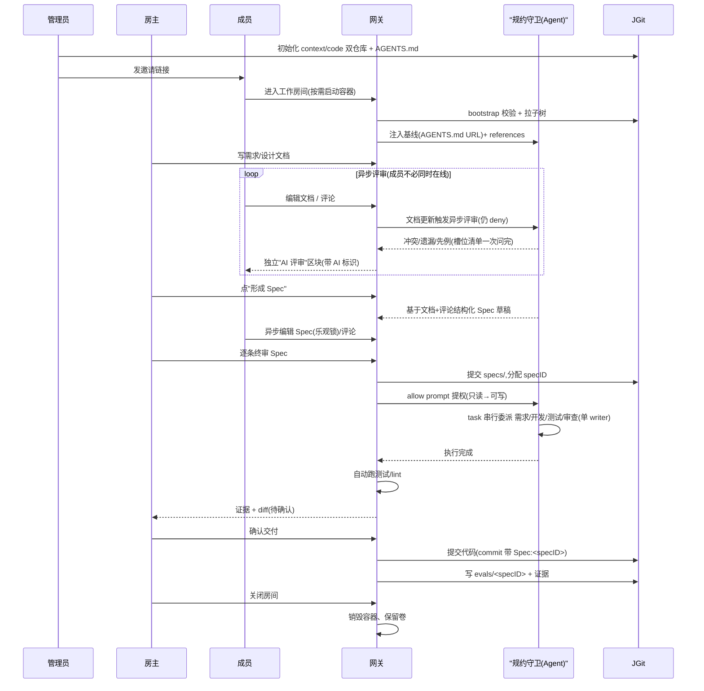
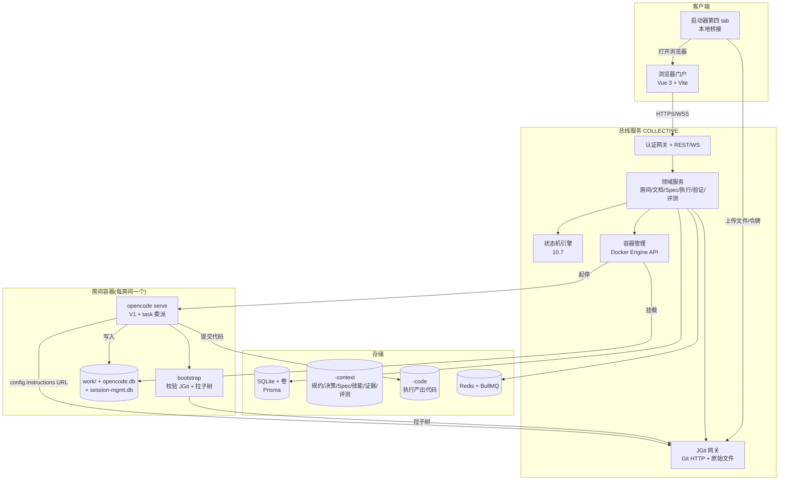
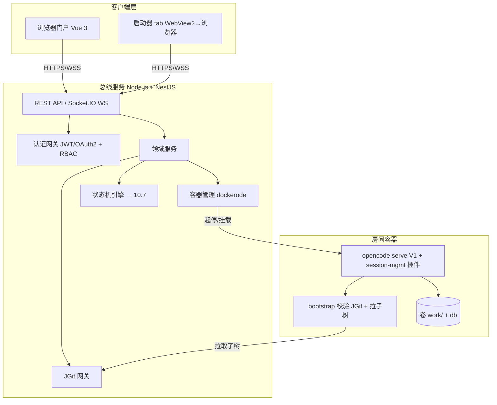
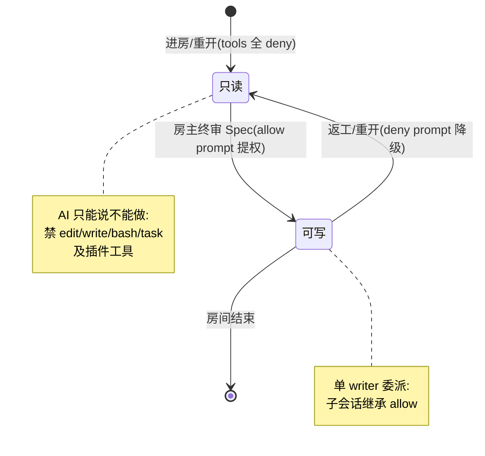
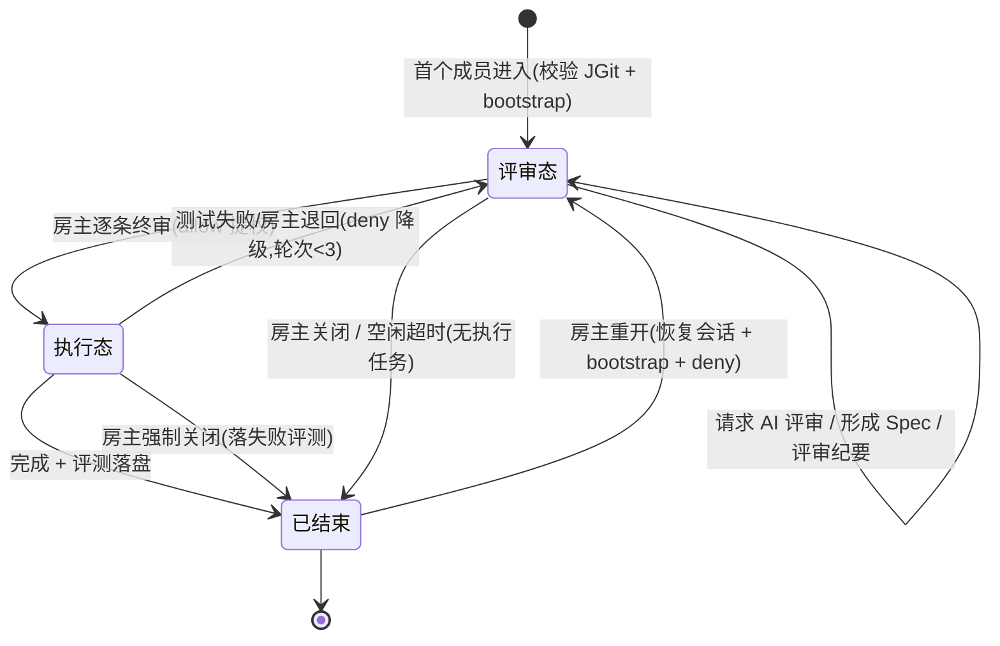

# COLLECTIVE · 人机协作平台方案

> 服务端常驻的团队协作房间:多人开会定细节,AI 以规约守卫在场,共识写成 Spec 后由多角色 Agent 串行执行,全程证据化、可审计。

本文档是**待实施的设计方案**,尚未落地,对齐业界 Agent 团队实践。

**阅读顺序**:第 1 至 4 章为"为什么做"(概述、背景场景、产品定位、两阶段愿景与场景边界);第 5 至 7 章为"体验与设计总览"(用户视角、角色权限、决策总表);第 8 至 9 章为"架构"(总体架构、技术架构);第 10 至 11 章为"机制"(关键机制、补强设计);第 12 章为"业界对齐";第 13 章为"演进接口(扩展点)";第 14 章为"落地"。

---

## 1. 一句话概述

总线服务上按需启动 opencode 工作房间容器(V1 内核);团队规约通过 JGit URL 注入、角色/技能/工作流规约拉取子树;成员以**异步文档 + 评论**协作(符合业界异步优先实践),AI 以**规约守卫**对文档做**异步评审**,评审意见作为**独立"AI 评审"区块**附在文档下(带 AI 标识,与人评论严格区分);评审阶段 Agent **只读**,房主终审 Spec 后**显式提权**进入执行阶段,由**串行单 writer** 的多角色 Agent 按职责分离执行,带**确定性验证门禁**;房主确认后按房间配置提交代码,commit 与证据通过 `specID` 关联;全程记录评测字段;评审结束销毁容器、保留卷,重开恢复会话并重跑 bootstrap。

---

## 2. 背景与场景

### 2.1 要解决的问题

现有协作房间是"本机 Agent + 局域网访客旁观/建议/排队",随主机终端关闭而消失,无团队上下文、无 Spec、无交付闭环。团队需要一个**服务端常驻、跨机器、可沉淀共识、可交付结果**的协作空间。

### 2.2 场景

- 一个团队可开**多个**工作房间,各自独立;房间是一个**持久化工作项空间**,不再是"会议室"。
- 每个房间**可用或不用工作流**;技能**上传经审批后可选启用**。
- **启动即注入**团队已约定的知识、规约、习惯,全员一致。
- 房间**可关闭和重开**,恢复原会话与工作区。
- 成员以**异步文档 + 评论**协作:发起人写需求/设计文档,相关人异步评论、补充;**讨论发生在文档里,不需要同时在线**。
- AI 规约守卫**异步评审文档**:对照团队规约与历史决策,指出冲突、追问遗漏、引用先例,结论作为独立"AI 评审"区块附于文档下;共识形成后由 AI 结构化为 Spec,经房主终审后交给团队 Agent 执行。

---

## 3. 产品定位分析

本产品是**人机协作平台**,本质是四类产品的交叉,而非单一工具。定位决定必须同时满足四类属性各自的基本约束(以下为判断,非实测结论)。

### 3.1 四类属性

| 属性 | 对应形态 | 由属性推出的基本因素 |
|---|---|---|
| 协作软件 | 异步文档空间、角色权限、评论与决策留痕 | 并发一致、通知与降噪、认知负荷、多端视图一致 |
| Agent 编排平台 | 多角色 Agent、任务委派、工作流、工具/技能生态 | 可控性(中断/接管/回滚)、可解释性、失败幂等、最小权限 |
| 工程治理系统 | Spec 驱动、确定性门禁、审批、审计、评测 | 门禁硬约束、责任归属、审计留痕、合规 |
| 知识管理平台 | JGit 版本化的团队上下文(规约/决策/经验) | 单一事实源、版本漂移、不可信输入处理 |

### 3.2 必须考虑的因素

| 类别 | 因素 |
|---|---|
| 行为正确性 | 客户旅程自洽、状态转换与触发点明确、失败语义与幂等 |
| 人机特有 | 人的注意力预算与审批疲劳、可控性(中断/接管/回滚)、安全边界(提示注入/恶意技能/沙箱) |
| 规模化 | 可解释性与决策溯源、成本与资源治理、可观测度量闭环、自治等级演进、多端一致、责任与合规 |

上述因素分别由第 10 章关键机制与第 11 章补强设计覆盖。

---

## 4. 两阶段愿景与场景边界

### 4.1 两阶段愿景与升级空间

方案按**两步走**设计,架构与状态模型从一开始就为第二步留出升级空间:

| 阶段 | 目标 | 决策主体 | 授权模型 |
|---|---|---|---|
| **第一步(本方案落地范围)** | 人在环上定需求:异步文档评审 → Spec 契约化 → 人确认后执行 | 人(房主)拍板 | a. 人工把关:外部事件只通知人,不自动提权 |
| **第二步(演进目标)** | 全自动:有客观信号的环节自动唤回 Agent 继续执行 | 预先授权范围内由系统自动推进 | b. 预授权自动执行:限定事件/范围/门禁下自动提权 |

**升级空间由三处低成本扩展点保证**:可扩充状态 schema(13.1)、终结态集合参数化不变量(13.1)、授权模型可替换字段(13.2)。因此第一步的实现不会成为第二步的障碍——从 a 升级到 b 是配置扩展,不是架构重写。第二步的具体设计(事件唤回、webhook、授权策略)**推迟到第一步落地后**(13.3)。

### 4.2 适用场景边界

- **团队成熟度**:适合已有规约/设计文档习惯的团队;从零开始的团队需先补基础(对应 GitLab 自主等级 L2 以上)。
- **协作形态**:以异步文档 + 评论为主,不依赖同步会议;若团队确需拍板同步环节,可作为房间外的独立活动,不在本方案流程内。
- **决策角色**:适合有明确决策人(房主)的团队;共识型团队需调整终审规则。
- **事件通知范围**:仅覆盖交付后有客观信号的环节(CI/review/deploy),不覆盖需求澄清阶段。

### 4.3 与现有协作房间的边界

| 维度 | 现有协作房间 | 团队房间(本方案) |
|---|---|---|
| 位置 | 本机 TUI 插件,局域网 `ws://` | 服务端 Docker,任意网络 |
| AI 角色 | 被观察的执行者,不介入讨论 | 规约守卫,异步评审文档、不拍板 |
| 上下文 | 无团队基线、无工作流状态 | JGit 注入团队规约/历史决策 |
| 产物 | 对话流,关终端即散 | 版本化 Spec + 决策/证据 + 代码提交 |
| 生命周期 | 随终端消亡 | 可关可重开,恢复会话 |
| 入口 | 启动器第三 tab | 门户 + 启动器第四 tab |

两者并存,不共享实现。轻量临时协作走本地房间,正式交付走团队房间。

---

---

## 5. 用户视角

### 5.1 完整旅程

```
管理员:部署总线/初始化 JGit 双仓库/写 AGENTS.md/发邀请
房主:门户建工作房间(选工作流/提交目标)→ 邀请成员
成员:点链接进房间 → 容器按需启动
发起:负责人写需求/设计文档(可半结构化:背景、目标、材料链接、初步想法)
评审态(Agent 只读,工具全 deny):
  成员异步编辑文档、评论、补充 —— 讨论发生在文档里,不需同时在线
  AI 规约守卫被请求或文档更新时异步评审:对照 AGENTS.md/规约/历史决策
  → 输出冲突/遗漏/先例,作为独立「AI 评审」区块附在文档下(带 AI 标识)
  → 追问用槽位清单一次问完,减少来回
  → 超长文档由 AI 生成评审纪要存 JGit(人看的交接材料)
收尾:房主点「形成 Spec」→ AI 读文档+评论 → 结构化 Spec 草稿
  → Spec 草稿(带 version)→ 成员异步编辑需 expectedVersion(乐观锁)/评论
  → 房主逐条终审 → 提交 JGit,分配 specID
提权:网关发一次 tools=allow 的 prompt → session.permission 切到可写态
执行态:AI 转编排者 → task 串行委派需求/开发/测试/审查(单 writer,继承 allow)
  房主可随时中断 / 接管 / 回滚(11.2)
验证:自动跑测试/lint → 证据回写 evidence/<specID>/
交付:房主看「证据+diff」确认 → 按房间配置提交 commit(带 Spec:<specID>)
评测:记录 spec 一次通过率/验证一次通过率/人工介入率/返工次数到 evals/<specID>
结束:房主关房间 → 销毁容器、保留卷(执行态不会因空闲超时被销毁)
重开:挂载卷恢复会话 → 重新 fetch AGENTS.md → 重跑 bootstrap 拉子树 → 降级权限到只读
```

用户旅程的交互时序:



### 5.2 两种进入方式

```
门户:浏览器打开公司内网门户 → 工作房间列表 → 进入房间
启动器:团队协作 → 团队房间 tab → (令牌已存,选本地文件/会话上传)→ 一键开浏览器进房间
```

注意:启动器 tab 不做本地目录实时挂载(服务端容器无法 `docker -v` 挂载成员本机目录)。代码工作区在服务端 `work/` 卷,来自 JGit。

### 5.3 不变 / 不会发生 / 需配合

**不变**:本地局域网房间照旧;四种工作流规则/门禁/理解确认不变;启动器其他页面不变。

**不会发生**:评审阶段 AI 改代码或跑命令(工具全 deny);成员不能直接改代码(只有提权后被委派的开发 Agent 能改 `work/`);不确认就不执行;基线不在运行中热更新;不自动提交代码;执行中不会因空闲超时被销毁;tab 不做本地目录实时挂载。

**需配合**:部署总线服务与 Docker;初始化 JGit 双仓库;成员申请令牌;容器配模型密钥;团队维护 JGit 中的 AGENTS.md。

---

## 6. 角色与权限

| 角色 | 权限 |
|---|---|
| 房主 | 建/关/重开房间、邀请成员、审批技能、配置提交目标、**请求 AI 评审**、**终审 Spec 并触发提权**、产出确认提交、**中断/接管/回滚(11.2)**、**事件唤醒后决定是否重新执行/提权(13.2)** |
| 成员 | 编辑/评论文档、请求 AI 评审、编辑/评论 Spec 草稿、看 AI 评审区块 |
| 访客 | 只读旁听 |

令牌 = 房主发出的邀请链接,绑定身份。

---

## 7. 已定决策总表

| 项 | 决策 | 依据 |
|---|---|---|
| 运行时 | V1(不用 V2) | V1 现役稳定、零侵入;V2 缺 `task` 委派、插件注入钩子、远程指令 URL |
| 多角色编排 | V1 `task` 真子代理委派,不自建 | `packages/opencode/src/tool/task.ts:81-371` |
| 多角色定位 | 职责分离 + 可审计,**不承诺并行提效** | 业界:代码任务真正可并行的部分少 |
| 基线注入 | 混合:AGENTS.md 走 JGit URL;角色/规约/技能拉子树 | V1 `config.instructions` 原生 fetch URL(`session/instruction.ts:158-168`) |
| 历史决策 | 挂 V1 `references` | `session/system.ts:71-102` |
| 评审规约 | 并入 AGENTS.md,不依赖 conventions 加载器 | conventions 按 type/stage 加载,无工作流房间用不上 |
| AI 评审角色 | 规约守卫,对文档做**异步评审**,不拍板;评审意见作为**独立"AI 评审"区块**附在文档下(带 AI 标识,与人评论严格区分);评审在文档更新或被请求时触发 | V1 `noReply` 与 HTTP 端点透传(`session/prompt.ts:1069`),零侵入内核 |
| **评审阶段权限** | **Agent 只读**:所有评审期 prompt 带 `tools` 全 deny,只能说不能做 | V1 `input.tools` 覆盖并 `setPermission`(`prompt.ts:1060-1067`) |
| **阶段提权** | 房主终审 Spec 后,执行前用一次带 `edit/bash/task=allow` 的 prompt 显式重设权限;确认子会话继承该 allow | V1 `session.permission` 持久、空 tools 不触发重设;子会话继承父 deny(`subagent-permissions.ts:4-27`) |
| Spec 确认 | AI 出草稿 → 成员逐条编辑/评论(**乐观锁**) → 房主逐条终审 → 提交 JGit | 草稿带 version,编辑需带 expectedVersion |
| 技能 | 上传 JGit → 房主审批 → 勾选启用 | skill 含 prompt+脚本,审批是信任边界 |
| 执行写入 | 同一阶段单 writer 串行,角色按阶段排队 | 业界 "one writer per area";V1 `task` 不自动建 worktree |
| 验证门禁 | 执行后自动跑测试/lint,证据回写 JGit;房主看"证据+diff" | 业界:确定性门禁胜过 prompt 约束 |
| 代码交付 | 按房间配置:JGit `code` 仓库或外部 git URL;证据/决策始终回 JGit `context`;**commit message 与证据均以 `specID` 关联** | 跨仓库可审计 |
| 评测 | 每次执行落一条 `evals/<specID>`:spec 一次通过率、验证一次通过率、人工介入率、返工次数;先记录,暂不做飞轮 | — |
| 重开 | 销毁容器、保留 `opencode.db` / `session-mgmt.db` / `work/` 卷;**重跑 bootstrap 重拉子树**(卷不保留 `.opencode/` 子树);AGENTS.md 重开时刷新 | — |
| 热更新 | 仅重开生效,运行中不变 | 匹配 V1 能力,降复杂度 |
| 资源 | 按需启动,评审结束销毁容器;**空闲超时仅在评审态且无执行任务时触发,执行态禁止超时销毁** | 避免执行中途被销毁 |
| 入口 | 内网门户(通用)+ 启动器第四 tab(本地桥接),与本地房间并存 | — |
| 工作流 | 继续留在 V1 插件,不迁移 | — |
| 唤醒授权模型 | **一期 a. 人工把关**:外部事件(review 评论/CI 结果)只注入评审态并通知房主,由房主决定是否重新执行;不自动提权。**二期演进目标 b. 预授权自动执行** | a 保留"人拍板"原则并供 PoC 验证;扩展点见 13.2,第二步细节推迟(13.3) |
| 事件通知与演进设计 | 状态用可扩充 schema 表达;不变量对"终结态集合"参数化;提交后房间转入"等待外部事件"态而非直接结束(Stage 2);授权模型可替换为 b | 两阶段愿景见 4.1;设计见第 13 章;实施见第 14 章 |

---

## 8. 总体架构

```
总线服务(新独立项目 opencode-team-bus,零侵入)
├─ Web 门户:房间列表 / 邀请链接
├─ HTTP/WS 网关:房间生命周期、文档/评审、Spec、执行、验证、评测、权限、
│                 AI 评审触发、状态机(评审态/执行态/已结束)、乐观锁
├─ 内置 JGit 服务(两个仓库)
│   ├─ <team>-context:AGENTS.md / decisions / specs / conventions / agents /
│   │                  skills / summaries / evidence/<specID> / evals/<specID>
│   └─ <team>-code:(仅当房间配置目标为 JGit 时)
└─ 房间容器(按需启动,评审结束销毁)
    ├─ bootstrap:校验 JGit 可达 → 拉 agents/conventions/skills 子树到 .opencode/
    │             (每次重建重跑,卷不保留 .opencode/ 子树)
    ├─ config.instructions → http://总线/git/<team>/AGENTS.md   ← 基线注入
    ├─ references → JGit decisions/                              ← 历史决策引用
    ├─ work/ 卷:单 writer 串行写入(保留)
    └─ 外部卷:opencode.db(会话) + session-mgmt.db(工作流状态)(保留)

启动器第四 tab:令牌代填 + 本地文件/会话上传 JGit + 一键开浏览器
```

组件关系与依赖:



---

## 9. 技术架构设计

COLLECTIVE 是独立项目,独立仓库、独立部署,不依赖本仓库的工具链。技术选型以业界主流、企业级可维护为原则;对 opencode 内核仅通过 HTTP 调用,不改内核。

### 9.1 分层与进程边界

```
┌─ 客户端层 ────────────────────────────────────────────┐
│  浏览器门户(Vue 3 + Vite) │ 启动器第四 tab(WebView2→浏览器) │
└──────────────────────┬────────────────────────────────┘
                       │ HTTPS / WSS
┌──────────────────────▼────────────────────────────────┐
│  总线服务 COLLECTIVE(Node.js + NestJS)                 │
│  ├─ 认证网关:JWT/OAuth2、角色鉴权(RBAC)               │
│  ├─ REST API:房间/Spec/技能/成员/状态机               │
│  ├─ WS 网关(Socket.IO):文档/评论、AI 评审、状态推送    │
│  ├─ 领域服务:房间/文档/Spec/执行编排/验证/评测         │
│  ├─ 容器管理:Docker Engine API(起停、卷、bootstrap)  │
│  ├─ JGit 网关:Git HTTP smart protocol + 原始文件服务   │
│  └─ 状态机引擎:驱动 10.7 的各转换与触发点               │
└──────────────────────┬────────────────────────────────┘
                       │ Docker API / 内部 HTTP
┌──────────────────────▼────────────────────────────────┐
│  房间容器(每房间一个,按需启动)                         │
│  ├─ opencode serve(V1,监听容器端口)                   │
│  │   └─ 插件:session-mgmt(可选工作流)                 │
│  ├─ bootstrap:校验 JGit → 拉子树到 .opencode/         │
│  └─ 卷:work/ + opencode.db + session-mgmt.db          │
└────────────────────────────────────────────────────────┘
```

分层视图:



### 9.2 技术选型与理由

COLLECTIVE 独立部署,选用成熟、社区活跃、企业级广泛采用的栈,便于长期维护与招人:

| 层 | 选型 | 理由 |
|---|---|---|
| 运行时 | Node.js 22 LTS + TypeScript | 业界事实标准,生态最大;TypeScript 类型安全,适合复杂领域模型 |
| 服务端框架 | NestJS(基于 Express/Fastify) | 企业级主流框架,模块化 / DI / 拦截器 / 守卫,契合 RBAC、状态机、领域分层 |
| REST / 实时 | NestJS REST + Socket.IO | REST 做资源 API(文档/评论/Spec),Socket.IO 推送评论更新、AI 评审区块与状态(自带房间/命名空间) |
| 前端门户 | Vue 3 + Vite + TypeScript + Pinia + Tailwind CSS | 主流前端栈;Vue 组合式 API 易维护,Pinia 管状态,Vite 构建快,Tailwind 统一 UI |
| 状态持久化 | SQLite + 卷(Prisma ORM) | 一期轻量、零运维、文件即库,放卷里天然满足"关容器保留、重开恢复";Prisma 屏蔽方言差异,后续可迁移 PostgreSQL / MySQL |
| Git 服务 | JGit(Java,独立进程) | 已定"内置 JGit 服务";提供 smart HTTP,版本化团队上下文 |
| 容器编排 | Docker Engine API(`dockerode`) | 规模可控,按需起停房间容器,不上 K8s |
| 认证 | JWT + OAuth2(Passport.js) | 标准方案;邀请令牌签 JWT,角色声明进 token |
| 任务队列 | BullMQ + Redis | 基于 Redis 的 Node.js 主流任务队列,任务持久化(进程挂了不丢)、失败重试与退避、延迟/定时、优先级与并发控制。用途:**JGit 串行写队列**(多房间并发写同一 `context` 仓库会撞 `index.lock`,必须排队串行提交)、滚动摘要后台生成、评测落盘、房主离线异步通知、WS 多副本广播(Redis pub/sub) |
| 可观测 | OpenTelemetry + Prometheus / Grafana | 业界标准追踪与指标;评测字段也可进metrics |
| 容器内 Agent | `opencode serve` + 原生 HTTP API | `noReply`/`tools` 经 `PromptPayload` 透传(`groups/session.ts:70`、`prompt.ts:1499-1521`),零侵入内核 |

**不选什么**:Bun/Hono/Elysia(绑定本仓库工具链,不便独立);独立 Flask/Django(与 TS 前端割裂);自建 Agent loop(丢掉 V1 的 `task` 委派);K8s(规模不需要);改 opencode 内核(破坏零侵入、升级必冲突)。

### 9.3 核心数据流

**异步文档评审(按需触发)**

```
成员编辑/评论文档 → 网关存文档(不进 Agent 会话)
                  → 网关判定是否触发评审(文档更新 或 成员请求)
评审触发 → 网关组装上下文(文档 + 评论 + 摘要 + references)
          → POST /session/:id/message { text:"评审该文档", tools:{...全 deny} }
          → V1 loop 跑,AI 输出评审意见写入会话
          → 网关读回 → 作为独立"AI 评审"区块附在文档下(带 AI 标识)
注:成员文档编辑不写入 Agent 会话,避免无关讨论占满上下文;评审按需进行。
```

**形成 Spec(触发模型)**

```
房主点"形成 Spec" → 网关组装上下文(文档 + 评论 + 评审纪要)
                  → POST /session/:id/message { text:"按共识起草 Spec", tools:{...全 deny} }
                  → V1 loop 跑,AI 输出 Spec 草稿
                  → 网关读回 → 作为 Spec 草稿(带 version)呈现,供异步编辑/终审
```

**终审提权 + 执行**(与 10.4 一致的两步链路)

```
步骤 1 · 纯提权(不触发模型):
  房主终审 → POST /session/:id/message
            { text:"", noReply:true, tools:{ edit:true, bash:true, task:true, ... } }
          → 只重设 session.permission,不进 loop、不产生工具呼叫
          → 回验 session.permission 确认为 allow
步骤 2 · 下达执行指令(触发模型):
  POST /session/:id/message { text:"按 Spec X 执行" }
        → Orchestrator 用 task 串行委派 → 子会话继承 allow
          → 容器 work/ 被单 writer 修改
```

提权必须先于任何委派完成(10.4),两步不可合并为一条 prompt。

### 9.4 数据模型(逻辑视图)

按 10.7 状态机落库,关键实体:

| 实体 | 存储 | 关键字段 |
|---|---|---|
| Room | SQLite(卷) | id, team, host, state(评审/执行/已结束), containerID, volumeRef, submitTarget |
| Member | SQLite(卷) | roomID, identityHash, role(房主/成员/访客), tokenHash |
| Spec | JGit `specs/` + SQLite 索引 | specID, version, status(草稿/终审/废弃), author |
| Eval | JGit `evals/<specID>` | 四项指标 + 埋点 |
| 操作日志 | JGit(append-only) | 事件、actor、时间、specID |

会话态与工作流态在容器卷的 `opencode.db` / `session-mgmt.db`,不进总线库(避免双写不一致)。

**迁移路径**:一期用 SQLite + 卷,零运维、满足单机恢复;数据访问统一走 Prisma,业务代码不写方言 SQL。后续如需多副本或更大并发,切换 Prisma datasource 到 PostgreSQL / MySQL 并做一次数据迁移即可,不改领域层。

### 9.5 模块划分(总线服务内)

```
src/
├── gateway/      # HTTP API + WS,认证鉴权
├── domain/
│   ├── room/     # 房间生命周期、状态机
│   ├── review/   # 文档评审、AI 评审区块、评审纪要
│   ├── spec/     # Spec 草稿/乐观锁/终审
│   ├── exec/     # 执行编排、验证门禁、评测
│   └── skill/    # 上传、审批、沙箱
├── infra/
│   ├── opencode/ # 封装 opencode serve 的 HTTP 客户端(noReply/tools/提权)
│   ├── docker/   # 容器起停、卷、bootstrap(dockerode)
│   ├── jgit/     # Git 服务 + 原始文件 + hash 校验
│   ├── redis/    # BullMQ 队列 + WS 多副本广播
│   └── bus/      # 状态推送、事件总线
├── store/        # SQLite + 卷 + Prisma(房间/成员/状态/日志;方言可迁移 PG/MySQL)
└── web/          # Vue 3 + Vite 门户源码
```

### 9.6 关键接口(网关 → opencode serve)

复用 V1 原生端点,不新增内核能力:

- `POST /session/:id/message` — 异步评审 / 形成 Spec / 提权;payload 含 `text`、`noReply`(纯提权用)、`tools`(权限覆盖)
- `GET /session/:id/messages` — 读回 AI 回应、组装 Spec 上下文
- 中断(11.2)— **待实施时确认** V1 是否提供会话中断端点;若无,统一用"终止并重建容器(卷保留)"降级,不假设该端点存在

### 9.7 部署与生命周期

- 总线服务常驻(单实例或少量副本),容器按需启动。
- 容器镜像:独立构建,基于官方 opencode 运行时镜像,加入 git、bootstrap 脚本与受限网络配置(11.3);不依赖本仓库的构建产物。
- 卷命名 `room-<id>-work` / `room-<id>-db`,房主关闭房间只停容器不删卷;重开挂载同卷。
- 空闲超时与执行态冻结按 10.6 状态机。

### 9.8 安全与隔离(对应 11.3)

- 容器:只读根文件系统,仅 `work/` 与卷可写;网络白名单(JGit/模型网关);不挂宿主 socket。
- 技能:上传静态扫描 + hash + 受限运行。
- AGENTS.md:拉取校验 hash,校验失败 bootstrap 拒绝启动。
- RBAC:房主/成员/访客权限在网关强制,不依赖 Agent 自觉。

---

## 10. 关键机制

### 10.1 启动 bootstrap

房间服务校验 JGit 可达(不可达则拒绝启动,避免 AI 静默失去基线——V1 fetch 失败返回空字符串),拉取 `agents/`、`conventions/`、`skills/` 到容器 `.opencode/`。

**重开时 bootstrap 必须重跑**:容器重建后重新拉取子树,不要复用卷里可能陈旧的 `.opencode/`;卷只保留 `opencode.db`、`session-mgmt.db` 与 `work/`。这样团队修改角色/技能/规约后,重开房间立即生效。

### 10.2 基线注入

`AGENTS.md`(含团队规约、习惯、评审规约)通过 `config.instructions` 的 URL 每次会话注入;`decisions/` 挂成 V1 `references`,AI 可引用历史决策。

### 10.3 AI 异步文档评审

AI 不再是"会议旁听者",而是**文档评审者**。成员以异步文档 + 评论协作,AI 在**文档更新或被显式请求**时异步评审,不参与实时讨论(异步优先,符合业界实践)。

| 要素 | 设计 |
|---|---|
| 触发 | 文档更新 或 成员点"请 AI 评审";非每条消息触发 |
| Agent 只读 | 评审 prompt 带 `tools` 全 deny,AI 只能输出意见,不能改文档/代码 |
| 追问方式 | 用**槽位清单集中一次问完**(缺口、冲突、待确认项),避免多轮来回 |
| 评审纪要 | 每积累 N 条评论生成人看的评审纪要存 JGit `summaries/`,作阶段交接材料;**不是上下文裁剪手段**(V1 无基线排除机制),超长文档由房主显式开新阶段会话 |

**评审展示**:AI 评审意见作为**独立"AI 评审"区块**附在文档下,带醒目"规约守卫 / AI"标识,**与人的评论严格区分、不混排**。这样"谁拍的板、谁只是提示"一目了然,也延续了"不设侧栏、但在文档内独立分区"的取向。

**成本提示**:评审按需触发而非每条消息,token 成本可控;超长文档靠评审纪要与新阶段会话管理,不承诺自动裁剪上下文。

### 10.4 两阶段权限切换(核心)

评审与执行的权限互斥,必须在同一会话中显式切换。V1 的 `session.permission` 是持久的,空 `tools` 不会触发重设(`prompt.ts:1060-1067`),所以必须用显式的 allow 覆盖。

**阶段一 · 评审态(只读)**

- 所有会进入 `loop()` 的 prompt(异步评审 prompt、形成 Spec 的 prompt)都带 `tools` 覆盖,将 `edit`、`write`、`apply_patch`、`bash`、`task` 等工具全部设为 deny。
- `noReply` 的消息不进 `loop()`(`prompt.ts:1069`),无权限问题。
- 结果:AI 只能"评审"(在独立 AI 评审区块输出冲突、遗漏、先例、Spec 草稿),不能"做"(不能改代码、不能跑命令、不能委派)。

**阶段二 · 执行态(提权)**

- 房主逐条终审 Spec 后,网关发出一次带 `tools: { edit: allow, write: allow, apply_patch: allow, bash: allow, task: allow }` 的 prompt,显式重设 `session.permission`,会话进入可写态。
- **必须确认 `task` 子会话继承的是提权后的 allow**:V1 子会话继承父会话的 deny(`subagent-permissions.ts:4-27`),若在 deny 态创建子会话,开发 Agent 将无法写 `work/`。提权必须在任何委派之前完成。
- 每个 Spec 分配 `specID`(如 `spec-20261119-xxx`),写入 Spec 文件、commit message(`Spec:<specID>`)与证据目录 `evidence/<specID>/`,实现跨仓库关联。

**提权为纯状态操作**:利用 `prompt.ts:1060-1069` 的顺序(先设 `session.permission`,再判断 `noReply` 早退),提权用 `noReply: true` + `tools: allow` 实现——设置权限但不触发模型回覆、不跑 loop、不产生工具呼叫。提权后只读回验 `session.permission`,再开始委派,消除时序竞态。

**Spec 草稿并发编辑**:草稿带 `version`;成员编辑需提交 `expectedVersion`,不匹配则拒绝并提示刷新(乐观锁)。评论不锁定。

**评审期工具 deny 须覆盖插件工具**:除 `edit/write/apply_patch/bash/task` 外,还须 deny 工作流插件注册的全部工具(`workflow_start`、`workflow_advance`、`comprehension_*`、`commit_gate_check`、`task_check` 等),防止 AI 在评审期自行启动/推进工作流。

**门禁单轨**:启用工作流的房间,提交门禁以 V1 sdlc 插件的 `commit_gate_check` 为准;房间的"房主看证据+diff 确认"是其**前置人工关卡**,二者串联,顺序为"房主确认 → 插件门禁 → 提交"。不启用工作流的房间仅走房主确认。

**权限降级触发点**(与提权对称,必须由网关自动执行,不依赖人):

- 返工切回评审态时:网关发一次 tools 全 deny 的 prompt,把会话压回只读态。
- 重开房间进入新评审时:同上,避免上次执行残留的 `allow` 随卷恢复带进新评审(V1 `session.permission` 是持久的)。

权限切换状态图:



### 10.5 验证、交付与评测

- Orchestrator 用 `task` 按阶段串行委派需求/开发/测试/审查(单 writer)。
- 执行完自动跑测试/lint,证据回写 `evidence/<specID>/`;房主看"证据 + diff"确认。
- 按房间配置提交 JGit `code` 仓库或外部 git URL,commit message 带 `Spec:<specID>`。
- 落一条评测记录到 `evals/<specID>`,字段口径:
  - **spec 一次通过率** = 终审一次通过的 Spec 数 / 总 Spec 数。
  - **验证一次通过率** = 测试/lint 一次通过的执行数 / 总执行数。
  - **人工介入率** = 需房主追问/退回/重新确认的执行数 / 总执行数。
  - **返工次数** = 因测试失败或房主退回而重做的轮数。
- 埋点:房主终审动作、测试门禁结果、退回动作由网关记录。

### 10.6 生命周期与状态机

**范围声明**:以下三态是 Stage 0/1 的实现范围。Stage 2 将增加第四态「等待外部事件」(定义见第 13 章),届时本节的状态图以第 13 章为准。

房间有三种状态:**评审态 → 执行态 → 已结束**,并支持 `执行态 → 评审态`(返工)。

- 评审结束(房主显式关闭,或**仅在评审态且无执行任务时**空闲超时)→ 进入已结束态 → 销毁容器,保留卷。
- **执行态禁止空闲超时销毁**:只有房主显式关闭,或执行完成 + 评测落盘后才销毁,避免执行中途中断与 running 工具状态残留。
- **执行态 → 评审态(返工)**:测试/lint 失败或房主退回时,网关自动发 deny prompt 降级权限并切回评审态,由人重新讨论细节;返工轮次上限 3 轮,超限强制结束并落失败评测。
- **空闲超时参数**:默认 N 分钟(建议 30),仅评审态计时,执行态冻结;房主显式操作优先于超时仲裁。
- 重开:挂载卷恢复会话,重新 fetch AGENTS.md,重跑 bootstrap 拉子树(基线刷新),并**显式降级权限到只读态**。

房间生命周期状态图(触发点详见 10.7):



### 10.7 状态转换矩阵与触发点

每个转换都必须有明确的**触发者、触发事件、前置条件、网关动作**。"状态画了但触发点没定"是方案不自洽的主要来源,本节给出完整定义。

**房间生命周期状态机**

| 从 → 到 | 触发者 | 触发事件 | 前置条件 | 网关动作 |
|---|---|---|---|---|
| 未启动 → 评审态 | 网关 | 第一个持有效令牌的成员进入房间 | JGit 可达、bootstrap 成功 | 起容器、注入基线、发 tools 全 deny 的 prompt |
| 评审态 → 评审态 | 成员 | 编辑文档 / 评论 | 评审态 | 文档存 JGit;不写入 Agent 会话(避免无关讨论占上下文) |
| 评审态 → 评审态 | 成员 / 房主 | 请求 AI 评审 | 评审态、文档有更新 | 异步评审 prompt(仍 deny),结论进独立 AI 评审区块 |
| 评审态 → 评审态 | 网关 | 评论数达到 N | 每 N 条(默认 20) | 生成评审纪要存 JGit `summaries/` |
| 评审态 → 执行态 | 网关 | 房主逐条终审完成 | Spec 已提交 JGit | 发 allow prompt 提权、开始委派 |
| 执行态 → 评审态 | 网关 | 测试失败 / 房主退回 | 返工轮次 < 3 | 发 deny prompt 降级权限、切回评审态 |
| 评审态 → 已结束 | 房主 / 网关 | 房主关闭 或 空闲超时 | 无执行任务 | 销毁容器、保留卷 |
| 执行态 → 已结束 | 网关 | 执行完成 + 评测落盘 | 评测记录写入成功 | 销毁容器、保留卷 |
| 执行态 → 已结束 | 房主 | 强制关闭 | — | 终止子会话、落失败评测、销毁容器 |
| 已结束 → 评审态 | 房主 | 重开 | 令牌有效、JGit 可达 | 挂载卷、重跑 bootstrap、发 deny prompt 降级 |

**权限状态机**

| 从 → 到 | 触发者 | 触发事件 | 网关动作 |
|---|---|---|---|
| 只读 → 可写 | 网关 | 房主完成 Spec 逐条终审 | 发一次 `edit/bash/task=allow` 的 prompt 重设权限;确认子会话继承 allow |
| 可写 → 只读 | 网关(自动) | 返工切回评审态 / 重开新评审 | 发 tools 全 deny 的 prompt 重设权限 |

**Spec 状态机**(下表状态均指 Spec 自身阶段,加 `S:` 前缀以区别于房间状态)

| 从 → 到 | 触发者 | 触发事件 | 前置条件 | 网关动作 |
|---|---|---|---|---|
| — → S:草稿 | 房主 | 点"形成 Spec" | 房间评审态、有讨论记录 | 发一次 prompt(仍 deny),AI 读摘要+近期输出草稿 |
| S:草稿 → S:草稿 | 成员 | 编辑 / 评论 | 编辑带 expectedVersion | 乐观锁校验,版本不符则拒绝 |
| S:草稿 → S:废弃 | 房主 | 点"废弃" | 房间评审态 | 标记废弃,不提交 JGit |
| S:草稿 → S:终审 | 房主 | 逐条勾选 | 所有条目已处理 | 分配 specID、存 JGit `specs/` |
| S:终审 → S:草稿 | 房主 | 点"退回" | — | 打回草稿,version+1,返工轮次+1 |
| S:终审 → S:执行 | 网关 | 终审完成事件 | specID 已分配 | 提权 + task 串行委派 |
| S:执行 → S:验证 | 网关 | 所有子会话 idle | 单 writer 完成 | 跑测试/lint |
| S:验证 → S:交付 | 房主 | 点"确认交付" | 测试/lint 通过 | 提交代码,commit message 带 `Spec:<specID>` |
| S:验证 → S:草稿 | 网关 | 测试失败 / 房主退回 | 轮次 < 3 | 降级权限、轮次+1、房间回评审态 |
| S:交付 → S:已归档 | 网关 | 评测落盘成功 | eval 写入成功 | 写 `evals/<specID>`;房间按 10.6 处理 |

**技能状态机**

| 从 → 到 | 触发者 | 触发事件 |
|---|---|---|
| — → 待审批 | 成员 | 上传至 JGit `skills/` |
| 待审批 → 启用 | 房主 | 审批通过 |
| 待审批 → 拒绝 | 房主 | 审批拒绝(保留文件但不启用) |
| 启用 → 停用 | 房主 | 取消勾选 |

**异常触发点**

| 事件 | 触发者 | 网关动作 |
|---|---|---|
| JGit 启动时不可达 | 网关 | 拒绝启动房间,向房主报错 |
| JGit 运行期不可达 | 网关 | 暂停摘要/Spec/证据写入,房间保持评审态并提示;恢复后补写 |
| 提交失败(push 拒绝/网络故障) | 网关 | 保持验证态,保留 diff 与证据,提示房主重试;不自动重试 |

**仲裁原则**:房主显式操作优先于自动超时;所有权限变更由网关执行,不由 AI 或成员直接改;所有写类转换(提权、提交、退回、废弃、降级)留操作日志到 JGit。

**未定义态说明**:上表覆盖 Stage 0/1 的三态。第四态「等待外部事件」及其转换在 Stage 2 启用,定义见第 13 章;在启用前该态不存在,不属本矩阵范围。

## 11. 三项补强设计

本章三项设计均不改 opencode 内核,在总线服务/网关层实现。

### 11.1 人工关卡分级(防止人成瓶颈与审批疲劳)

房主当前需要:建房间、邀请、审批技能、请求 AI 评审、终审 Spec、确认产出、配置提交目标。关卡过多会导致**人变成瓶颈**或**橡皮图章式点击**,反而失去"人在环上"的意义。

**关卡分级**

| 级别 | 关卡 | 规则 |
|---|---|---|
| 必须人看(硬关卡) | Spec 终审、产出确认提交、技能审批 | 必须房主显式操作;AI 与成员都不能代劳 |
| 可自动放行(软关卡) | 评审纪要归档、证据回写、评测落盘、测试/lint 通过的常规记录 | 网关自动执行,结果进评审区/日志供人事后查看 |
| 条件触发 | AI 评审请求、提交目标配置 | 仅房主可改,但不阻塞流程 |

**房主离线降级**

- 进入"待终审"后房主离线:Spec 草稿保持 JGit 中的草稿态,**不提交、不执行**,通过异步通知提醒;房主回来后继续。
- 执行态中房主离线:不自动推进任何不可逆操作(提交代码),任务停在"待确认交付";容器按 10.6 保持(执行态不超时销毁),但为避免资源长期占用,超过配置时长(如 24 小时)转"挂起",保留卷并销毁容器,房主回来后重开继续。
- 硬关卡永不因离线而自动放行。

**审批疲劳对策**

- 终审支持批量勾选无异议项,有异议项才逐条展开。
- AI 提示默认折叠,高风险项(冲突/安全/架构偏离)才主动提醒。
- 每次终审只展示与上次相比的增量改动。

### 11.2 可控性三件套:中断 / 接管 / 回滚

执行态必须让人能随时夺回控制,否则"人在环上"只是旁观。

| 能力 | 触发者 | 机制 |
|---|---|---|
| **中断** | 房主 | 点"中断" → 网关向当前会话发中断信号、停止投递新 prompt、置房间为"已中断"(属执行态子状态);保留 `work/` 与证据。实施时核实 V1 的会话中断 API,若不可用则终止并重建容器(卷保留)实现同等效果 |
| **接管** | 房主 | 点"接管" → 写锁从 Agent 转给房主;Agent 停写,房主在界面/IDE 改 `work/`;改完点"交还",Agent 重读文件后继续(防止用旧上下文覆盖) |
| **回滚** | 房主 | 按 `specID` 回滚:每次执行前对 `work/` 做 git 分支/快照;回滚恢复到该 Spec 执行前的工作区状态;证据与 Spec 不删(审计需要),只标记"已回滚" |

**约束**:三项都只房主可操作;都写操作日志到 JGit;回滚后返工轮次按 10.6 计数,超过 3 轮强制结束并落失败评测。

### 11.3 安全边界:提示注入 / 恶意技能 / 沙箱

三项不可信输入必须按"数据而非指令"处理:

**1. 技能(供应链攻击面)**

- 上传的 skill 含 prompt + 潜在脚本,审批前做静态扫描(网络调用、凭据访问、文件外发、命令行执行)。
- 启用后在**受限环境**运行:无外网(仅白名单 JGit/模型网关)、文件系统仅可见 `work/` 与技能自身目录、不继承宿主凭据。
- 审批通过的 skill 记录 hash,版本变更需重新审批。

**2. AGENTS.md(JGit URL 拉取的不可信输入)**

- 拉取内容做完整性校验(hash/签名),校验失败则 bootstrap 拒绝启动。
- 内容标记为"团队规约数据",与用户消息明确分层;规约中若含指令性文本,不得被当作对本轮对话的直接命令。

**3. 文档与评论(提示注入)**

- 成员的文档内容与评论标记为不可信数据;AI 不得执行其中"忽略规约""直接提交"之类的指令性内容;这类意图只能通过房主的显式操作(终审/确认)生效。

**4. 容器隔离(权限不等于沙箱)**

- 事实:opencode 的 permission 是确认层,不是沙箱;容器内 `bash` 以容器进程权限运行。
- 因此容器需:最小网络白名单、按房间隔离的模型凭据、不挂载宿主 socket、只读根文件系统(仅 `work/` 与卷可写)。
- 提交到外部 git URL 的凭据按房间配置隔离,不共享。

---

## 12. 与业界实践的对齐

| 业界原则 | 本方案 |
|---|---|
| Spec 驱动("show me your SPEC") | Spec 是异步文档评审与执行之间的契约,人确认后执行 |
| 异步优先 | 文档 + 评论协作,不依赖同步会议;AI 按需异步评审、槽位清单集中追问 |
| 人在环上(监控式工程) | 房主终审 Spec、确认产出;AI 不拍板;房主可中断/接管/回滚(11.2) |
| 1 编排者 + 专职 Agent | Orchestrator + 需求/开发/测试/审查,`task` 串行委派 |
| Repo 是单一事实源 | JGit 集中托管规约/角色/技能/决策/证据 |
| 规范即代码 | 团队规约写进 JGit 的 AGENTS.md 随会话注入 |
| 人在不可逆操作上审批 | 提交代码必须房主确认 |
| 确定性门禁 | 执行后自动跑测试/lint,证据化回写 |
| 单 writer | 同阶段只有一个 Agent 写 `work/` |
| 最小权限 | 评审态工具全 deny,终审后显式提权;技能与容器额外隔离(11.3) |
| 可审计 | 多角色定位为职责分离 + 证据留痕,commit 与证据用 specID 关联,不宣称并行 |
| 可度量 | 记录 spec/验证一次通过率、人工介入率、返工次数 |

---

## 13. 演进接口(仅保留扩展点)

按 4.1 的两阶段愿景,第一步落地人在环上的单房间版,第二步演进为全自动。本章**只保留低成本扩展点**,不提前设计第二步细节——后者必须等第一步落地、有了运行数据后再定义,避免基于未验证假设做设计。

### 13.1 状态模型前向兼容(保留)

**状态用可扩充 schema 表达**

状态不 hardcode 为三态,而用统一结构表达,例如 `RoomState = { id, terminal, entryActions, exitActions, allowedTransitions }`。PoC 可只实现三态,但状态表示必须能承载第四态「等待外部事件」——这是模型层的前向相容,而非仅在文档里预留一格。

**不变量对"终结态集合"参数化**

不变量写成 `Spec=终审 ⟹ Room ∈ TERMINAL_OR_PENDING`(集合由配置定义),不列举具体状态。这样启用「等待外部事件」态时不改断言本身,只改配置。

### 13.2 授权模型可替换(保留)

预留 `Room.authModel` 字段(a=人工把关,b=预授权自动执行),第一步固定为 a;第二步切换为 b 是配置扩展,不改架构。

### 13.3 第二步设计推迟(不提前实现)

以下内容**不在本方案范围**,等第一步落地后再设计:

- 无人事件唤回的完整恢复路径(起容器 / 还原 session / 权限决策)
- webhook 接收与事件→状态映射
- b 模型的授权范围、完成判据、解锁条件与试点顺序

**理由**:这些依赖尚未验证的假设(客观完成判据、预授权范围、回滚审计),提前设计会与当前三态机产生冲突(对抗审查已发现此类矛盾)。扩展点(13.1 / 13.2)已保留,届时不需要重写架构。

---

## 14. 实施落地

### 14.1 改动清单

1. 总线服务(独立项目):门户、房间 API、双 JGit 仓库、文档/评论、AI 评审触发、评审纪要、验证门禁、评测、权限、**状态机**、**两阶段权限切换**、**乐观锁**、**人工关卡分级(11.1)**、**中断/接管/回滚(11.2)**、**技能沙箱与不可信输入校验(11.3)**。
2. 房间镜像:独立构建(基于官方 opencode 运行时镜像),加 git + bootstrap 脚本(重开重跑)、受限网络与凭据隔离(11.3),不依赖本仓库构建产物。
3. 启动器第四 tab:`index.html:220-222`、`Program.cs:126-307`、静态断言改 tab 计数、按安装 skill 全量重打包。
4. 技能审批与启用流、技能静态扫描与沙箱(11.3)。
5. 评审规约内容(写进 JGit `AGENTS.md`,非代码)。
6. 演进扩展点(第 13 章):可扩充状态 schema、终结态集合参数化不变量、`Room.authModel` 可替换字段。第二步细节(webhook / 无人唤醒 / b 模型)推迟,不列入本期改动。

**不改 opencode 内核**。两阶段权限切换只依赖 V1 原生能力:评审期 `input.tools` deny(`prompt.ts:1060-1067`)、终审后显式 allow 重设、`noReply` 早退(`prompt.ts:1069`);AI 异步评审为按需触发的普通 prompt,不新增内核能力。

### 14.2 分阶段实施路径(对抗审核修正版)

采用"薄 PoC + 前向兼容 + 增量"三阶段,先验证技术命门,再逐步升级到事件驱动的 Factory。

**Stage 0 — 薄 PoC(验证技术命门)· 2–4 周**

- 范围:建房 → bootstrap 注入 AGENTS.md → 异步文档评审(10.3)→ 形成 Spec → 终审 → noReply allow 提权(10.4 两步链路)→ task 单 writer 委派 → 跑测试 → 证据回写。
- 不做:UI、人工关卡分级、中断/接管/回滚全套、技能沙箱、启动器 tab。
- **验收标准(可证伪)**:
  1. 评审态下所有写/命令/委派/插件工具被拒
  2. 终审后 allow prompt 确实重设权限,且**子会话继承 allow 能写 `work/`**
  3. 返工/重开后 deny 再次生效(权限双向切换可靠)
  4. 会话从卷恢复后状态与基线正确
  5. 状态 schema 可承载第四态「等待外部事件」(仅结构验证,不跑真实唤醒——后者属 Stage 2)
- **边界**:PoC 只验证技术可行性,不验证 UX(文档评审/终审走 API)。

**Stage 1 — 单房间可用版 · 3–4 周**

- 状态机配置化(Markdown,放 JGit,总线与容器双读),采用第 13.1 节的可扩充 schema。
- 不变量按第 13.1 节对终结态集合参数化。
- JGit BullMQ 串行写队列(规避 `index.lock`)。
- 跨存储对账(总线 / 容器卷 / JGit),以总线为主状态。
- 最小硬关卡:Spec 终审、确认提交。
- 宣告 PoC 代码可抛弃,不继承其临时状态处理。

**Stage 2 — 事件通知(第一步范围内)**

- 落地授权模型 a(13.2),不引入自动提权;实现人把关的事件通知,非全自动 Factory。
- 提交后房间转入「等待外部事件」态,由人确认后推进。
- **webhook 接入、无人唤醒恢复路径、b 模型细节不在本阶段设计范围**(13.3),待第一步落地后再定义。

**时间成本(粗估,仅判断)**

| 阶段 | 周期 | 说明 |
|---|---|---|
| Stage 0 薄 PoC | 2–4 周 | 验证技术命门;若提权机制不符预期需改方案,故预留 2–4 周 |
| Stage 1 单房间可用版 | 3–4 周 | — |
| Stage 2 事件通知 | 待评估 | 第一步落地后按真实数据定范围,本方案不提前估 |

本方案**只对第一步(Stage 0–1)给出明确周期,共 5–8 周**。第二步(全自动)的周期与方案在第一步落地后再定——避免基于未验证假设做估算。
### 14.3 约束与铁律

1. 不改 `packages/*` 下任何上游文件,定制全在独立目录。
2. 上游同步只走 `origin`,手工同步 `upstream/dev`,升级后检查 `experimental.chat.system.transform` 签名(见 `opencode-session-mgmt/docs/upstream-sync.md:55-57`)。
3. 缺失能力优先在房间服务外部实现,不 fork 内核。

