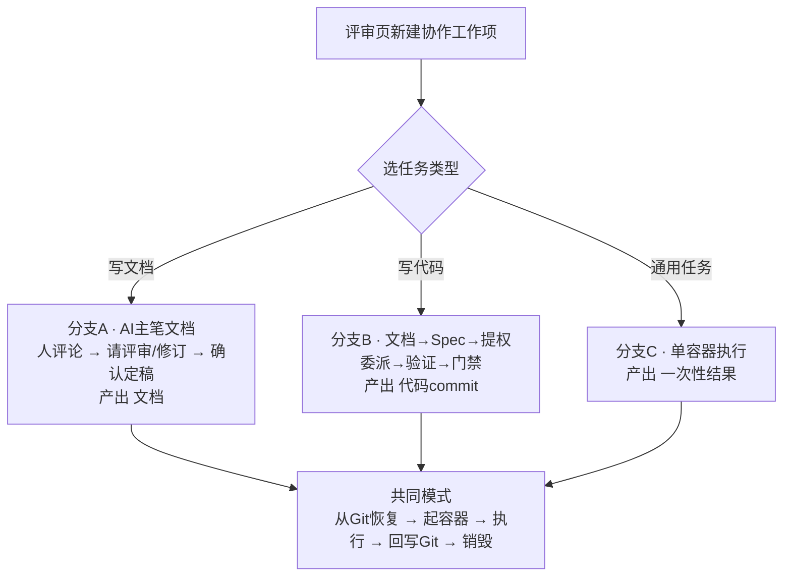
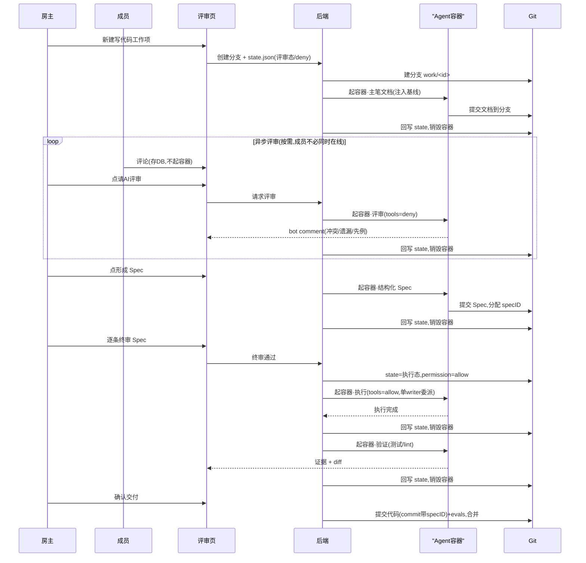
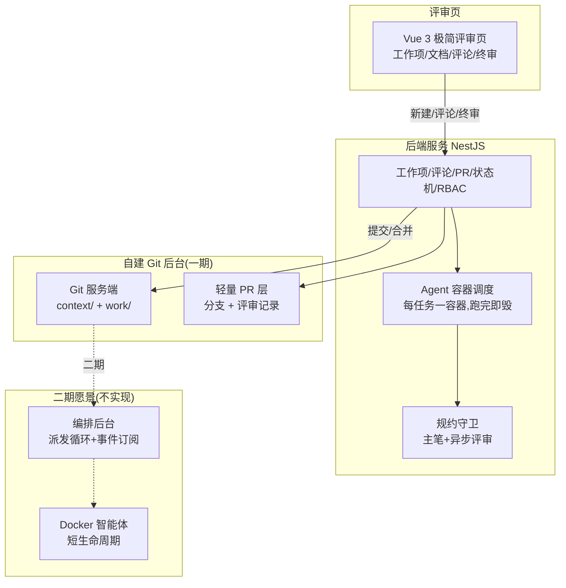
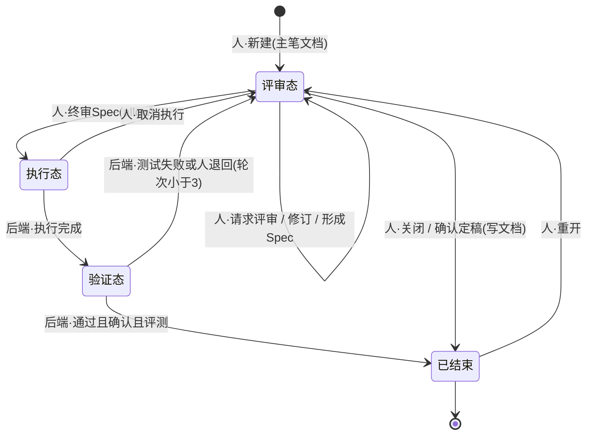
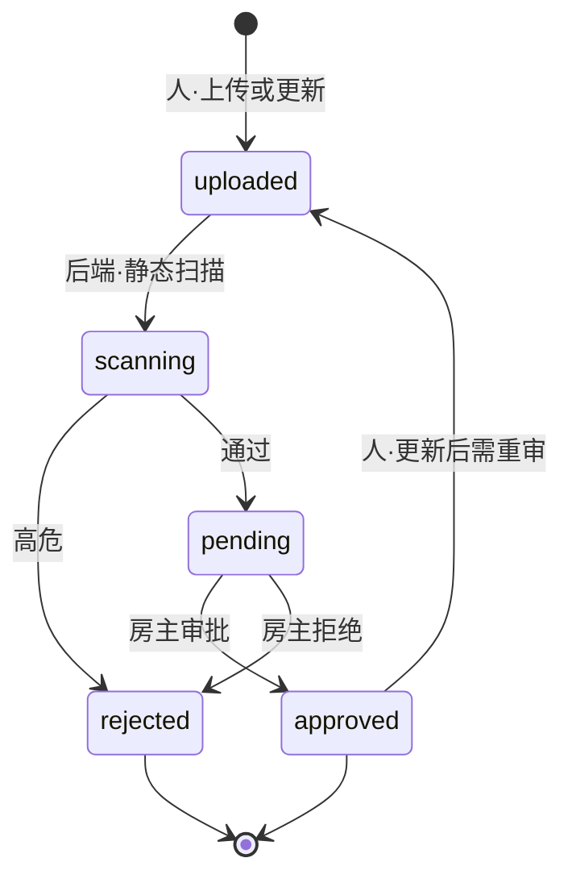

# COLLECTIVE · 人机协作平台方案

> 内部系统里的团队协作服务:评审页是入口,服务端 Docker 容器里的 Agent 执行,自建 Git 仓库是单一事实源。AI 主笔文档/Spec,人在评审页异步评论与终审,共识契约化后由多角色 Agent 串行执行,全程证据化、可审计。二期演进为后台编排 + Docker 化短生命周期智能体的全自动工厂,一期只预留接口。

本文档是完整设计方案,按"为什么做 → 做什么 → 怎么做 → 落地"组织:

| 段落 | 章节 | 内容 |
|---|---|---|
| 为什么做 | 1 概述、2 背景场景、3 产品定位、4 两阶段愿景 | 问题、定位、愿景、边界 |
| 做什么 | 5 用户视角、6 角色权限、7 已定决策总表 | 三类任务旅程、参与者、决策汇总 |
| 怎么做 | 8 总体架构(含 PR 层)、9 技术架构、10 关键机制、11 补强设计 | 形态、技术栈、状态机与容器调度、关卡与可控性 |
| 验证与落地 | 12 业界对齐、13 一期范围与落地 | 对标、要建什么、实施路径、扩展点 |

附录"核心诉求确认清单"是方案的依据,可回头对照。

---

## 1. 一句话概述

一期建一个**轻量协作服务**:评审页(Vue 3)+ 后端服务(NestJS)+ 自建 Git 服务端 + **服务端 Agent 执行器(Docker 容器)**。评审页点按钮新建工作项 → 后端起一个 Agent 容器 → AI 主笔文档/Spec 提交到工作项分支 → 人在评审页异步评论、房主终审 → 写代码任务经显式提权后多角色 Agent 串行执行,带测试门禁与证据留痕。三类任务(写文档/写代码/通用任务)各有独立旅程。二期(愿景)引入后台编排器 + Docker 化短生命周期智能体实现全自动,一期只预留状态模型与授权接口。

---

## 2. 背景与场景

### 2.1 要解决的问题

现有协作房间是"本机 Agent + 局域网访客旁观/建议/排队",随终端关闭而消失,无团队上下文、无 Spec、无交付闭环。团队需要一个**跨机器、可沉淀共识、可交付结果**的协作空间。

关键约束:**内部系统,用不了 GitHub/GitLab**。没有现成 Git Web 界面与 PR 能力可借,Git 服务端、PR 层、评审界面都必须自建。

### 2.2 核心场景

- 团队开**多个工作项**,每个工作项是一个持久化协作空间(不是会议室)。
- 三类任务**旅程分支**:写文档、写代码、通用任务(见第 5 章)。
- **异步优先**:以评审页评论为载体,讨论发生在评论里,不需同时在线。
- **启动即注入**:团队规约、知识、习惯全员一致(AGENTS.md / conventions / skills)。
- **单一事实源**:自建 Git 仓库承载规约、文档、Spec、代码、证据;评审页是它的界面层。

### 2.3 与现有协作房间的边界

| 维度 | 现有协作房间 | 本方案(一期) |
|---|---|---|
| 位置 | 本机 TUI + 局域网 `ws://` | 服务端协作服务 + 评审页 |
| Agent 运行 | 成员本机 | **服务端 Docker 容器**(评审页触发) |
| AI 角色 | 执行者,不介入讨论 | 规约守卫,异步评审、不拍板 |
| 产物 | 对话流,关终端即散 | Git 版本化 Spec + 决策/证据 + 代码 |
| 入口 | 启动器第三 tab | 评审页「新建协作工作项」按钮 |

---

## 3. 产品定位分析

本产品是**人机协作平台**,四类属性交叉。属性决定"必须考虑的领域设计",后者映射到本文档的具体章节:

| 属性 | 形态 | 必须考虑的领域设计(括号内为落点章节) | 覆盖章节 |
|---|---|---|---|
| 协作软件 | 异步评审空间、角色权限、评论留痕 | 并发一致(10.5 乐观锁、11.2 单 writer)、通知降噪(10.2)、认知负荷(10.2)、决策留痕(Git,第 8 章)、**协作闭环边界**(8.1) | 第 8、8.1、10.2、10.5、11.2 节 |
| Agent 编排平台 | 多角色 Agent、任务委派、工作流、技能 | 可控性(11.2、10.7 回滚)、可解释性(10.4 证据/diff)、最小权限(10.3、11.3)、**技能治理**(10.8)、**容器任务调度与幂等**(10.5、10.6) | 第 10.3–10.8、11.2、11.3 节 |
| 工程治理系统 | Spec 驱动、确定性门禁、审计、评测 | 门禁硬约束(10.4)、责任归属(10.4 specID 追溯、11.1 人拍板)、审计留痕(第 8 章 Git、10.4 证据)、可度量(10.4 评测) | 第 8、10.4、11.1 节 |
| 知识管理平台 | Git 版本化团队上下文 | 单一事实源(4.1、第 8 章)、版本漂移(10.1)、不可信输入(11.3)、**状态外置与恢复**(4.1、10.5、10.6) | 第 4.1、8、10.1、10.5、10.6、11.3 节 |

**无状态短生命周期容器架构的必考虑因素**:

| 因素 | 为什么必需 | 落实 |
|---|---|---|
| **状态外置与恢复** | 容器跑完即毁,无任何进程记得工作项进度 | 状态存 Git `state.json`,起容器前读、任务后写;失败补偿见 reconciler(10.5、10.6) |
| **容器任务调度与幂等** | 每动作=起一个容器,重复触发会重复提交 | 幂等键 `(workItemID, state版本, task类型)` + Git ref CAS 乐观锁(10.5、10.6) |
| **触发点明确** | 容器不自我推进,必须定义谁触发下一步 | 只有人动作与后端两类触发者(10.5) |
| **自建 Git / PR 层** | 内部系统无 GitHub,裸 Git 无 PR | 轻量 PR 层(分支+评论+diff+合并)(8.1) |

**延续的通用因素**:客户旅程自洽、失败幂等、人的注意力预算与审批疲劳、安全边界(提示注入)、成本治理、度量闭环、自治等级演进(二期)。

---

## 4. 两阶段愿景与场景边界

### 4.1 两阶段愿景

| 阶段 | 目标 | Agent 形态 | 后台 | 决策主体 |
|---|---|---|---|---|
| **一期(本方案范围)** | 人在环上处理三类任务 | **Docker 短生命周期智能体**(每任务一容器、跑完即毁,评审页触发) | 协作服务:评审页 + 后端 + Git 服务 | 人拍板 |
| **二期(愿景,不实现)** | 全自动:事件驱动唤回 Agent | Docker 短生命周期智能体(同形态,由编排器自动触发) | 编排后台(派发循环 + 任务服务 + 事件订阅) | 预授权范围自动推进 |

**统一的容器形态**:一期与二期都用**无状态、短生命周期**容器——每任务拉起、跑完即毁,**状态全部外置到 Git**(会话历史、工作流阶段、Spec、权限、证据)。差别只在触发者:一期由**评审页的人动作**触发(新建/评论/终审/确认),二期由**编排器的事件**触发。因此一期容器与二期容器复用同一镜像,二期不需要改造容器形态,只需加编排器。

**状态外置到 Git 的关键含义**:
- 容器不持有会话:每次任务由后端从 Git 恢复上下文(AGENTS.md、Spec、评论、会话历史)到容器,执行完把结果写回 Git,随即销毁。
- 权限不是会话内状态:工作流阶段与权限级别(评审只读 / 执行可写)存 Git,后端据此决定新容器 prompt 的 `tools` 覆盖——不再有"同一会话提权",而是"新容器按 Git 里的阶段决定权限"。
- 取消/重开成本低:容器本就是一次性的,取消即终止;重开只是从 Git 重建上下文。

**为什么 Agent 放服务端并用 Docker**:入口、评论、评审结果、确认信号都发生在评审页/后端;Agent 无状态短生命周期化后,后端按 Git 状态起容器、注入上下文、收结果,无需维护长驻会话。Docker 隔离执行环境(依赖/权限/网络/凭据),镜像二期复用。代价是一期需自建轻量协作服务与容器调度,以及 Git 状态外置机制。

**升级空间**:靠三处低成本扩展点保证——可扩充状态 schema、不变量对终结态集合参数化、`authModel` 可替换字段(见第 10、13 章)。二期具体设计(编排器、Docker 智能体、事件订阅、授权策略)推迟到一期落地后。

### 4.2 适用场景边界

- **团队成熟度**:适合已有规约/设计文档习惯的团队(GitLab 自主等级 L2 以上)。
- **协作形态**:异步文档 + 评论为主;同步拍板活动在方案流程之外。
- **决策角色**:适合有明确决策人(房主)的团队;共识型团队需调整终审规则。
- **内部系统**:无 GitHub 可用,Git 服务、PR 层、评审页自建;接受自建运维成本。

---

## 5. 用户视角

三类任务共享:评审页入口、启动注入、Git 同步、角色权限。差异在**是否经 AI 主笔与异步评审、是否形成 Spec、是否提权执行代码、是否门禁**(通用任务为单容器直跑,不经主笔/评审)。

### 5.1 入口与三类分支总览

**入口**:评审页点「新建协作工作项」→ 选任务类型(写文档/写代码/通用)→ 填任务描述 → 后端创建工作项分支与 Git 状态 → 起一个 Agent 容器(从 Git 恢复上下文)执行首个任务 → 回写 Git → 容器销毁。其中写文档/写代码先由 AI 主笔文档提交到分支、成员再异步评论;通用任务则直接执行返回结果、无文档环节。每次动作都是「从 Git 恢复 → 起容器 → 执行 → 回写 Git → 销毁」。

| 任务类型 | 对应工作流 | 产出 | 形成 Spec | 提权写代码 | 验证门禁 |
|---|---|---|---|---|---|
| 写文档 | `task` / `reqdoc` | 文档本身(PRD/分析/材料) | 否(文档即共识) | 否 | 否 |
| 写代码 | `sdlc` | 代码 commit | 是 | 是 | 是 |
| 通用任务 | `task` 单阶段 | 一次性结果 | 否 | 否 | 否 |

三类任务的分支结构:



### 5.2 分支 A · 写文档(`task`/`reqdoc`)——文档即交付物

```
评审页点「新建协作」→ 选写文档 → 填任务描述
→ 后端起容器(从 Git 恢复上下文)→ AI 主笔文档提交分支 → 回写 Git → 销毁容器
→ 成员在评审页评论(异步,只存 DB 不起容器)
→ 人点「请 AI 评审」→ 起容器异步评审(bot comment,槽位清单一次问完)→ 销毁
→ 房主点「依评论修订」→ 起容器依评论修订文档(乐观锁)→ 回写、销毁
→ 房主确认定稿 → 合并到主分支,即产出
无 Spec、无提权写代码、无测试门禁
```

### 5.3 分支 B · 写代码(`sdlc`)——文档是 Spec 前置,代码是产出

```
评审页新建协作 → 选写代码 → 填需求描述
→ 起容器主笔需求文档(分支)→ 回写 Git、销毁 → 成员评论 → 人点「请 AI 评审」→ 起容器异步评审、销毁
→ 房主点「形成 Spec」→ AI 据评审页讨论结构化 Spec 草稿(分支)
→ 成员评论 → 房主逐条终审 → 提交 Spec,分配 specID
→ 后端从 Git 读权限状态,起新容器带 tools=allow → 多角色 task 串行委派(单 writer)→ 回写 Git、销毁
→ 后端起「验证」容器跑测试/lint → 证据回写、销毁 → 房主看证据+diff 确认 → 提交代码(commit 带 Spec:<specID>)
→ 评测落 evals/<specID> → 合并分支
```

写代码分支的完整时序(展示人、评审页、后端、容器、Git 的交互与容器的一次性特征):



### 5.4 分支 C · 通用任务(`task` 单阶段)——轻量直接执行

```
评审页新建协作 → 选通用任务 → 填任务描述 → 起容器执行 → 结果回写 Git → 销毁容器 → 合并分支
无 Spec、无提权、无门禁、无多角色委派
```

### 5.5 结束 / 重开

- 结束有两条路径:**自然完成**(写文档=确认定稿、写代码=验证通过并确认交付、通用任务=结果回写即结束)与**手工关闭**(房主随时可显式关工作项)。两者都写 `state=已结束`;无容器可销毁(每次任务已自行销毁),Git 保留全部状态与历史;一期无空闲超时自动结束。
- 重开:已结束的工作项由房主在评审页重新打开 → 后端从 Git 读回状态 → 后续起容器时按 Git 权限(评审态=只读)注入 tools=deny。

---

## 6. 角色与权限

| 角色 | 权限 |
|---|---|
| 房主 | 建/关/重开工作项、邀请成员、审批技能、**请求 AI 评审**、**发起修订(依评论)**、**终审 Spec 并触发提权**、确认产出提交、**取消执行任务 / 人工修订分支 / 回滚** |
| 成员 | 在评审页评论、请求 AI 评审、看 AI 评审 bot comment |
| 访客 | 只读旁听 |

身份由自建评审页账号绑定;Git 仓库权限与之一致(房主读写/成员读写评论/访客只读)。

---

## 7. 已定决策总表

本章汇总前面各章确认的设计决策,作为进入架构与机制章(第 8–11 章)前的索引;具体展开见对应章节。

| 项 | 决策 | 依据 |
|---|---|---|
| 运行时 | opencode V1,零侵入 | opencode V1 现役稳定;V2 缺 task 委派等 |
| 多角色编排 | V1 `task` 真子代理串行,单 writer | `task.ts:81-371`;不承诺并行 |
| 形态(一期) | 协作服务:评审页 + 后端 + Git 服务 + **无状态短生命周期 Agent 容器(每任务一容器)** | 内部系统无 GitHub;状态外置 Git,二期复用同形态 |
| 入口 | 评审页「新建协作工作项」按钮 | 用户确认 |
| 协作载体 | 自建轻量 PR:工作项分支 + 评审页评论;AI 主笔文档/Spec(提交到分支) | 单 writer 统一;异步优先 |
| 基线注入 | AGENTS.md/conventions/skills 从 Git 注入,V1 原生发现 | `config.instructions` + 本地 AGENTS.md |
| 历史决策 | 挂 V1 `references` | `session/system.ts:71-102` |
| AI 角色 | 规约守卫(主笔/异步评审/结构化 Spec/委派四类动作),评审意见为 bot comment(独立、带标识) | 不拍板 |
| 两阶段权限 | 评审态只读(tools=deny);写代码任务终审后**新容器按 Git 阶段带 `tools=allow`**执行(无同一会话提权) | 状态外置 Git,容器无状态 |
| 门禁 | 仅写代码分支:测试/lint + 证据回写 + specID 关联 | 确定性门禁 |
| 任务分支 | 写文档/写代码/通用三类,差异在 Spec/提权/门禁 | 差异由现有工作流形态(task/reqdoc/sdlc)承载 |
| 二期愿景 | 后台编排 + Docker 智能体(同一容器形态);只留扩展点,不实现 | 一期容器形态已为二期就绪 |
| 技术栈 | 一期:NestJS + Vue 3 + SQLite/Prisma(索引)+ Git 服务(状态源)+ Docker Agent(短生命周期);编排器属二期 | 形态收敛 |

---

## 8. 总体架构

```
评审页(Vue 3,极简:工作项/文档/评论/终审)
    │ 新建协作、评论、终审
后端服务(NestJS)
    ├─ 工作项/评论/PR/终审/状态机
    ├─ Agent 容器调度(每任务起一个无状态 Docker 容器,跑完即毁)
    └─ 权限校验(RBAC)
自建 Git 服务端(一期后台)
    ├─ 团队仓库:context/(规约/文档/Spec/证据) + work/(代码)
    └─ 轻量 PR 层:工作项分支 + 评审记录(后端 DB)+ 合并
二期愿景(不实现):编排后台 + Docker 化短生命周期智能体
```

组件关系:



### 8.1 关键设计:PR 层在自建 Git 上的实现

自建 Git 服务端没有 GitHub 式 PR。一期用**轻量 PR 层**实现,并**明确划界**以防范围膨胀。

**一期最小支持范围**:
- 分支:每个工作项一个 `work/<id>`;执行 run 分支(10.7)不暴露为 PR。
- diff:相对主分支的**只读** unified diff(文件列表 + 逐文件增删改行),不做行内建议应用。
- 评论:纯文本,绑定 `branch + commit + file + line`,支持「已解决/未解决」标记;不写回 Git。
- 合并:房主确认后 **squash merge** 到主分支,保持线性历史;合并前校验验证证据存在、commit 带 specID(写代码分支)。
- 审阅:房主**单点终审**(硬关卡),不做多人多级 approve 投票。

**明确不支持(一期)及回退**:

| 不支持 | 一期回退 |
|---|---|
| 行内 suggestion 一键应用 | 评论写文本建议;由房主/成员在「人工修订分支」(11.2)改后重提 |
| 在线冲突解决编辑器 | 检测到冲突即中止合并,提示退回人工修订分支或重新发起任务 |
| 多文件批量行级评论/批量应用 | 仅逐条文本评论 |
| 评论线程/嵌套/reaction/富文本 | 纯文本 + 已解决标记 |
| CODEOWNERS / 多级审批 / 强制 review 规则 | 房主单点终审(硬关卡) |
| 分支保护 / CI 状态回填 | 后端门禁结果直接写 `evidence/`,不做 CI 集成 |
| 跨仓库 / 多批次 PR | 单仓库、单工作项、单分支 |

**评论锚点失效处理**:评论绑定提交 SHA 并留存原始行快照;分支前进后若锚定行已变,标 `outdated`(不删除、不自动迁移),人可手动重新锚定或保留为历史。

这样在不依赖 GitHub 的前提下,提供"分支 + 只读 diff + 文本评论 + 单点合并"的最小协作闭环,边界清晰、可控工期。

---

## 9. 技术架构(一期最小栈)

### 9.1 技术选型

| 层 | 选型 | 理由 |
|---|---|---|
| 评审页 | Vue 3 + Vite + TypeScript | 轻量、主流,只做极简界面 |
| 后端 | NestJS + TypeScript | 企业级、模块化;承载工作项/评论/状态机/Agent 调度 |
| 索引与协作数据 | SQLite + Prisma | 评论/评审记录/任务执行记录/评测索引;**权威工作项状态在 Git**(见 10.6);轻量零运维 |
| Git 后台 | 自建 Git 服务端 + 轻量 PR 层 | 内部系统无 GitHub;单一事实源 |
| Agent 容器 | 每任务一个无状态 Docker 容器,内含 V1 `opencode serve`,跑完即毁 | 执行环境隔离,状态全在 Git;容器无状态便于二期编排复用 |
| 容器管理 | Docker Engine API(`dockerode`) | 后端按需起停容器;无卷、无长驻会话,规模可控 |
| 技能管理 | Git `context/skills/` + 后端静态扫描 | 技能可审计、授权后才注入;详见 10.8 |
| 二期(愿景) | 编排器 + BullMQ/Redis + webhook(由编排器按事件拉起同类容器) | 不实现;一期容器形态与镜像已就绪 |

**不选什么**:不建完整平台门户、不建编排器(二期);不自建 Agent loop;不改内核。

### 9.2 关键接口(后端 → 服务端 opencode)

- `POST /session/:id/message` — 主笔 / 评审 / 修订 / 形成 Spec / 提权(含 `text`、`noReply`、`tools`)
- `GET /session/:id/messages` — 读回 AI 输出
- 取消执行任务:后端终止运行中的容器(一期不支持"中断长驻会话"——容器短生命周期,取消即终止容器、丢弃未完成输出,状态回评审态)

（安全边界统一在第 11.3 节描述。）

---

## 10. 关键机制

### 10.1 工作项启动与上下文注入

评审页新建工作项 → 后端建分支、起 Agent 容器(内有 V1 opencode 会话)→ 从 Git 拉取 AGENTS.md/conventions/skills 注入会话,技能只注入已审批且 hash 匹配者(见 10.8)。容器重建时重新拉取,不复用陈旧副本(收敛**版本漂移**:每次任务都基于 Git 最新规约,基线不会陈旧)。

### 10.2 AI 主笔与异步评审

- AI 的角色是**规约守卫**(顶层立场:守住团队规约、不拍板),在工作项流程中具体承担**主笔起草、异步评审、结构化 Spec、执行委派**四类动作。文档/Spec 由 AI 起草,提交到工作项分支;人只在评审页评论。
- 评审由人点「请 AI 评审」按需触发,非每条评论、也非每次分支更新自动触发;人评论本身只存后端 DB、不起容器(**通知降噪**:不打扰、不刷屏)。
- 追问用槽位清单集中一次问完(**降低认知负荷**:一次问清、不分多轮打断)。
- 评审意见作为 bot comment 存后端 DB,带 AI 标识,与人评论严格区分、不混排。
- 长文档生成评审纪要点 Git(人看的交接材料);不是上下文裁剪手段,超长由人开新工作项。

### 10.3 两阶段权限切换(仅写代码分支)

- 评审态:所有进 `loop()` 的 prompt 带 tools 全 deny;AI 只输出文本(后端提交到分支),不改文件/跑命令/委派。
- 提权:房主终审 Spec 后,后端把「允许执行」阶段写入 Git;执行任务起新容器时,按 Git 阶段给 prompt 带 `tools=allow`,委派开发 Agent。没有长驻会话,权限状态在 Git、由新容器继承。
- 子会话继承提权后的 allow;提权必须先于任何委派。
- 写文档/通用任务不提权。

### 10.4 执行、门禁与评测(仅写代码分支)

- `task` 按阶段串行委派需求/开发/测试/审查,单 writer。
- 自动跑测试/lint,证据回写 `evidence/<specID>/`。
- 房主看证据+diff 确认(**可解释性**:证据与 diff 说明"改了什么、为何这样改")→ 提交代码到分支,commit 带 `Spec:<specID>`(**责任归属**:可追溯 Spec 与终审人)→ 合并主分支。

**评测口径与埋点**(每 spec 落 `evals/<specID>.json`,随 Git 版本化):

| 指标 | 计算口径 | 埋点来源 |
|---|---|---|
| spec 一次通过率 | 首次「形成 Spec」草稿即被终审接受(期间无驳回/无重做)的 spec 数 ÷ 进入终审的 spec 总数 | DB `spec_review`(形成 Spec 任务、驳回、终审事件) |
| 验证一次通过率 | 首轮执行后验证即通过(`retryCount=0`)的 spec 数 ÷ 进入验证态的 spec 总数 | `state.json` 的 `retryCount` 与验证态转换事件 |
| 人工介入率 | 发生**非必经**人工动作(验证失败退回 / 取消执行 / 回滚 / 人工修订)的 spec 数 ÷ spec 总数 | `state.json` 事件(退回、取消、`lastRollback`、人工修订标记) |
| 平均返工次数 | Σ(每 spec 的 验证失败退回 + 取消执行 + 回滚 次数) ÷ spec 总数 | `state.json`(`retryCount` 增量、`rollbackCount`、取消计数) |

- **必经硬关卡不计入人工介入**:Spec 终审、产出确认提交、技能审批是流程必经,不算"补救";只统计非预期的人工返工动作。
- **不新增独立埋点**:所有指标由 10.5/10.6/10.7 的既有状态转换事件推导,与状态机保持单一口径,避免"日志口径"与"状态口径"两套数。
- **可重建**:原始事件在 Git/DB,`evals/<specID>.json` 为派生快照;全局聚合由 DB 查询生成,可重建。

### 10.5 生命周期与状态机(Git 状态 + 容器任务调度)

**状态外置到 Git**:容器无状态、跑完即毁,唯一的真相是 Git 里的工作项状态文件(如 `context/work/<id>/state.json`),记录 `state`、`phase`、`permission`、`retryCount`、`specID`。后端每次**起容器前读状态、任务完成后写回**;容器自己不持有也不推进状态。并发控制、幂等与失败补偿见 10.6。

**两类触发者(容器不自我推进)**:
1. **人动作**(评审页):新建、请求评审、终审、确认、关闭/重开。
2. **后端**:读 Git 状态 + 容器完成事件,决定下一任务;容器跑完即毁,不会自己触发下一步。

**状态 → 容器任务映射表**(每转换=起一个带明确任务的容器):

| 从 → 到 | 触发者 | 事件 | 前置 | 后端动作(写 Git + 起容器任务) |
|---|---|---|---|---|
| 未启动 → 评审态 | 人(评审页) | 新建工作项 | Git 可达 | 写 `state=评审态,permission=deny`;起容器任务「主笔文档」,注入基线 |
| 评审态 → 评审态 | 人(评审页) | **点「请 AI 评审」(按需,非每条评论)** | Spec 未终审 | 起容器任务「异步评审」(tools=deny),结论写 bot comment;人评论本身只存后端 DB、不起容器 |
| 评审态 → 评审态 | 人(评审页) | 点「依评论修订」(写文档分支) | 存在待处理评论/评审意见 | 起容器任务「修订文档」(tools=deny),修订稿提交分支(乐观锁);不自动触发 |
| 评审态 → 评审态 | 人(评审页) | 点「形成 Spec」 | 讨论记录完整 | 起容器任务「结构化 Spec」,草稿提交分支 |
| 评审态 → 执行态 | 人(评审页) | 房主逐条终审 | Spec 已提交、specID 已分配 | 写 `state=执行态,permission=allow`;起容器任务「执行」(tools=allow,单 writer) |
| 执行态 → 验证态 | 后端 | 执行任务完成(干净退出) | 代码已提交分支 | 写 `state=验证态`;起容器任务「验证」(只读 headCommit,跑测试/lint,tools 只读+命令),证据回写(见 10.7) |
| 验证态 → 已结束 | 后端 | 验证通过 + 房主确认 + 评测落盘 | eval 写入成功 | 写 `state=已结束`;提交代码 commit 带 specID、合并 |
| 验证态 → 评审态 | 后端 | 测试失败 / 人退回 | retryCount < 3 | `reset` 到 runBase(见 10.7);写 `state=评审态,permission=deny,retryCount+1`;回评审(不自动起执行容器) |
| 执行态 → 评审态 | 人(评审页) | 房主点「取消执行」 | 容器运行中 | 终止容器、reset 到 runBase(见 10.7)、丢弃未完成输出、写 `state=评审态,permission=deny` |
| 评审态 → 已结束 | 人(评审页) | 房主关闭 | 无执行任务 | 写 `state=已结束`;合并/归档;无容器需停 |
| 已结束 → 评审态 | 人(评审页) | 重开 | Git 可达 | 写 `state=评审态,permission=deny`;后续起容器注入 deny |

状态转换图(触发者标注为"人"或"后端",容器不自我推进;此图为写文档/写代码分支,通用任务走简化路径见下文):



**空闲超时 removed**:无状态架构下无长驻进程计时,一期**不设空闲超时自动结束**;工作项由人显式关闭。二期编排器可引入定时器。

**写文档分支的定稿状态**:`评审态 → 已结束`(触发:房主点「确认定稿」;动作:合并文档分支到主分支、写 `state=已结束`)。无执行态、无 allow 提权、无门禁。

**通用任务简化状态**:`新建 → 执行态 → 已结束`(单容器执行、结果回写即结束),无评审态、无 Spec、无门禁。状态同样存 Git、容器同样短生命周期。

### 10.6 状态权威源、并发与失败补偿

**权威源划分(消除 Git / DB 双写歧义)**:

| 数据 | 权威源 | 说明 |
|---|---|---|
| 工作项状态 `state/phase/permission/retryCount/specID` | **Git** `context/work/<id>/state.json` | 唯一事实源;后端只经它推进状态 |
| 文档 / Spec / 代码 / 证据 / 评测 | **Git** 分支与目录 | 与状态同库,合并即定稿 |
| 评论、评审记录 | **后端 DB**(唯一来源,需备份) | 不写回 Git;绑定 `branch+file+line+commit` 锚点 |
| 任务执行记录、评测索引 | 后端 DB(派生,**可重建**) | 可由 `state.json` + 幂等键重建 |
| 分支最新提交 | Git ref | ref 更新是原子操作,用作并发控制点 |

关键判定:**`state.json` 是权威快照,不是分布式写锁**。并发由三点共同保证——①同一 `workItemID` 的后端操作串行化;②写状态走 Git ref 的原子 compare-and-swap;③单 writer(任一时刻只有一方写分支)。

**原子状态更新(乐观并发)**:
1. 读 `state.json` 得 `version`。
2. 计算 `nextState`,拒绝非法转换。
3. 以 `expected=version` 提交并 push;Git ref 更新即 CAS——版本不符则 push 被拒。
4. push 被拒 → 重新读取,**不覆盖**他人写入;并发人工动作以先到者为准,后到者提示"状态已变化,请刷新"。

**幂等(容器任务)**:
- 任务键 `idemKey = hash(workItemID, stateVersion, taskType)`,一个 key 只对应一次容器执行。
- 后端在 DB 记 `task(idemKey, status=pending|running|done|failed)`,**起容器前先写 `pending`**。
- 容器完成回调携带 `idemKey` + 结果 commit;该 key 已 `done` 则丢弃重复回调。
- 容器任务本身幂等:同一 `stateVersion` 输入的重复执行不改变最终状态。

**写序(Git 权威、DB 派生)**:先推 Git 状态/产物 → 写 `task=pending` → 起容器 → 完成后回写产物与下一状态 → 最后更新 DB 索引。

**失败补偿矩阵**:

| 失败点 | 现象 | 补偿 |
|---|---|---|
| Git push 状态失败 | 状态未变 | 中止该动作、丢弃内存结果、提示重试;不写 DB |
| 起容器失败 | Git 已是"待执行"、DB 有 pending | reconciler 按 idemKey 重试起容器(有上限);超限标「人工介入」 |
| 容器中途崩溃 | 无结果回写,状态仍 pending | 不自动推进;reconciler 按 idemKey 重起或标人工;丢弃未提交的半截产物 |
| 结果回写 push 失败 | 容器已产出但状态未更新 | 用 idemKey 幂等重放回写;不重复起容器 |
| DB 写/索引失败 | DB 落后于 Git | 以 Git 准重建该工作项索引;不影响状态推进 |

**恢复(reconciler)**:后端启动/定时扫描非终结态工作项,比对 `state.json` 与 DB `task` 记录。仅当"Git 状态为某态 + DB 存在 pending 且无 running 容器"时按 idemKey 安全重试;无法判定(如执行中途崩溃且已有部分提交)时**不自动续跑**,置「待人工确认」,由房主决定重跑或回滚(半截修改清理与回滚见 10.7)。

**评论的例外**:评论/评审记录只存 DB、不写回 Git,故 DB 必须定期备份;其余派生索引均可由 Git 重建。

### 10.7 执行/验证容器的运行边界与回滚

**分支与快照模型**:
- `work/<id>`:工作项活动分支(单 writer)。
- 每轮执行前,后端把当前 HEAD 记为 `runBase`(写入 state.json:`runID`、`runBase`),并打快照 tag `spec/<specID>/run-<n>/base`。
- 执行容器只在 `work/<id>` 上提交,提交边界=本轮 run。
- 容器被判定失败/超时/取消时,后端 `reset --hard runBase`,并把被丢弃的 HEAD 存到 `attempt/<runID>/aborted`(留证,不影响活动分支)。

**执行容器"干净退出"判定**(进入验证态的前提):退出码为 0、至少产生一个提交、结果清单(`runID`/`commit`/`changedPaths`)成功回写 Git;任一不满足即视为失败,按 10.6 补偿,不进入验证态。

**任务级超时(非空闲超时)**:每个执行/验证容器设**单次任务最长时限**,超时即终止容器、按失败处理。这与"一期不设空闲超时自动结束工作项"不冲突:前者约束单次任务,后者约束工作项闲置,闲置仍只由房主关闭。

**执行 → 验证衔接**:执行完成写 `state=验证态`,记录 `headCommit`;验证容器**只读** `headCommit`,跑测试/lint,证据写 `evidence/<specID>/run-<n>/`,不改代码、不再提交。通过后等房主确认再合并;失败则 `reset --hard runBase`(失败代码不入活动分支,存 aborted 取证)→ `state=评审态,permission=deny,retryCount+1`。

**按 specID 回滚**:Spec 终审提交时打基线 tag `spec/<specID>`(契约快照)。回滚 = 把 `work/<id>` 恢复到该快照、证据 `evidence/<specID>/` 保留并标 `rolled-back`、被回滚提交留 aborted/reflog 供审计。回滚后的状态联动:

| 回滚时机 | 回滚动作 | 回滚后 state | retryCount |
|---|---|---|---|
| 执行态(未出结果) | 先终止容器,再 reset 到 `spec/<specID>` | 评审态 / deny | 归 0 |
| 验证态 | reset 到 `spec/<specID>` | 评审态 / deny | 归 0 |
| 已结束(已合并交付) | **不 force-reset 共享主分支**,在 main 上生成 `revert` 提交(引用 specID),并重开工作项 | 评审态 / deny | 归 0 |

显式回滚一律 `retryCount` 归 0(作废本轮、重新决策);它与**普通验证失败**(10.5 的 `验证态 → 评审态`:reset 到 runBase、`retryCount+1`)是两种不同动作,不可混淆。

- "回滚并重跑"(可选):房主直接重跑同一 Spec → `state=执行态`,起新执行容器(`run-<n+1>`,`runBase`=回滚点),`rollbackCount+1`,retryCount 保留。
- 已交付分支只做 revert、不做 force-reset,避免改写共享主分支历史。

**与 10.6 的分工**:10.6 保证状态可靠推进与失败补偿;本节保证代码在分支上的隔离、丢弃与回滚,两者共同确保容器失败不污染活动分支、不产生不可解释的半成品。

### 10.8 技能管理(存放 / 审批 / 注入 / 隔离)

**存放**:技能放 Git `context/skills/<name>/`(`SKILL.md` + 资源),与文档/Spec 同库、可审计、可回滚。

**审批状态机**(状态存 Git):

| 状态 | 触发者 | 动作 |
|---|---|---|
| uploaded | 人(上传/更新) | 写入技能目录,记录提交人 |
| scanning | 后端 | 静态扫描(可疑命令/外链/写系统路径/读凭据),产出 `scanReport`;高危直接 rejected |
| pending | 后端 | 扫描通过,待房主审 |
| approved | 房主 | 硬关卡审批通过,记录批准 hash |
| rejected | 房主/后端 | 拒绝,附原因,不可注入 |



**hash 校验**:批准时记录目录 hash;注入前校验与批准值一致,不一致(批准后被改)拒绝注入并要求重新审批——防"批后偷改"。

**注入(与基线同路径)**:每次起容器从 Git 拉基线时,只把 `approved` 且 hash 匹配、且在当前工作项白名单内的技能复制进容器技能目录,交由 V1 原生发现;未审批/不匹配的不注入(不改内核)。

**受限运行**:技能在容器内受限执行——工具白名单、网络受限、除工作分支外只读、无宿主凭据;由 Docker 运行时(无特权、cap-drop、网络策略)+ opencode 工具策略双层约束。

**权限**:成员可上传、不可自批;房主审批(第 6 章、11.1 硬关卡)。

**一期范围**:存放 + 上传 + 静态扫描 + hash + 房主审批 + 按白名单注入 + 容器受限运行为一期最小实现;技能市场/评分/依赖解析属二期扩展点(13.3)。

---

## 11. 补强设计

### 11.1 人工关卡分级

- 硬关卡(必须人):Spec 终审、产出确认提交、技能审批。
- 软关卡(自动):评审纪要归档、证据回写、评测落盘、测试通过记录。
- 房主离线:工作项停留在当前态(如验证态待确认)、异步通知;不自动放行硬关卡。

### 11.2 可控性(无状态架构下的形态)

无长驻 Agent,因此**不做"中断长驻会话 / 接管写锁"**;一期提供三项更简单的控制:

| 能力 | 机制 | 说明 |
|---|---|---|
| **取消执行任务** | 房主点取消 → 后端终止运行中的容器 → reset 到 runBase → Git 状态回评审态、丢弃未完成输出 | 容器短生命周期,取消即终止;不保留半成品(详见 10.7) |
| **人工修订分支** | 房主直接在评审页/本地改 `work/` 分支 → 标记"人工修订" → 后续容器基于修订后的分支继续 | 无需写锁交接:人不与 Agent 并发写,而是 Agent 任务结束后人再改 |
| **回滚** | 按 `spec/<specID>` 快照恢复;已交付则在 main 生成 revert(不 force-reset);证据标 `rolled-back` | 状态与 retryCount 联动见 10.7 |

**并发原则**:任一时刻只有一方写分支(Agent 容器 或 房主),不并行——这与"单 writer"一致,无需写锁交接。

### 11.3 安全边界

统一收敛于此(技术章不再重复):

- **技能**:上传静态扫描 + 批准 hash 校验 + 受限运行(完整流程见 10.8)。
- **AGENTS.md**:从 Git 拉取校验 hash,失败拒绝加载;作为规约数据与用户消息分层。
- **评论**:评审页评论标记不可信数据,防提示注入(不得执行"忽略规约/直接提交")。
- **权限**:评审页账号 + Git 仓库权限一致;RBAC 在后端强制,不可逆操作(合并/提交)经人确认。

---

## 12. 与业界实践的对齐

| 业界原则 | 本方案 |
|---|---|
| 异步优先(GitLab) | 评审页评论,不需同时在线 |
| Spec 驱动 | 写代码任务 Spec 契约化,人终审后执行 |
| 人在环上 | 终审/确认硬关卡,可取消任务/人工修订/回滚 |
| 单 writer + 确定性门禁 | AI 单主笔 + 代码单 writer + 测试门禁 |
| 上下文工程 | AGENTS.md/conventions/skills 注入 + references |
| 单一事实源 | Git 仓库承载全部产物 |
| 渐进自治 | 一期人在环上,二期编排全自动,扩展点预留 |

---

## 13. 一期范围与落地

### 13.1 本期要建

1. **自建 Git 服务端** + 团队仓库初始化(context/ + work/)。
2. **轻量 PR 层**:工作项分支 + 只读 unified diff + 文本评论(已解决标记)+ 房主单点 squash 合并;不支持行级建议/在线冲突解决/多级审批(边界见 8.1)。
3. **极简 Vue 评审页**:新建工作项(选任务类型)、分支 diff、评论、终审。
4. **NestJS 后端**:工作项/评论/状态机/RBAC/Agent 容器调度(Docker API 起停)/**失败补偿 reconciler**(幂等重试、恢复非终结态)/**分支快照与回滚**(runBase、按 specID revert)/**评测落盘**(`evals/<specID>.json`,口径见 10.4)。
5. **Agent 容器镜像**:基于官方 opencode 运行时镜像,加 git;每任务起一个无状态容器,从 Git 恢复上下文后做主笔/评审/委派/门禁,结果回写 Git 后销毁。
6. **技能管理(最小)**:Git `context/skills/` 存放 + 上传 + 静态扫描 + hash + 房主审批 + 按白名单注入 + 容器受限运行(见 10.8)。

**不改 opencode 内核**;二期编排器/Docker 智能体不建,只留扩展点。

### 13.2 实施路径

| 阶段 | 范围 | 周期(粗估) |
|---|---|---|
| PoC | 评审页新建 → 起 Agent 容器 → 主笔 PR → 评论 →(写代码)终审把 allow 写入 Git → 新起执行容器注入 allow → task 串行委派(子会话继承 allow)→ 验证 → 门禁 → 提交/合并;**验证 state.json CAS、幂等键去重、失败补偿,以及中断丢弃与按 specID 回滚** | 4–6 周 |
| 一期可用 | 三类任务旅程、轻量 PR、状态机、补强设计、权限 | 5–7 周 |
| 二期 | 编排后台 + Docker 智能体;落地后再定 | 待评估 |

### 13.3 扩展点(为二期预留,不实现)

- 可扩充状态 schema(承载第四态「等待外部事件」)
- 不变量对终结态集合参数化
- `authModel` 可替换字段(a 人工把关 → b 预授权自动执行)
- PR 层增强:行内 suggestion 应用、在线冲突解决、CODEOWNERS/多级审批、CI 状态回填(一期明确不做,见 8.1)

---

## 附:核心诉求确认清单(本方案据此重写)

1. 人机协作平台,业务+开发共用;两步走,二期只留接口。
2. 内部系统无 GitHub,Git 服务、PR 层、评审页自建。
3. 入口 = 评审页「新建协作工作项」按钮。
4. Agent 放服务端,评审页直接触发(解决"评审页 ↔ 本地 Agent"连接缺口)。
5. 三类任务旅程分支;AI 主笔 + PR 评审对写文档/写代码都适用。
6. 一期 = 极简评审页 + 后端 + Git 服务 + **无状态短生命周期 Docker Agent 容器(状态全在 Git)**,不建编排器;容器形态已为二期就绪。
7. 单 writer 统一:AI 主笔文档、代码单 writer;人不与 Agent 并发写,需人工调整时走人工修订分支(11.2)。
8. 写代码分支:评审只读 → 终审把 allow 写入 Git → 新起执行容器注入 allow → task 串行委派(子会话继承 allow)→ 验证 → 门禁 → 提交/合并。
9. V1 零侵入,不 fork 内核;技术栈最小。
10. 文档要求:逻辑顺序、无历史、旅程自洽、触发点明确。
