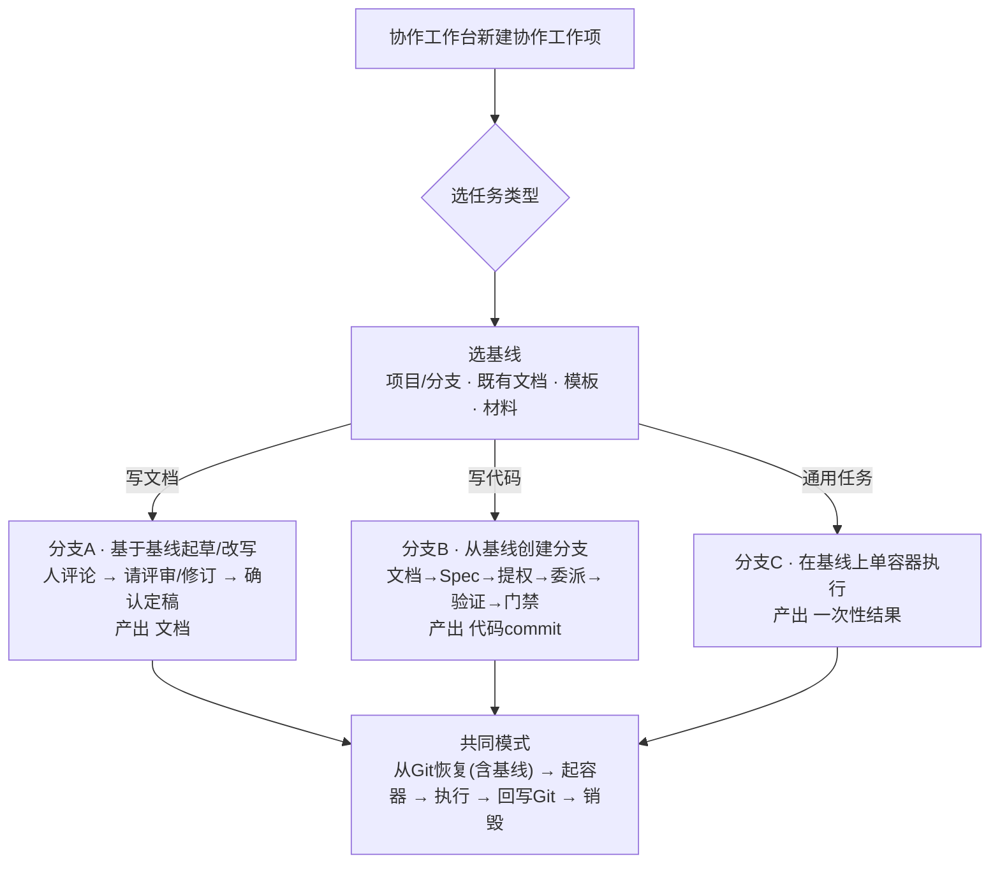
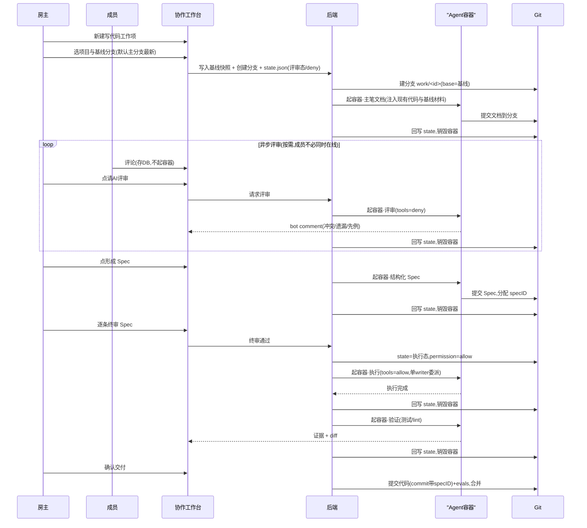
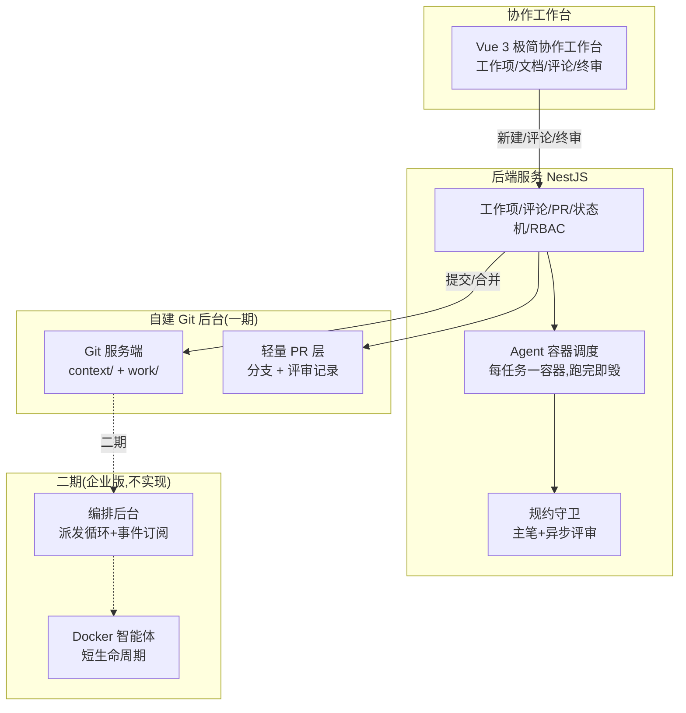
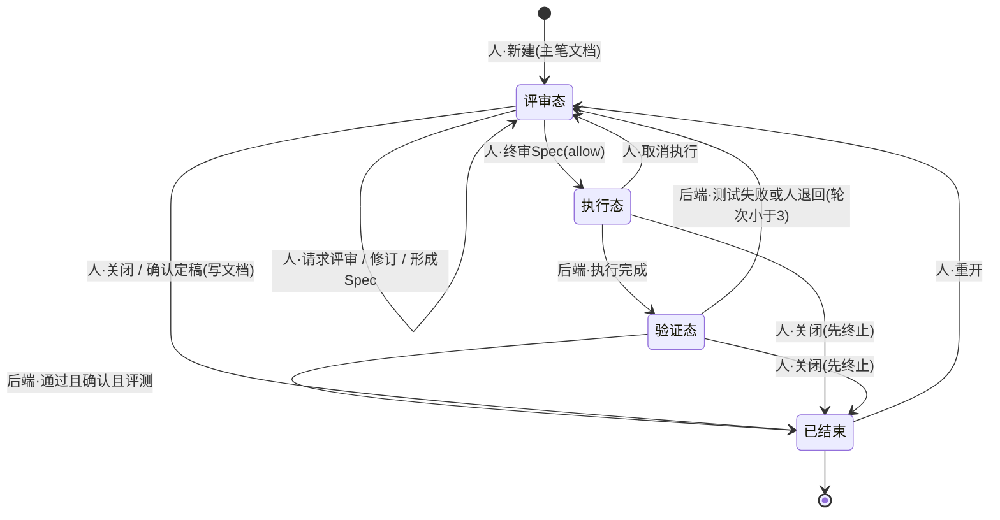
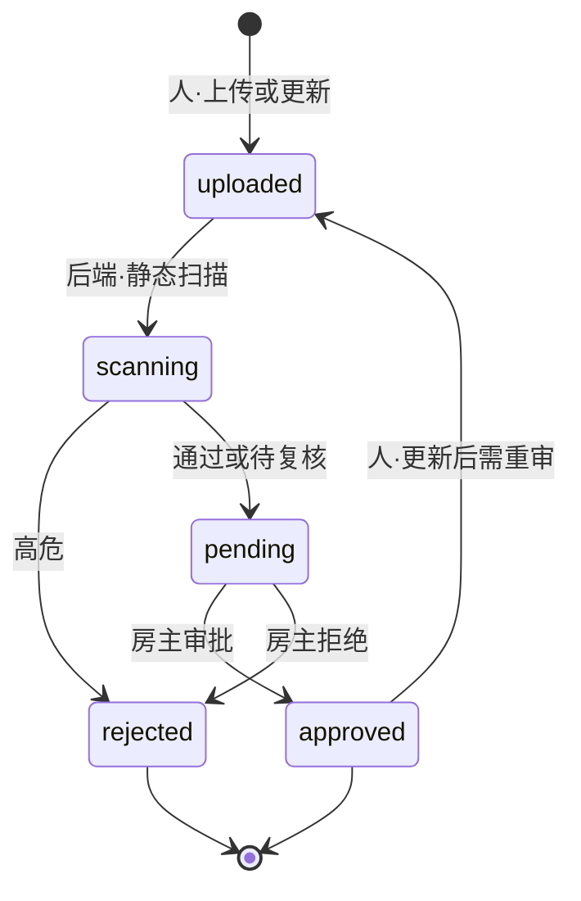
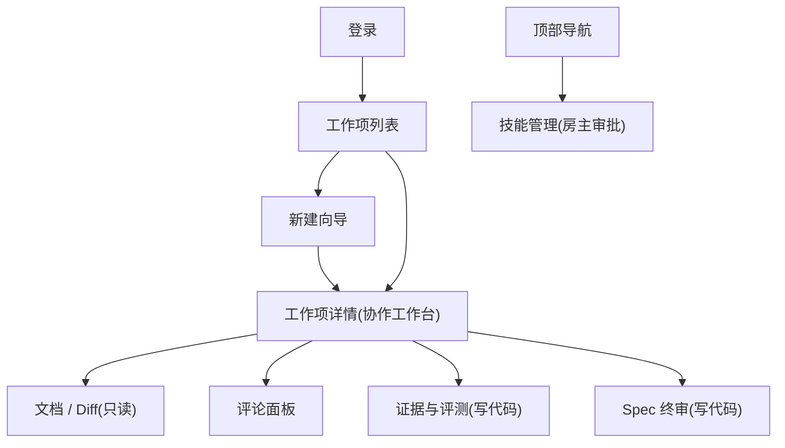

# COLLECTIVE · 团队版智能体平台方案

> 内部系统里的团队协作服务:协作工作台是入口,服务端 Docker 容器里的 Agent 执行,自建 Git 仓库是单一事实源。AI 主笔文档/Spec,人在协作工作台异步评论与终审,共识契约化后由多角色 Agent 串行执行,全程证据化、可审计。二期演进为后台编排 + Docker 化短生命周期智能体的全自动工厂,一期只预留接口。

本文档是完整设计方案,按"为什么做 → 做什么 → 怎么做 → 落地"组织:

| 段落 | 章节 | 内容 |
|---|---|---|
| 为什么做 | 1 概述、2 背景场景、3 产品定位、4 两阶段(团队版/企业版) | 问题、定位、阶段、边界 |
| 做什么 | 5 用户视角、6 角色权限、7 已定决策总表 | 三类任务旅程、参与者、决策汇总 |
| 怎么做 | 8 总体架构(含 PR 层)、9 技术架构、10 关键机制、11 补强设计 | 形态、技术栈、状态机与容器调度、关卡与可控性 |
| 验证与落地 | 12 业界对齐、13 一期范围与落地 | 对标、要建什么、实施路径、扩展点 |
| 集成规格 | 14 opencode serve 调用与权限注入 | 容器启动、会话/权限注入、基线/结构化输出、preflight |
| 界面设计 | 15 协作工作台(UI)设计(含强制 UI 规范) | 页面、状态×角色操作矩阵、令牌/外壳/组件/帮助、交互边界、结果取回与导出 |
| 附录 | A 需求与验收、B 架构决策(ADR)、C 追溯矩阵、D 成功指标与非目标、E 风险假设、F 术语表、G 威胁建模与签署 | 可验收、可复盘、可追溯、可控风险 |

附录提供可验收与可追溯的依据：附录 A 需求与验收标准、附录 B 架构决策记录(ADR)、附录 C 追溯矩阵。

---

## 1. 一句话概述

一期建一个**轻量协作服务**:协作工作台(Vue 3)+ 后端服务(NestJS)+ 自建 Git 服务端 + **服务端 Agent 执行器(Docker 容器)**。协作工作台点按钮新建工作项 → 后端起一个 Agent 容器 → AI 主笔文档/Spec 提交到工作项分支 → 人在协作工作台异步评论、房主终审 → 写代码任务经显式提权后多角色 Agent 串行执行,带测试门禁与证据留痕。三类任务(写文档/写代码/通用任务)各有独立旅程。二期(企业版)引入后台编排器 + Docker 化短生命周期智能体实现全自动,一期只预留状态模型与授权接口。

---

## 2. 背景与场景

### 2.1 要解决的问题

现有协作房间是"本机 Agent + 局域网访客旁观/建议/排队",随终端关闭而消失,无团队上下文、无 Spec、无交付闭环。团队需要一个**跨机器、可沉淀共识、可交付结果**的协作空间。

关键约束:**内部系统,用不了 GitHub/GitLab**。没有现成 Git Web 界面与 PR 能力可借,Git 服务端、PR 层、评审界面都必须自建。

### 2.2 核心场景

- 团队开**多个工作项**,每个工作项是一个持久化协作空间(不是会议室)。
- 三类任务**旅程分支**:写文档、写代码、通用任务(见第 5 章)。
- **异步优先**:以协作工作台评论为载体,讨论发生在评论里,不需同时在线。
- **启动即注入**:团队规约、知识、习惯全员一致(AGENTS.md / conventions / skills)。
- **单一事实源**:自建 Git 仓库承载规约、文档、Spec、代码、证据;协作工作台是它的界面层。

### 2.3 与现有协作房间的边界

| 维度 | 现有协作房间 | 本方案(一期) |
|---|---|---|
| 位置 | 本机 TUI + 局域网 `ws://` | 服务端协作服务 + 协作工作台 |
| Agent 运行 | 成员本机 | **服务端 Docker 容器**(协作工作台触发) |
| AI 角色 | 执行者,不介入讨论 | 规约守卫,异步评审、不拍板 |
| 产物 | 对话流,关终端即散 | Git 版本化 Spec + 决策/证据 + 代码 |
| 入口 | 现有协作房间入口 | 协作工作台「新建协作工作项」按钮 |

---

## 3. 产品定位分析

本产品是**团队版智能体平台**,四类属性交叉。属性决定"必须考虑的领域设计",后者映射到本文档的具体章节:

| 属性 | 形态 | 必须考虑的领域设计(括号内为落点章节) | 覆盖章节 |
|---|---|---|---|
| 协作软件 | 异步评审空间、角色权限、评论留痕 | 并发一致(10.6 乐观锁、11.2 单 writer)、通知降噪(10.2)、认知负荷(10.2)、决策留痕(Git,第 8 章)、**协作闭环边界**(8.1) | 第 8、8.1、10.2、10.5、11.2 节 |
| Agent 编排平台 | 多角色 Agent、任务委派、工作流、技能 | 可控性(11.2、10.7 回滚)、可解释性(10.4 证据/diff)、最小权限(10.3、11.3)、**技能治理**(10.8)、**容器任务调度与幂等**(10.5、10.6) | 第 10.3–10.8、11.2、11.3 节 |
| 工程治理系统 | Spec 驱动、确定性门禁、审计、评测 | 门禁硬约束(10.4)、责任归属(10.4 specID 追溯、11.1 人拍板)、审计留痕(第 8 章 Git、10.4 证据)、可度量(10.4 评测) | 第 8、10.4、11.1 节 |
| 知识管理平台 | Git 版本化团队上下文 | 单一事实源(4.1、第 8 章)、版本漂移(10.1)、不可信输入(11.3)、**状态外置与恢复**(4.1、10.5、10.6) | 第 4.1、8、10.1、10.5、10.6、11.3 节 |

**无状态短生命周期容器架构的必考虑因素**:

| 因素 | 为什么必需 | 落实 |
|---|---|---|
| **状态外置与恢复** | 容器跑完即毁,无任何进程记得工作项进度 | 状态存 Git `state.json`,起容器前读、任务后写;失败补偿见 reconciler(10.5、10.6) |
| **容器任务调度与幂等** | 每动作=起一个容器,重复触发会重复提交 | 幂等键 `(workItemID, state版本, task类型)` + Git ref CAS 乐观锁(10.5、10.6) |
| **触发点明确** | 容器不自我推进,必须定义谁触发下一步 | 只有人动作与后端两类触发者(10.5) |
| **自建 Git / PR 层** | 内部系统无 GitHub,裸 Git 无 PR | 轻量 PR 层(分支+评论+diff+合并)(8.1) |

**延续的通用因素**:客户旅程自洽、失败幂等、人的注意力预算与审批疲劳、安全边界(提示注入)、成本治理、度量闭环、自治等级演进(二期)。

---

## 4. 两阶段(团队版 / 企业版)与场景边界

### 4.1 两阶段:团队版(一期)与企业版(二期)

| 阶段 | 目标 | Agent 形态 | 后台 | 决策主体 |
|---|---|---|---|---|
| **一期(团队版,本方案范围)** | 人在环上处理三类任务 | **Docker 短生命周期智能体**(每任务一容器、跑完即毁,协作工作台触发) | 协作服务:协作工作台 + 后端 + Git 服务 | 人拍板 |
| **二期(企业版,不实现)** | 全自动:事件驱动唤回 Agent | Docker 短生命周期智能体(同形态,由编排器自动触发) | 编排后台(派发循环 + 任务服务 + 事件订阅) | 预授权范围自动推进 |

命名对应:**一期 = 团队版**(本方案范围,人拍板);**二期 = 企业版**(不实现,预授权自动推进)。

**统一的容器形态**:一期与二期都用**无状态、短生命周期**容器——每任务拉起、跑完即毁,**状态全部外置到 Git**(会话历史、工作流阶段、Spec、权限、证据)。差别只在触发者:一期由**协作工作台的人动作**触发(新建/评论/终审/确认),二期由**编排器的事件**触发。因此一期容器与二期容器复用同一镜像,二期不需要改造容器形态,只需加编排器。

**状态外置到 Git 的关键含义**:
- 容器不持有会话:每次任务由后端从 Git 恢复上下文(AGENTS.md、Spec、评论、会话历史)到容器,执行完把结果写回 Git,随即销毁。
- 权限不是会话内状态:工作流阶段与权限级别(评审只读 / 执行可写)存 Git,后端据此决定新容器 prompt 的 `tools` 覆盖——不再有"同一会话提权",而是"新容器按 Git 里的阶段决定权限"。
- 取消/重开成本低:容器本就是一次性的,取消即终止;重开只是从 Git 重建上下文。

**为什么 Agent 放服务端并用 Docker**:入口、评论、评审结果、确认信号都发生在协作工作台/后端;Agent 无状态短生命周期化后,后端按 Git 状态起容器、注入上下文、收结果,无需维护长驻会话。Docker 隔离执行环境(依赖/权限/网络/凭据),镜像二期复用。代价是一期需自建轻量协作服务与容器调度,以及 Git 状态外置机制。

**升级空间**:靠三处低成本扩展点保证——可扩充状态 schema、不变量对终结态集合参数化、`authModel` 可替换字段(见第 10、13 章)。二期具体设计(编排器、Docker 智能体、事件订阅、授权策略)推迟到一期落地后。

### 4.2 适用场景边界

- **团队成熟度**:适合已有规约/设计文档习惯的团队(GitLab 自主等级 L2 以上)。
- **协作形态**:异步文档 + 评论为主;同步拍板活动在方案流程之外。
- **决策角色**:适合有明确决策人(房主)的团队;共识型团队需调整终审规则。
- **内部系统**:无 GitHub 可用,Git 服务、PR 层、协作工作台自建;接受自建运维成本。

---

## 5. 用户视角

三类任务共享:协作工作台入口、启动注入、Git 同步、角色权限。差异在**是否经 AI 主笔与异步评审、是否形成 Spec、是否提权执行代码、是否门禁**(通用任务为单容器直跑,不经主笔/评审)。

### 5.1 入口与三类分支总览

**入口**:协作工作台点「新建协作工作项」→ 选任务类型(写文档/写代码/通用)→ **选基线**(现有项目/分支、既有文档/模板、上传材料)→ 填任务描述 → 后端把**基线快照**写入 Git(`context/work/<id>/baseline.json` + `inputs/`),并创建工作项分支(写代码从基线提交创建)→ 起一个 Agent 容器(从 Git 恢复**基线上下文**)执行首个任务 → 回写 Git → 容器销毁。

基线是关键:真实工作大多是**在既有项目或既有文档上增量修改**,很少从零开始。因此 AI 一律基于基线起草/改写,不重写既有内容;写代码分支从基线提交创建,只做增量改动。

| 任务类型 | 对应工作流 | 基线来源 | 产出 | 形成 Spec | 提权写代码 | 验证门禁 |
|---|---|---|---|---|---|---|
| 写文档 | `task` / `reqdoc` | 既有文档 / 模板 / 上传材料 | 文档本身(PRD/分析/材料) | 否(文档即共识) | 否 | 否 |
| 写代码 | `sdlc` | 现有项目分支(默认主分支最新) | 代码 commit | 是 | 是 | 是 |
| 通用任务 | `task` 单阶段 | 项目目录 + 可选输入材料 | 一次性结果 | 否 | 否 | 否 |

三类任务的分支结构:



### 5.1.1 基线怎么建立

基线是工作项开工时**冻结的一份既有内容快照**,不是空项目。按任务类型有三种建立方式:

**代码基线(写代码 / 通用)**
- 前提:项目已在团队仓库(初次使用由房主/管理员把现有代码导入自建 Git 的 `main`)。
- 选择:默认 `main` 最新 HEAD;也可指定 tag / 历史 commit(用于改旧版本)。
- 记录 `baseCommit`,后端从该提交创建 `work/<id>`。
- 未入库:向导提示「先导入项目」,不启动容器。

**文档基线(写文档)**
- 三选一:① 从团队仓库已有文件选择(路径 + commit);② 上传文件(后端写入 `context/work/<id>/inputs/` 并提交);③ 选择模板(从 `context/templates/` 复制到工作项)。
- 每条材料记录 `{name, path, hash, source}`。

**通用任务基线**:项目/commit + 可选输入材料(同上)。

**快照文件 `baseline.json`**(与首个任务同批提交到 `work/<id>`):

```jsonc
{
  "type": "code|doc|task",
  "project": "repo",
  "baseCommit": "<sha>|null",
  "template": { "path": "context/templates/prd.md", "hash": "..." },
  "inputs": [
    { "name": "旧需求.docx", "path": "context/work/<id>/inputs/...", "hash": "...", "source": "upload|repo" }
  ],
  "createdAt": "...", "createdBy": "..."
}
```

**存储与合并**
- `baseline.json` 与 `inputs/` 放工作项分支 `context/work/<id>/`。
- 容器启动前按清单注入;注入前校验 hash(防篡改/漂移)。
- 合并到主分支时**只合并交付物**;`context/work/<id>/` 不并入 `main`,保留在工作项分支与导出包(L3 审计包)。
- 模板变更不影响已建工作项(基线已固定 path + hash)。

**模板维护**:模板放 `context/templates/`,由房主/管理员上传并版本化;选择时记录 path + hash。

### 5.2 分支 A · 写文档(`task`/`reqdoc`)——文档即交付物

```
协作工作台点「新建协作」→ 选写文档 → 选基线(既有文档/模板/上传材料)→ 填任务描述
→ 后端写入基线快照(context/work/<id>/baseline.json + inputs/)
→ 起容器(从 Git 恢复基线上下文)→ AI 在基线上起草或改写并提交分支 → 回写 Git → 销毁容器
→ 成员在协作工作台评论(异步,只存 DB 不起容器)
→ 人点「请 AI 评审」→ 起容器异步评审(bot comment,槽位清单一次问完)→ 销毁
→ 房主点「依评论修订」→ 起容器依评论修订文档(乐观锁)→ 回写、销毁
→ 房主确认定稿 → 合并到主分支,即产出
无 Spec、无提权写代码、无测试门禁;既有文档/模板只作基线,不在其上直接重写
```

### 5.3 分支 B · 写代码(`sdlc`)——文档是 Spec 前置,代码是产出

```
协作工作台新建协作 → 选写代码 → 选项目与基线分支(默认主分支最新)→ 填需求描述
→ 后端写入基线快照(baseCommit + 材料),从基线提交创建 work/<id> 分支
→ 起容器主笔需求文档(注入现有代码与基线材料,基于现状分析)→ 回写 Git、销毁
→ 成员评论 → 人点「请 AI 评审」→ 起容器异步评审、销毁
→ 房主点「形成 Spec」→ AI 结合现有代码与讨论结构化 Spec 草稿(分支)
→ 成员评论 → 房主逐条终审 → 提交 Spec,分配 specID
→ 后端从 Git 读权限状态,起新容器带 tools=allow → 多角色 task 串行委派(单 writer,在 work/<id> 上做增量改动)→ 回写 Git、销毁
→ 后端起「验证」容器跑测试/lint → 证据回写、销毁 → 房主看证据+diff 确认 → 提交代码(commit 带 Spec:<specID>)
→ 评测落 evals/<specID> → 合并分支
基于现有项目改,不是空项目;diff 相对基线/主分支展示
```

写代码分支的完整时序(展示人、协作工作台、后端、容器、Git 的交互与容器的一次性特征):



### 5.4 分支 C · 通用任务(`task` 单阶段)——轻量直接执行

```
协作工作台新建协作 → 选通用任务 → 选项目目录与可选输入材料 → 填任务描述
→ 写入基线快照 → 起容器在基线上执行 → 结果回写 Git → 销毁容器 → 合并分支
无 Spec、无提权、无门禁、无多角色委派;输入材料只作基线,不修改原文件
```

### 5.5 结束 / 重开

- 结束有两条路径:**自然完成**(写文档=确认定稿、写代码=验证通过并确认交付、通用任务=结果回写即结束)与**手工关闭**(房主可随时显式关工作项;若关闭时正有执行/验证容器在跑,后端先终止容器并 reset 到 `runBase`(见 10.7),再写 `state=已结束`,不留半成品)。两者都写 `state=已结束`;关闭后不再起新容器,Git 保留全部状态与历史;一期无空闲超时自动结束。
- 重开:已结束的工作项由房主在协作工作台重新打开 → 后端从 Git 读回状态 → 后续起容器时按 Git 权限(评审态=只读)注入 tools=deny。

---

## 6. 角色与权限

| 角色 | 权限 |
|---|---|
| 房主 | 建/关/重开工作项、邀请成员、审批技能、**请求 AI 评审**、**形成 Spec**、**发起修订(依评论)**、**终审 Spec 并触发提权**、确认产出提交、**取消执行任务 / 人工修订分支 / 回滚** |
| 成员 | 在协作工作台评论、请求 AI 评审、看 AI 评审 bot comment |
| 访客 | 只读旁听 |

身份由自建协作工作台账号绑定;Git 仓库权限与之一致(房主读写/成员读写评论/访客只读)。

---

## 7. 已定决策总表

本章汇总前面各章确认的设计决策,作为进入架构与机制章(第 8–11 章)前的索引;具体展开见对应章节。

| 项 | 决策 | 依据 |
|---|---|---|
| 运行时 | opencode V1,零侵入 | opencode V1 现役稳定;V2 缺 task 委派等 |
| 多角色编排 | V1 `task` 真子代理串行,单 writer | `task.ts:81-371`;不承诺并行 |
| 形态(一期) | 协作服务:协作工作台 + 后端 + Git 服务 + **无状态短生命周期 Agent 容器(每任务一容器)** | 内部系统无 GitHub;状态外置 Git,二期复用同形态 |
| 入口 | 协作工作台「新建协作工作项」按钮 | 用户确认 |
| 协作载体 | 自建轻量 PR:工作项分支 + 协作工作台评论;AI 主笔文档/Spec(提交到分支) | 单 writer 统一;异步优先 |
| 基线注入 | AGENTS.md/conventions/skills 从 Git 注入,V1 原生发现 | `config.instructions` + 本地 AGENTS.md |
| 历史决策 | 挂 V1 `references` | `session/system.ts:71-102` |
| AI 角色 | 规约守卫(主笔/异步评审/结构化 Spec/委派四类动作),评审意见为 bot comment(独立、带标识) | 不拍板 |
| 两阶段权限 | 评审态只读(tools=deny);写代码任务终审后**新容器按 Git 阶段带 `tools=allow`**执行(无同一会话提权) | 状态外置 Git,容器无状态 |
| 门禁 | 仅写代码分支:测试/lint + 证据回写 + specID 关联 | 确定性门禁 |
| 任务分支 | 写文档/写代码/通用三类,差异在 Spec/提权/门禁 | 差异由现有工作流形态(task/reqdoc/sdlc)承载 |
| 二期(企业版) | 后台编排 + Docker 智能体(同一容器形态);只留扩展点,不实现 | 一期容器形态已为二期就绪 |
| 技术栈 | 一期:NestJS + Vue 3 + SQLite/Prisma(索引)+ Git 服务(状态源)+ Docker Agent(短生命周期);编排器属二期 | 形态收敛 |

---

## 8. 总体架构

```
协作工作台(Vue 3,极简:工作项/文档/评论/终审)
    │ 新建协作、评论、终审
后端服务(NestJS)
    ├─ 工作项/评论/PR/终审/状态机
    ├─ Agent 容器调度(每任务起一个无状态 Docker 容器,跑完即毁)
    └─ 权限校验(RBAC)
自建 Git 服务端(一期后台)
    ├─ 团队仓库:context/(规约/文档/Spec/证据) + work/(代码)
    └─ 轻量 PR 层:工作项分支 + 评审记录(后端 DB)+ 合并
二期(企业版,不实现):编排后台 + Docker 化短生命周期智能体
```

组件关系:



### 8.1 关键设计:PR 层在自建 Git 上的实现

自建 Git 服务端没有 GitHub 式 PR。一期用**轻量 PR 层**实现,并**明确划界**以防范围膨胀。

**一期最小支持范围**:
- 分支:每个工作项一个 `work/<id>`,**从基线提交创建**;执行 run 分支(10.7)不暴露为 PR。
- diff:相对基线/主分支的**只读** unified diff(文件列表 + 逐文件增删改行),不做行内建议应用。
- 评论:纯文本,绑定 `branch + commit + file + line`,支持「已解决/未解决」标记;不写回 Git。
- 合并:房主确认后 **squash merge** 到主分支,保持线性历史;合并前校验验证证据存在、commit 带 specID(写代码分支)。
- 审阅:房主**单点终审**(硬关卡),不做多人多级 approve 投票。

**明确不支持(一期)及回退**:

| 不支持 | 一期回退 |
|---|---|
| 行内 suggestion 一键应用 | 评论写文本建议;由房主/成员在「人工修订分支」(11.2)改后重提 |
| 在线冲突解决编辑器 | 检测到冲突即中止合并,提示退回人工修订分支或重新发起任务 |
| 多文件批量行级评论/批量应用 | 仅逐条文本评论 |
| 评论线程/嵌套/reaction/富文本 | 纯文本 + 已解决标记 |
| CODEOWNERS / 多级审批 / 强制 review 规则 | 房主单点终审(硬关卡) |
| 分支保护 / CI 状态回填 | 后端门禁结果直接写 `evidence/`,不做 CI 集成 |
| 跨仓库 / 多批次 PR | 单仓库、单工作项、单分支 |

**评论锚点失效处理**:评论绑定提交 SHA 并留存原始行快照;分支前进后若锚定行已变,标 `outdated`(不删除、不自动迁移),人可手动重新锚定或保留为历史。

这样在不依赖 GitHub 的前提下,提供"分支 + 只读 diff + 文本评论 + 单点合并"的最小协作闭环,边界清晰、可控工期。

---

## 9. 技术架构(一期最小栈)

### 9.1 技术选型

| 层 | 选型 | 理由 |
|---|---|---|
| 协作工作台 | Vue 3 + Vite + TypeScript | 轻量、主流,只做极简界面 |
| 后端 | NestJS + TypeScript | 企业级、模块化;承载工作项/评论/状态机/Agent 调度 |
| 索引与协作数据 | SQLite + Prisma | 评论/评审记录/任务执行记录/评测索引;**权威工作项状态在 Git**(见 10.6);轻量零运维 |
| Git 后台 | 自建 Git 服务端 + 轻量 PR 层 | 内部系统无 GitHub;单一事实源 |
| Agent 容器 | 每任务一个无状态 Docker 容器,内含 V1 `opencode serve`,跑完即毁 | 执行环境隔离,状态全在 Git;容器无状态便于二期编排复用 |
| 容器管理 | Docker Engine API(`dockerode`) | 后端按需起停容器;无卷、无长驻会话,规模可控 |
| 技能管理 | Git `context/skills/` + 后端静态扫描 | 技能可审计、授权后才注入;详见 10.8 |
| 二期(企业版) | 编排器 + BullMQ/Redis + webhook(由编排器按事件拉起同类容器) | 不实现;一期容器形态与镜像已就绪 |

**不选什么**:不建完整平台门户、不建编排器(二期);不自建 Agent loop;不改内核。

### 9.2 关键接口(后端 → 服务端 opencode)

- `POST /session` — 建会话,body 含 `permission` 规则集(权限随会话创建注入,见 14.2)
- `POST /session/:id/message` — 主笔 / 评审 / 修订 / 形成 Spec / 执行(同步返回最终消息;`parts` 载体、可带 `agent`/`model`/`format`)
- `GET /session/:id/message` — 读回消息历史
- `POST /session/:id/abort` — 中断当前轮(容器内取消)
- 取消执行任务:后端终止运行中的容器(一期不支持"中断长驻会话"——容器短生命周期,取消即终止容器、丢弃未完成输出,状态回评审态)

> 精确字段、鉴权、权限规则与结构化输出见第 14 章。

（安全边界统一在第 11.3 节描述。）

---

## 10. 关键机制

### 10.1 工作项启动与上下文注入

协作工作台新建工作项 → 后端写入基线快照(见 5.1.1)、创建分支、起 Agent 容器(内有 V1 opencode 会话)→ 注入三部分上下文:①团队规约 AGENTS.md/conventions/skills(技能只注入已审批且 hash 匹配者,见 10.8);②工作项基线 `context/work/<id>/baseline.json`、`inputs/` 材料、模板;③写代码场景的基线提交代码上下文。按任务相关性**最小化注入**,不灌无关历史。容器重建时重新拉取,不复用陈旧副本(收敛**版本漂移**:每次任务都基于 Git 最新规约与基线,不会陈旧)。

### 10.2 AI 主笔与异步评审

- AI 的角色是**规约守卫**(顶层立场:守住团队规约、不拍板),在工作项流程中具体承担**主笔起草、异步评审、结构化 Spec、执行委派**四类动作。文档/Spec 由 AI 起草,提交到工作项分支;人只在协作工作台评论。
- 评审由人点「请 AI 评审」按需触发,非每条评论、也非每次分支更新自动触发;人评论本身只存后端 DB、不起容器(**通知降噪**:不打扰、不刷屏)。
- 追问用槽位清单集中一次问完(**降低认知负荷**:一次问清、不分多轮打断)。
- 评审意见作为 bot comment 存后端 DB,带 AI 标识,与人评论严格区分、不混排。
- 长文档生成评审纪要点 Git(人看的交接材料);不是上下文裁剪手段,超长由人开新工作项。

### 10.3 两阶段权限切换(仅写代码分支)

- 评审态:所有进 `loop()` 的 prompt 带 tools 全 deny;AI 只输出文本(后端提交到分支),不改文件/跑命令/委派。
- 提权:房主终审 Spec 后,后端把「允许执行」阶段写入 Git;执行任务起新容器时,按 Git 阶段给 prompt 带 `tools=allow`,委派开发 Agent。没有长驻会话,权限状态在 Git、由新容器继承。
- 子会话只继承父会话的 deny/external_directory,**不继承 allow**;执行子代理的写权限来自其 agent 配置。评审态的 `*:deny` 会传播并阻断委派(详见 14.2)。提权必须先于任何委派。
- 写文档/通用任务不提权。

### 10.4 执行、门禁与评测(仅写代码分支)

- `task` 按阶段串行委派需求/开发/测试/审查,单 writer。
- 自动跑测试/lint,证据回写 `evidence/<specID>/`。
- 房主看证据+diff 确认(**可解释性**:证据与 diff 说明"改了什么、为何这样改")→ 提交代码到分支,commit 带 `Spec:<specID>`(**责任归属**:可追溯 Spec 与终审人)→ 合并主分支。

**评测口径与埋点**(每 spec 落 `evals/<specID>.json`,随 Git 版本化):

| 指标 | 计算口径 | 埋点来源 |
|---|---|---|
| spec 一次通过率 | 首次「形成 Spec」草稿即被终审接受(期间无驳回/无重做)的 spec 数 ÷ 进入终审的 spec 总数 | DB `spec_review`(形成 Spec 任务、驳回、终审事件) |
| 验证一次通过率 | 首轮执行后验证即通过(`retryCount=0`)的 spec 数 ÷ 进入验证态的 spec 总数 | `state.json` 的 `retryCount` 与验证态转换事件 |
| 人工介入率 | 发生**非必经**人工动作(验证失败退回 / 取消执行 / 回滚 / 人工修订)的 spec 数 ÷ spec 总数 | `state.json` 事件(退回、取消、`lastRollback`、人工修订标记) |
| 平均返工次数 | Σ(每 spec 的 验证失败退回 + 取消执行 + 回滚 次数) ÷ spec 总数 | `state.json`(`retryCount` 增量、`rollbackCount`、取消计数) |

- **必经硬关卡不计入人工介入**:Spec 终审、产出确认提交、技能审批是流程必经,不算"补救";只统计非预期的人工返工动作。
- **不新增独立埋点**:所有指标由 10.5/10.6/10.7 的既有状态转换事件推导,与状态机保持单一口径,避免"日志口径"与"状态口径"两套数。
- **可重建**:原始事件在 Git/DB,`evals/<specID>.json` 为派生快照;全局聚合由 DB 查询生成,可重建。

### 10.5 生命周期与状态机(Git 状态 + 容器任务调度)

**状态外置到 Git**:容器无状态、跑完即毁,唯一的真相是 Git 里的工作项状态文件(如 `context/work/<id>/state.json`),记录 `state`、`phase`(执行态内的子阶段:需求/开发/测试/审查,其余状态为空)、`permission`、`retryCount`、`specID`、`runID`、`rollbackCount`,以及 `baseline`(`baseCommit` + 材料/模板清单)。后端每次**起容器前读状态、任务完成后写回**;容器自己不持有也不推进状态。并发控制、幂等与失败补偿见 10.6。

**两类触发者(容器不自我推进)**:
1. **人动作**(协作工作台):新建、请求评审、终审、确认、关闭/重开。
2. **后端**:读 Git 状态 + 容器完成事件,决定下一任务;容器跑完即毁,不会自己触发下一步。

**状态 → 容器任务映射表**(每转换=起一个带明确任务的容器):

| 从 → 到 | 触发者 | 事件 | 前置 | 后端动作(写 Git + 起容器任务) |
|---|---|---|---|---|
| 未启动 → 评审态 | 人(协作工作台) | 新建工作项 | Git 可达 | 写 `state=评审态,permission=deny`;起容器任务「主笔文档」,注入基线 |
| 评审态 → 评审态 | 人(协作工作台) | **点「请 AI 评审」(按需,非每条评论)** | Spec 未终审 | 起容器任务「异步评审」(tools=deny),结论写 bot comment;人评论本身只存后端 DB、不起容器 |
| 评审态 → 评审态 | 人(协作工作台) | 点「依评论修订」(写文档分支) | 存在待处理评论/评审意见 | 起容器任务「修订文档」(tools=deny),修订稿提交分支(乐观锁);不自动触发 |
| 评审态 → 评审态 | 人(协作工作台) | 点「形成 Spec」 | 讨论记录完整 | 起容器任务「结构化 Spec」,草稿提交分支 |
| 评审态 → 评审态 | 人(协作工作台) | 标记「人工修订」 | **仅评审态开放**;房主已直接改 `work/` 分支 | 记录修订标记,不自动起容器;触及 Spec 则**强制重新终审**后才可进执行态,未触及则保持评审态、可选请 AI 评审 |
| 评审态 → 执行态 | 人(协作工作台) | 房主逐条终审 | Spec 已提交、specID 已分配 | 写 `state=执行态,permission=allow`;起容器任务「执行」(tools=allow,单 writer) |
| 执行态 → 验证态 | 后端 | 执行任务完成(干净退出) | 代码已提交分支 | 写 `state=验证态`;起容器任务「验证」(只读 headCommit,跑测试/lint,tools 只读+命令),证据回写(见 10.7) |
| 验证态 → 已结束 | 后端 | 验证通过 + 房主确认 + 评测落盘 | eval 写入成功 | 写 `state=已结束`;提交代码 commit 带 specID、合并 |
| 验证态 → 评审态 | 后端 | 测试失败 / 人退回 | retryCount < 3 | `reset` 到 runBase(见 10.7);写 `state=评审态,permission=deny,retryCount+1`;回评审(不自动起执行容器) |
| 执行态 → 评审态 | 人(协作工作台) | 房主点「取消执行」 | 容器运行中 | 终止容器、reset 到 runBase(见 10.7)、丢弃未完成输出、写 `state=评审态,permission=deny` |
| 评审态 → 已结束 | 人(协作工作台) | 房主关闭 | 无执行任务 | 写 `state=已结束`;合并/归档;无容器需停 |
| 执行态 → 已结束 | 人(协作工作台) | 房主关闭(执行中) | 先终止执行容器、reset 到 runBase(见 10.7) | 写 `state=已结束`;丢弃未完成、归档 |
| 验证态 → 已结束 | 人(协作工作台) | 房主关闭(验证中) | 先终止验证容器 | 写 `state=已结束`;证据保留标 `aborted`、归档 |
| 已结束 → 评审态 | 人(协作工作台) | 重开 | Git 可达 | 写 `state=评审态,permission=deny`;后续起容器注入 deny |

状态转换图(触发者标注为"人"或"后端",容器不自我推进;此图为写文档/写代码分支,通用任务走简化路径见下文):



**空闲超时 removed**:无状态架构下无长驻进程计时,一期**不设空闲超时自动结束**;工作项由人显式关闭。二期编排器可引入定时器。

**写文档分支的定稿状态**:`评审态 → 已结束`(触发:房主点「确认定稿」;动作:合并文档分支到主分支、写 `state=已结束`)。无执行态、无 allow 提权、无门禁。

**通用任务简化状态**:`新建 → 执行态 → 已结束`(单容器执行、结果回写即结束),无评审态、无 Spec、无门禁。状态同样存 Git、容器同样短生命周期。

### 10.6 状态权威源、并发与失败补偿

**权威源划分(消除 Git / DB 双写歧义)**:

| 数据 | 权威源 | 说明 |
|---|---|---|
| 工作项状态 `state/phase/permission/retryCount/specID` | **Git** `context/work/<id>/state.json` | 唯一事实源;后端只经它推进状态 |
| 文档 / Spec / 代码 / 证据 / 评测 | **Git** 分支与目录 | 与状态同库,合并即定稿 |
| 评论、评审记录 | **后端 DB**(唯一来源,需备份) | 不写回 Git;绑定 `branch+file+line+commit` 锚点 |
| 任务执行记录、评测索引 | 后端 DB(派生,**可重建**) | 可由 `state.json` + 幂等键重建 |
| 分支最新提交 | Git ref | ref 更新是原子操作,用作并发控制点 |

关键判定:**`state.json` 是权威快照,不是分布式写锁**。并发由三点共同保证——①同一 `workItemID` 的后端操作串行化;②写状态走 Git ref 的原子 compare-and-swap;③单 writer(任一时刻只有一方写分支)。

**原子状态更新(乐观并发)**:
1. 读 `state.json` 得 `version`。
2. 计算 `nextState`,拒绝非法转换。
3. 以 `expected=version` 提交并 push;Git ref 更新即 CAS——版本不符则 push 被拒。
4. push 被拒 → 重新读取,**不覆盖**他人写入;并发人工动作以先到者为准,后到者提示"状态已变化,请刷新"。

**幂等(容器任务)**:
- 任务键 `idemKey = hash(workItemID, stateVersion, taskType)`,一个 key 只对应一次容器执行。
- 后端在 DB 记 `task(idemKey, status=pending|running|done|failed)`,**起容器前先写 `pending`**。
- 容器完成回调携带 `idemKey` + 结果 commit;该 key 已 `done` 则丢弃重复回调。
- 容器任务本身幂等:同一 `stateVersion` 输入的重复执行不改变最终状态。

**写序(Git 权威、DB 派生)**:先推 Git 状态/产物 → 写 `task=pending` → 起容器 → 完成后回写产物与下一状态 → 最后更新 DB 索引。

**实现约束(防重试风暴)**:同一 `workItemID` 的写操作经**单工作项串行队列**执行;同一动作(如连点「请 AI 评审」)在短窗口内去抖合并、只保留一次;push 被拒后的"重读 → 重算 → 重推"有次数上限,超限返回「状态已变化,请刷新」,不无限重试。

**失败补偿矩阵**:

| 失败点 | 现象 | 补偿 |
|---|---|---|
| Git push 状态失败 | 状态未变 | 中止该动作、丢弃内存结果、提示重试;不写 DB |
| 起容器失败 | Git 已是"待执行"、DB 有 pending | reconciler 按 idemKey 重试起容器(有上限);超限标「人工介入」 |
| 容器中途崩溃 | 无结果回写,状态仍 pending | 不自动推进;reconciler 按 idemKey 重起或标人工;丢弃未提交的半截产物 |
| 结果回写 push 失败 | 容器已产出但状态未更新 | 用 idemKey 幂等重放回写;不重复起容器 |
| DB 写/索引失败 | DB 落后于 Git | 以 Git 准重建该工作项索引;不影响状态推进 |

**恢复(reconciler)**:后端启动/定时扫描非终结态工作项,比对 `state.json` 与 DB `task` 记录。仅当"Git 状态为某态 + DB 存在 pending 且无 running 容器"时按 idemKey 安全重试;无法判定(如执行中途崩溃且已有部分提交)时**不自动续跑**,置「待人工确认」,由房主决定重跑或回滚(半截修改清理与回滚见 10.7)。

**评论的例外**:评论/评审记录只存 DB、不写回 Git,故 DB 必须定期备份;其余派生索引均可由 Git 重建。

### 10.7 执行/验证容器的运行边界与回滚

**分支与快照模型**:
- `work/<id>`:工作项活动分支(单 writer),**从 `baseline.baseCommit` 创建**;写代码时即现有项目在该基线上的副本,后续只做增量改动。
- 每轮执行前,后端把当前 HEAD 记为 `runBase`(写入 state.json:`runID`、`runBase`),并打快照 tag `spec/<specID>/run-<n>/base`。
- 执行容器只在 `work/<id>` 上提交,提交边界=本轮 run。
- 容器被判定失败/超时/取消时,后端 `reset --hard runBase`,并把被丢弃的 HEAD 存到 `attempt/<runID>/aborted`(留证,不影响活动分支)。

**执行容器"干净退出"判定**(进入验证态的前提):退出码为 0、至少产生一个提交、结果清单(`runID`/`commit`/`changedPaths`)成功回写 Git。结果清单由**后端(宿主侧)**在容器退出后对比 `runBase..HEAD` 与退出码生成并校验,**不依赖容器内自报**(容器只可输出结构化日志供参考);任一不满足即视为失败,按 10.6 补偿,不进入验证态。

**任务级超时(非空闲超时)**:每个执行/验证容器设**单次任务最长时限**,超时即终止容器、按失败处理。这与"一期不设空闲超时自动结束工作项"不冲突:前者约束单次任务,后者约束工作项闲置,闲置仍只由房主关闭。

**执行 → 验证衔接**:执行完成写 `state=验证态`,记录 `headCommit`;验证容器对源码与状态**只读** `headCommit`,另开隔离可写的临时构建/缓存目录(tmpfs 或独立卷)供测试/lint 使用,**临时目录用后丢弃、不提交**;证据写 `evidence/<specID>/run-<n>/`,不改代码、不再提交。通过后等房主确认再合并;失败则 `reset --hard runBase`(失败代码不入活动分支,存 aborted 取证)→ `state=评审态,permission=deny,retryCount+1`。

**按 specID 回滚**:Spec 终审提交时打基线 tag `spec/<specID>`(契约快照)。回滚 = 把 `work/<id>` 恢复到该快照、证据 `evidence/<specID>/` 保留并标 `rolled-back`、被回滚提交留 aborted/reflog 供审计。回滚后的状态联动:

| 回滚时机 | 回滚动作 | 回滚后 state | retryCount |
|---|---|---|---|
| 执行态(未出结果) | 先终止容器,再 reset 到 `spec/<specID>` | 评审态 / deny | 归 0 |
| 验证态 | reset 到 `spec/<specID>` | 评审态 / deny | 归 0 |
| 已结束(已合并交付) | **不 force-reset 共享主分支**,在 main 上生成 `revert` 提交(引用 specID),并重开工作项 | 评审态 / deny | 归 0 |

显式回滚一律 `retryCount` 归 0(作废本轮、重新决策);它与**普通验证失败**(10.5 的 `验证态 → 评审态`:reset 到 runBase、`retryCount+1`)是两种不同动作,不可混淆。

- "回滚并重跑"(可选):房主直接重跑同一 Spec → `state=执行态`,起新执行容器(`run-<n+1>`,`runBase`=回滚点),`rollbackCount+1`,retryCount 保留。
- 已交付分支只做 revert、不做 force-reset,避免改写共享主分支历史。

**回滚后的分支基线(避免历史分叉)**:
- 未交付回滚(执行/验证态):`work/<id>` 已在 `spec/<specID>` 基线,无需与 `main` 对齐。
- 已交付回滚(revert):重开时后端把 `work/<id>` **重置到 revert 后的 `main` HEAD**,丢弃旧 work 历史,在该基线上重开评审态,下一轮 Spec/执行从此基线出发。
- 合并前校验:`work/<id>` 必须已包含最新 `main`(或可 squash 无冲突),否则拒绝合并并提示先对齐,避免再次合并时分叉。

**评论与评审结论的失效标记**:回滚/`reset` 时,凡锚定在被作废 commit 上的评论与评审结论,在 DB 标 `rolled-back`(按 commit 锚点匹配),协作工作台单列「已回滚轮次」,不得作为当前依据。

**与 10.6 的分工**:10.6 保证状态可靠推进与失败补偿;本节保证代码在分支上的隔离、丢弃与回滚,两者共同确保容器失败不污染活动分支、不产生不可解释的半成品。

### 10.8 技能管理(存放 / 审批 / 注入 / 隔离)

**存放**:技能放 Git `context/skills/<name>/`(`SKILL.md` + 资源),与文档/Spec 同库、可审计、可回滚。

**审批状态机**(状态存 Git):

| 状态 | 触发者 | 动作 |
|---|---|---|
| uploaded | 人(上传/更新) | 写入技能目录,记录提交人 |
| scanning | 后端 | 静态扫描(可疑命令/外链/写系统路径/读凭据),产出 `scanReport`;命中**高危规则**直接 rejected,其余可疑项进入 pending 待人工复核(可白名单豁免) |
| pending | 后端 | 扫描通过,待房主审 |
| approved | 房主 | 硬关卡审批通过,记录批准 hash |
| rejected | 房主/后端 | 拒绝,附原因,不可注入 |



**规则与误报**:一期维护**显式高危规则清单**(如执行任意命令、外传凭据、写系统路径);避免纯关键词误杀常规构建/测试脚本——非高危命中不一票否决,进入 pending 交房主复核,或经白名单豁免后放行。

**hash 校验**:批准时记录目录 hash;注入前校验与批准值一致,不一致(批准后被改)拒绝注入并要求重新审批——防"批后偷改"。

**注入(与基线同路径)**:每次起容器从 Git 拉基线时,只把 `approved` 且 hash 匹配、且在当前工作项白名单内的技能复制进容器技能目录,交由 V1 原生发现;未审批/不匹配的不注入(不改内核)。

**受限运行**:技能在容器内受限执行——工具白名单、网络受限、除工作分支外只读、无宿主凭据;由 Docker 运行时(无特权、cap-drop、网络策略)+ opencode 工具策略双层约束。

**权限**:成员可上传、不可自批;房主审批(第 6 章、11.1 硬关卡)。

**一期范围**:存放 + 上传 + 静态扫描 + hash + 房主审批 + 按白名单注入 + 容器受限运行为一期最小实现;技能市场/评分/依赖解析属二期扩展点(13.3)。

---

## 11. 补强设计

### 11.1 人工关卡分级

- 硬关卡(必须人):Spec 终审、产出确认提交、技能审批。
- 软关卡(自动):评审纪要归档、证据回写、评测落盘、测试通过记录。
- 房主离线:工作项停留在当前态(如验证态待确认)、异步通知;不自动放行硬关卡。

### 11.2 可控性(无状态架构下的形态)

无长驻 Agent,因此**不做"中断长驻会话 / 接管写锁"**;一期提供三项更简单的控制:

| 能力 | 机制 | 说明 |
|---|---|---|
| **取消执行任务** | 房主点取消 → 后端终止运行中的容器 → reset 到 runBase → Git 状态回评审态、丢弃未完成输出 | 容器短生命周期,取消即终止;不保留半成品(详见 10.7) |
| **人工修订分支** | 房主直接在协作工作台/本地改 `work/` 分支 → 标记"人工修订"(仅评审态开放) → 后续基于修订分支继续 | 无需写锁交接:人不与 Agent 并发写;触及 Spec 强制重新终审(衔接见 10.5) |
| **回滚** | 按 `spec/<specID>` 快照恢复;已交付则在 main 生成 revert(不 force-reset);证据标 `rolled-back` | 状态与 retryCount 联动见 10.7 |

**并发原则**:任一时刻只有一方写分支(Agent 容器 或 房主),不并行——这与"单 writer"一致,无需写锁交接。

### 11.3 安全边界

统一收敛于此(技术章不再重复):

- **技能**:上传静态扫描 + 批准 hash 校验 + 受限运行(完整流程见 10.8)。
- **AGENTS.md**:从 Git 拉取校验 hash,失败拒绝加载;作为规约数据与用户消息分层。
- **评论**:协作工作台评论标记不可信数据,防提示注入(不得执行"忽略规约/直接提交")。
- **权限**:协作工作台账号 + Git 仓库权限一致;RBAC 在后端强制,不可逆操作(合并/提交)经人确认。

---

## 12. 与业界实践的对齐

| 业界原则 | 本方案 |
|---|---|
| 异步优先(GitLab) | 协作工作台评论,不需同时在线 |
| Spec 驱动 | 写代码任务 Spec 契约化,人终审后执行 |
| 人在环上 | 终审/确认硬关卡,可取消任务/人工修订/回滚 |
| 单 writer + 确定性门禁 | AI 单主笔 + 代码单 writer + 测试门禁 |
| 上下文工程 | AGENTS.md/conventions/skills 注入 + references |
| 单一事实源 | Git 仓库承载全部产物 |
| 渐进自治 | 一期人在环上,二期编排全自动,扩展点预留 |

---

## 13. 一期范围与落地

### 13.1 本期要建

1. **自建 Git 服务端** + 团队仓库初始化(context/ + work/)。
2. **轻量 PR 层**:工作项分支 + 只读 unified diff + 文本评论(已解决标记)+ 房主单点 squash 合并;不支持行级建议/在线冲突解决/多级审批(边界见 8.1)。
3. **极简 Vue 协作工作台**:新建工作项(选任务类型、选基线)、分支 diff、评论、终审(详见第 15 章)。
4. **NestJS 后端**:工作项/评论/状态机/RBAC/Agent 容器调度(Docker API 起停)/**失败补偿 reconciler**(幂等重试、恢复非终结态)/**分支快照与回滚**(runBase、按 specID revert)/**评测落盘**(`evals/<specID>.json`,口径见 10.4)。
5. **Agent 容器镜像**:基于官方 opencode 运行时镜像,加 git;每任务起一个无状态容器,从 Git 恢复上下文后做主笔/评审/委派/门禁,结果回写 Git 后销毁。
6. **技能管理(最小)**:Git `context/skills/` 存放 + 上传 + 静态扫描 + hash + 房主审批 + 按白名单注入 + 容器受限运行(见 10.8)。
7. **结果导出**:单文件、证据包、评测、自动报告(见 15.11);L4 批量/API/镜像属企业版。

**不改 opencode 内核**;二期编排器/Docker 智能体不建,只留扩展点。

### 13.2 实施路径

| 阶段 | 范围 | 周期(粗估) |
|---|---|---|
| PoC | 协作工作台新建 → 起 Agent 容器 → 主笔 PR → 评论 →(写代码)终审把 allow 写入 Git → 新起执行容器注入 allow → task 串行委派(子代理按 agent 配置授写、仅继承父 deny)→ 验证 → 门禁 → 提交/合并;**验证 state.json CAS、幂等键去重、失败补偿、中断丢弃与按 specID 回滚,以及第 14.6 的权限 preflight** | 4–6 周 |
| 一期可用 | 三类任务旅程、轻量 PR、状态机、补强设计、权限 | 5–7 周 |
| 二期 | 编排后台 + Docker 智能体;落地后再定 | 待评估 |

### 13.3 扩展点(为二期预留,不实现)

- 可扩充状态 schema(承载第四态「等待外部事件」)
- 不变量对终结态集合参数化
- `authModel` 可替换字段(a 人工把关 → b 预授权自动执行)
- PR 层增强:行内 suggestion 应用、在线冲突解决、CODEOWNERS/多级审批、CI 状态回填(一期明确不做,见 8.1)

---

## 14. 集成规格:opencode serve 容器调用与权限注入

本章把 9.2 的接口落到可直接编码的字段与调用序列;所有结论以当前 V1 源码为准(`session/prompt.ts`、`tool/task.ts`、`permission/index.ts`)。

### 14.1 容器与 serve 启动

- 镜像在官方 opencode 运行时基础上加 `git`;容器 `entrypoint` 拉取 `work/<id>` 到 `/workspace`,再执行 `opencode serve --hostname 0.0.0.0 --port <p>`。
- 鉴权:启动前注入随机 `OPENCODE_SERVER_PASSWORD`;后端每次请求带 `Authorization: Basic base64(":"+password)`(或 `?auth_token=`)。未设密码的 serve 不鉴权,生产禁用。
- 工作目录:每个请求带 `x-opencode-directory: /workspace`(或 `?directory=`),服务端按此定位实例,不必在启动时绑定项目。
- 就绪探针:`GET /session` 返回 200 即视为可服务;超时未就绪则容器失败,按 10.6 补偿。

### 14.2 会话创建与权限注入(关键)

权限随会话创建注入:`POST /session` 的 body 含 `permission: Rule[]`,`Rule = { permission, pattern, action }`,`action ∈ {allow, deny, ask}`。

**判定语义(务必注意)**:
- `evaluate` 无匹配规则时**默认 `ask`**(非 deny);headless 容器里 `ask` 会阻塞,故必须显式给足规则,不留 `ask`。
- 规则按数组顺序 `findLast` 命中,后加者优先。

**评审态(只读)**——用显式 deny 兜底,再按需放行只读工具:
```jsonc
{ "permission": [
  { "permission": "*", "pattern": "*", "action": "deny" },
  { "permission": "read", "pattern": "*", "action": "allow" },
  { "permission": "glob", "pattern": "*", "action": "allow" },
  { "permission": "grep", "pattern": "*", "action": "allow" }
] }
```

**执行态(可写)**——显式 allow 所需工具(避免落回 `ask`):
```jsonc
{ "permission": [
  { "permission": "*", "pattern": "*", "action": "deny" },
  { "permission": "read", "pattern": "*", "action": "allow" },
  { "permission": "glob", "pattern": "*", "action": "allow" },
  { "permission": "grep", "pattern": "*", "action": "allow" },
  { "permission": "edit", "pattern": "*", "action": "allow" },
  { "permission": "bash", "pattern": "*", "action": "allow" },
  { "permission": "task", "pattern": "*", "action": "allow" }
] }
```

**子会话继承的真实语义(修正"继承 allow")**:
- `task` 派生子会话时,子会话权限 = 父会话的 **deny 与 external_directory** 规则 + 默认 `todowrite/task` deny;父会话的 **allow 不向子会话传播**。
- 子会话的 allow 来自**子代理自身 `agent.permission` 配置**;评估时以 `merge(agent.permission, childSession.permission)` 的 `findLast` 决定。
- 因此执行态的提权落法:`①` 执行会话显式 allow(`task` 等);`②` 确保所选执行子代理在其 agent 配置中允许 `edit/write/bash`。评审态的 `*:deny` 会传播到子会话,从而**阻断委派**,正合只读要求。
- 复用旧会话(带 `task_id`)不再重建权限;一期不复用旧会话,每次任务新建会话,保证权限与 Git 阶段一致。

### 14.3 基线注入与结构化输出

- 基线:`/workspace` 内已有 `AGENTS.md/conventions`,由 V1 原生发现;技能只把 **approved 且 hash 匹配** 的目录复制进工作区 skills 路径(见 10.8),不额外走消息注入。
- 模型/代理:请求可带 `agent`、`model`;不传则用镜像内默认配置。
- 结构化输出:对"形成 Spec""验证结果"等,传 `format: { type: "json_schema", schema: <JSONSchema>, retryCount: 2 }`,从返回消息的 `parts` 读取结构化结果;普通文本任务用 `format: { type: "text" }`。
- `noReply: true` 仅用于"写入消息但不触发模型轮"(播种历史),常规任务不用。

### 14.4 任务调用与结果读取

- 主笔/评审/修订/形成 Spec:`POST /session/:id/message`,body `{ parts: [{ type: "text", text: "<任务指令>" }], agent?, format? }`;**同步**返回最终消息(单个 JSON 流),容器据此判定本轮完成。
- 执行:`agent` 选编排代理,依赖 `task` 工具串行委派;会话权限为 14.2 执行态。
- 验证:执行会话或专用验证代理用 `bash` 跑测试/lint;证据 = 命令输出 + `GET /session/:id/diff`;按 10.7 只读源码、临时目录可写。
- 结果汇总:后端读返回消息 `parts`(文本或结构化)与 `/diff`,生成结果清单(见 10.7,后端侧生成、不信任容器自报)。

### 14.5 取消、超时与异步

- 同步 prompt 期间取消:后端调 `POST /session/:id/abort`,再按容器级 kill;按 10.7 `reset --hard runBase`。
- 单次任务超时:达 10.7 的任务级时限即 kill 容器,按失败处理。
- 需要异步时用 `POST /session/:id/prompt_async`(立即 204),靠 `GET /session/:id/status` 或事件流轮询完成;一期默认用同步,逻辑更简单。

### 14.6 上线前 preflight(验证 V1 行为一致)

1. 建评审会话(`*:deny` + 只读 allow),发一条要求写文件的消息 → 断言无 `edit/write` 工具调用、无落盘。
2. 建执行会话(allow 集),发同类消息 → 断言可写并产生提交。
3. 执行会话内触发 `task` 子代理 → 断言子代理仅继承父 deny、其写权限来自 agent 配置;评审会话内 `task` 被 deny。
4. 断言未出现 `ask` 挂起(headless 无人工应答)。
5. 锁定 opencode 版本;升级时重跑以上断言。

---

## 15. 协作工作台(UI)设计

协作工作台是系统的**唯一入口与人机交互面**;后端、容器、Git 都服务于它。设计原则:**极简、状态驱动、权限驱动、异步优先、只读优先**;UI 只暴露 10.5 状态表中存在的动作,不新增非法路径。

### 15.1 设计原则

- **极简**:只做"看产物、写评论、点动作",不做 IDE、项目管理或实时会议。
- **状态驱动**:界面随工作项状态变化,按钮按 **状态 + 角色** 启用/禁用,不呈现非法操作。
- **权限驱动**:房主/成员/访客能力不同;越权操作不渲染。
- **异步优先**:评论是主载体;不依赖在线状态、无实时同屏。
- **只读优先**:文档与 diff 默认只读;写只发生在容器任务或"人工修订"。
- **UI 无本地状态机**:一切以 `state.json`/后端返回为准,UI 只发起动作与刷新。

### 15.2 信息架构



### 15.3 页面

**工作项列表**
- 展示:标题、任务类型、状态徽章、负责人、最近活动、「待我处理」标记、未读 bot 评论数。
- 筛选:状态 / 类型 / 我参与的;主按钮「新建工作项」(房主可见)。

**新建向导**(四步,防误建)
1. 选任务类型(写文档 / 写代码 / 通用);
2. **选基线**:写代码选项目与基线分支(默认主分支最新);写文档选既有文档 / 模板 / 上传材料;通用任务选项目目录与可选输入材料;
3. 填任务描述;
4. 确认预览(将写入基线快照、创建 `work/<id>`、起首个容器)→ 确认后返回详情并显示"运行中"。

**工作项详情(协作工作台)**
- 顶栏:标题、类型、状态徽章、权限徽章(只读/可写)、**操作按钮组**(按状态+角色计算)。
- 主区左:文档或**只读 unified diff**(文件树 + 逐文件增删改;无行内建议按钮)。
- 主区右:**评论时间线**(人评论 vs bot comment 视觉区分;已解决/未解决;outdated;已回滚轮次分组)。
- 页签:文档/Diff、证据与评测(写代码)、Spec 终审(写代码)。
- 运行指示:当前容器任务(主笔/评审/修订/执行/验证)、耗时、「取消」(房主)。

**Spec 终审(写代码)**
- 逐条列出 Spec 条目,房主逐条通过/退回;全部通过后才可「终审提交并提权」(二次确认)。

**证据与评测(写代码)**
- 展示 `evidence/<specID>/` 的测试/lint 输出、diff、`evals/` 指标;底部「确认交付」硬关卡。

**技能管理(房主)**
- 列表:名称、扫描状态、审批状态、hash、白名单;上传、审批/拒绝(见 10.8)。

### 15.4 状态 × 角色 → 可用操作

| 操作 | 评审态 | 执行态 | 验证态 | 已结束 | 角色 |
|---|---|---|---|---|---|
| 新建工作项 | — | — | — | — | 房主 |
| 评论 | ✓ | ✓ | ✓ | 只读历史 | 房主/成员 |
| 请 AI 评审 | ✓ | — | — | — | 房主/成员 |
| 形成 Spec | ✓(写代码) | — | — | — | 房主 |
| 依评论修订 | ✓(写文档) | — | — | — | 房主 |
| 人工修订 | ✓ | — | — | — | 房主 |
| 终审 Spec(提权) | ✓(写代码) | — | — | — | 房主 |
| 确认定稿 | ✓(写文档) | — | — | — | 房主 |
| 退回 / 重评审 | — | — | ✓ | — | 房主 |
| 确认交付 | — | — | ✓ | — | 房主 |
| 取消执行 | — | ✓ | — | — | 房主 |
| 回滚 | — | ✓ | ✓ | ✓ | 房主 |
| 关闭 | ✓ | ✓(先终止) | ✓(先终止) | — | 房主 |
| 重开 | — | — | — | ✓ | 房主 |
| 审批技能 | —(独立页) | — | — | — | 房主 |

> 访客全部只读;成员仅"评论 + 请 AI 评审 + 看 bot comment"。

### 15.5 关键交互

- **请 AI 评审**:点击即置 loading 并**去抖(防连点)** → 后端起容器 → 完成后 bot comment 出现并高亮"新增评审";期间显示"评审中…"。
- **终审 / 确认交付**:二次确认(不可逆)→ 写状态并起容器/合并。
- **取消执行**:二次确认 → 终止容器 → 回评审态,提示"已取消,未保留半成品"。
- **回滚**:二次确认并显示目标 `specID`;已交付时提示"将在主分支生成 revert"。
- **关闭**:执行/验证中关闭,提示"将先终止运行中任务"。
- **评论**:行级纯文本;不提供一键应用建议(见 8.1)。

### 15.6 交互细节与边界

- **Bot vs 人**:颜色/头像/标签区分,不混排。
- **outdated**:分支前进致锚点失效 → 标灰并显示原行快照,可手动重锚。
- **rolled-back**:已回滚轮次的评论/评审单列折叠区,明确"不得作为当前依据"(10.7)。
- **冲突**:合并冲突 → 提示"退回人工修订分支";不提供在线冲突编辑器(8.1)。
- **离线**:房主离线时硬关卡停留待确认 + 站内通知,不自动放行(11.1)。

### 15.7 空态 / 错误态

- 无工作项:引导「新建工作项」。
- 容器失败:显示"执行失败/已重试/待人工确认"(10.6),房主可重试。
- 权限不足:隐藏或禁用并说明原因,不报裸错。

### 15.8 组件与技术

- 技术:Vue 3 + Vite + TypeScript;轻量路由与状态管理;只读 unified diff 渲染库;纯文本评论(无富文本)。
- 组件:`StateBadge`、`ActionBar`(按状态+角色计算)、`BaselinePicker`(项目/分支/文档/模板/材料)、`DiffViewer`(只读)、`CommentThread`(人/bot 区分)、`SpecChecklist`、`EvidencePanel`、`SkillTable`、`RunningTaskBar`。
- 桌面优先;响应式仅保证最小可用,一期不做移动端深度适配。

### 15.9 与后端的契约

- 所有动作 = 调后端接口 → 后端写 Git / 起容器 → UI 轮询或订阅刷新状态;**UI 不直接写 Git**。
- 状态与权限以 `state.json` 和后端返回为准(9.2、14)。

### 15.10 UI 规范(强制)

前述为界面行为设计;本节是实现必须遵守的规范。内容自成一体、不依赖其他项目文档;协作工作台使用本节定义的令牌与组件语言,外壳尺寸按协作工作台场景定义。

**15.10.1 设计令牌(唯一取值来源)**

用 CSS 变量集中定义(建议 `tokens.css`);组件内禁止裸色值、裸圆角、裸字号。协作工作台采用如下令牌,**值即实现值**:

```css
:root{
  /* 色板 */
  --sidebar:#0f172a; --sidebar-soft:#162033;
  --main:#f8fafc; --card:#ffffff; --surface-2:#f1f5f9;
  --ink:#0f172a; --ink-2:#334155; --ink-3:#475569; --ink-weak:#94a3b8;
  --muted:#64748b; --line:#e2e8f0; --line-strong:#cbd5e1;
  --blue:#2563eb; --blue-strong:#1d4ed8; --blue-focus:#60a5fa; --blue-soft:#dbeafe;
  --green:#10b981;
  --warn-bg:#fffbeb; --warn-line:#fde68a; --warn-ink:#92400e;
  --ok-bg:#ecfdf5; --ok-line:#a7f3d0; --ok-ink:#065f46;
  --danger-bg:#fef2f2; --danger-line:#fecaca; --danger-ink:#991b1b;
  /* 间距(4 的倍数) */
  --s1:4px; --s2:8px; --s3:12px; --s4:16px; --s6:24px; --s8:32px;
  /* 圆角 */
  --r-6:6px; --r-8:8px; --r-12:12px; --r-16:16px;
  /* 字号 */
  --t-11:11px; --t-12:12px; --t-13:13px; --t-14:14px; --t-15:15px;
  --t-18:18px; --t-20:20px; --t-22:22px; --t-30:30px;
  /* 阴影 */
  --shadow-card:0 8px 28px rgba(15,23,42,.04);
  --shadow-modal:0 24px 64px rgba(15,23,42,.28);
}
```

- 用法:正文 `--ink`,次要 `--muted`,分隔 `--line`,主操作 `--blue`,成功/警告/危险用对应 `*-bg` / `*-line` / `*-ink` 三件套。
- 例外:`1px` 描边、`0`、`50%` 可直接写。

**15.10.2 外壳契约(冻结)**
- 左侧导航 240px(工作项 / 技能);顶栏 56px;内容 `max-width:1440px`、`padding:24px 32px`。
- 详情页双栏:diff `1.6fr` / 评论 `0.9fr`;`≤1024px` 单栏堆叠;`≤768px` 导航收起。
- 改外壳(导航/顶栏/内容宽度/断点)需记 ADR;新增页面不得改这些值。

**15.10.3 组件原语(只复用,不重造)**
- 通用:`Button`(primary/ghost/link/tab)、`Card`、`Panel`、`Toolbar/Filters`、`Field`、`CheckRow`、`ListRow`、`Empty`、`Notice`、`OkStrip`、`Modal`、`Badge/Chip`。
- 协作工作台专用:`StateBadge`、`ActionBar`、`BaselinePicker`、`DiffViewer`、`CommentThread`、`SpecChecklist`、`EvidencePanel`、`SkillTable`、`RunningTaskBar`。
- 新原语先登记到本节再使用。

**15.10.4 页面模板**
- 列表-详情、向导(新建工作项)、页签(文档 / 证据 / Spec 终审)、弹层(帮助)。
- 新功能从模板起步,只填空位。

**15.10.5 说明与帮助(统一)**
- 五类说明:页面级(`.sub`)、区块级(hint + 帮助入口)、字段级(`field-hint`)、行内提示(tip / warn)、操作反馈(notice / okstrip);完整内容进**单一 HelpModal**。
- 每个功能区块一个帮助入口,复用同一 HelpModal;帮助正文用**受限 Markdown 子集**(标题/列表/代码/提示),不内联长 HTML。
- 文案面向用户操作顺序,按钮名与界面一致,不写内部术语;警告/成功用统一令牌色,不写裸色文本。

**15.10.6 状态与权限驱动**
- 按钮可用性由 15.4 的"状态 × 角色"矩阵驱动;非法操作不渲染。
- UI 无本地状态机,一切以 `state.json`/后端返回为准(15.9)。

**15.10.7 强制与回归**
- 静态检查:token lint(无裸色值/圆角/字号);间距采用存量棘轮,不新增任意值。
- 结构测试:外壳尺寸、每视图标题与主操作、列表用 `Panel`、帮助入口与 HelpModal。
- 视觉回归:关键页截图对比(Playwright),PR 附前后图。
- 评审清单 + 外壳变更 ADR;违反任一项不得合并。

**15.10.8 可访问性与文案**
- 键盘可达、焦点可见、对比度达标;桌面优先,响应式保证最小可用。
- 一个概念一个名字;按钮用动词;中英文之间加空格。

### 15.11 结果取回与导出

定位:容器不直接交付文件;导出由后端从 Git 与 DB 组装,工作台提供入口,不经容器。

**能力分层**

| 层 | 内容 | 一期 |
|---|---|---|
| L1 单文件 | 文档/代码/证据文件下载 | 是 |
| L2 交付包 | 产物 + `evidence/<specID>/` zip + `evals/<specID>.json` | 是 |
| L3 审计包 | L2 + `git bundle` + `state.json` 历史 + 评论/评审 + 自动报告 | 是(`git bundle` 可选) |
| L4 组织级 | 批量导出、CSV/Excel、API/webhook、Git 镜像 | 否(企业版) |

**最大导出包(内容上限)**
- 产物:主分支合并结果或 `work/<id>` 快照;完整文件树 + 单文件原始内容。
- 版本:分支、`spec/<specID>` tag、aborted refs 的 `git bundle`;patch/diff。
- 证据:`evidence/<specID>/run-<n>/`(测试/lint 输出、diff、截图若有)。
- 评测:`evals/<specID>.json` 与聚合指标。
- 过程与审计:`state.json` 全历史、评论/评审(人/bot、outdated、rolled-back)、审批与回滚记录。
- 报告:自动生成 HTML/PDF,追溯 需求 → Spec → 执行 → 验证 → 交付。

**规则**
- 后端组装(读 Git 与 DB),不提供容器文件服务;不导出未落盘的 stdout/临时文件与未持久化推理。
- 权限与 Git 读权限一致;访客只读;**导出行为记审计**(谁 / 何时 / 哪个包)。
- 未完成工作项可导「当前快照」并标注 draft;已确认/已结束可导全量包。
- 大二进制不进 Git,需对象存储(企业版)。

**入口**:详情页「导出」菜单,按状态与角色启用;L4 入口在企业版。

---

## 附录 A · 需求与验收标准

R1–R9 源自核心诉求 1–9;R10 为协作工作台体验需求;R11 为结果取回需求;R12 为基于基线增量工作需求;原第 10 条「文档质量」属方法论约束,不列为产品需求。每条给出 `Given-When-Then` 验收,**无验收标准视为未通过需求质量门**。

**R1 平台定位**:业务与开发共用的团队版智能体平台;一期人拍板,二期只留接口。
- Given 业务与开发两类用户
- When 在一期使用平台
- Then 两类任务均可发起并交付,且一期不依赖二期编排器即可运行

**R2 无 GitHub 的自建栈**:Git 服务、PR 层、协作工作台自建。
- Given 环境无 GitHub/GitLab
- When 新建并评审一个工作项
- Then 分支、diff、评论、合并在自建栈内完成,无外部托管依赖

**R3 入口**:协作工作台「新建协作工作项」为唯一入口。
- Given 已登录且对仓库有写权限
- When 点击「新建协作工作项」并选择任务类型
- Then 创建 `work/<id>` 分支与 `state=评审态/deny`,并起容器产出首版文档

**R4 服务端执行**:Agent 在服务端,协作工作台动作直接触发。
- Given 用户在协作工作台触发动作
- When 点新建 / 请评审 / 终审
- Then 后端在服务端起容器执行,不依赖用户本机 Agent 在线

**R5 三类任务旅程**:写文档 / 写代码 / 通用三类分支;AI 主笔 + 异步评审对文档与代码适用。
- Given 选择写文档 / 写代码 / 通用
- When 走完对应旅程
- Then 产出符合 5.2–5.4,且文档与代码均经 AI 评审 bot comment

**R6 一期形态**:极简协作工作台 + 后端 + Git + 无状态短生命周期 Docker 容器,状态在 Git,不建编排器。
- Given 任一任务执行
- When 容器结束
- Then 状态可从 Git 恢复,且无长驻编排进程参与;二期镜像可复用

**R7 单 writer**:AI 主笔、代码单 writer;人不并发写,人工调整走人工修订分支。
- Given 任一时刻
- When Agent 正在执行
- Then 人不可并发写同一分支;人工调整须走「人工修订」(10.5、11.2)

**R8 写代码分支**:评审只读 → 终审把 allow 写入 Git → 新容器 → task 委派 → 验证 → 提交。
- Given Spec 已终审
- When 起执行容器
- Then 会话 `tools=allow`,子代理按 agent 配置授写、仅继承父 deny;验证通过后才合并(14.2)

**R9 V1 零侵入**:不改内核,技术栈最小。
- Given 一期部署
- When 检查实现
- Then 未修改 opencode 内核;技术栈为 NestJS + Vue 3 + SQLite + Git + Docker

**R10 协作工作台体验**:极简、状态驱动、权限驱动、异步优先、只读优先。
- Given 任一角色在任一状态
- When 打开工作项详情
- Then 仅显示该角色该状态允许的操作;文档/diff 默认只读;人评论与 bot comment 可区分(15.4、15.10)

**R11 结果可取回**:人能把结果带出系统。
- Given 工作项处于已确认/已结束,或明确导出草稿
- When 在详情页选择「导出」
- Then 得到当前分支或主分支对应的文件/交付包;导出行为记入审计(15.11)

**R12 基于既有基线的增量工作**:工作项从既有项目/文档/模板开始,不是空白。
- Given 我要在现有项目或既有文档上继续
- When 新建工作项并选择基线(项目分支 / 既有文档 / 模板 / 材料)
- Then 后端生成 `baseline.json`(baseCommit / inputs / template + hash)并提交到工作项分支,分支从基线创建;AI 在基线上增量修改,不重写既有内容;合并只并交付物(5.1.1、10.1、10.7)

## 附录 B · 架构决策记录(ADR)

每条含 背景 / 选项 / 决策 / 后果 / 未选及原因;只写结论不写备选视为决策未完成。

**ADR-1 容器形态**
- 背景:长驻会话有空闲仲裁与状态漂移问题,二期需复用。
- 选项:无状态短生命周期容器;长驻会话 + 卷挂载。
- 决策:无状态短生命周期容器,状态外置 Git。
- 后果:取消/重开简单、二期平滑;代价是每任务有冷启与上下文恢复成本。
- 未选:长驻会话——空闲超时仲裁复杂、状态易漂移、二期难复用。

**ADR-2 状态权威源**
- 背景:需要单一事实源支撑容器无状态。
- 选项:Git `state.json` 权威;DB 权威。
- 决策:Git 权威,DB 存评论/索引(派生可重建)。
- 后果:与产物同源、可恢复;代价是 Git 非事务库,需 CAS/幂等/补偿。
- 未选:DB 权威——与 Git 产物双写易不一致、容器重建难。

**ADR-3 评审触发**
- 背景:评审成本与打扰。
- 选项:按需点「请 AI 评审」;每条评论 / 每次提交自动。
- 决策:按需人工触发。
- 后果:降噪、省成本;代价是可能漏评审(由房主把关)。
- 未选:自动触发——噪音大、成本高、打扰异步协作。

**ADR-4 PR 层范围**
- 背景:内部无 GitHub,需自建但工期有限。
- 选项:轻量(只读 diff + 文本评论 + 单点 squash);完整 GitHub 式。
- 决策:轻量,明确不支持项 + 回退。
- 后果:工期可控;代价是高级评审能力缺失。
- 未选:完整式——范围膨胀,易拖垮 5–7 周工期。

**ADR-5 运行时**
- 背景:需多角色 task 委派且零侵入。
- 选项:opencode V1;V2;fork 内核。
- 决策:V1 零侵入。
- 后果:稳定、无维护分支;代价是受 V1 能力边界约束。
- 未选:V2 缺 task 委派;fork 维护成本高。

**ADR-6 权限注入**
- 背景:容器无状态、无长驻会话。
- 选项:会话创建带 `permission`;会话内提权。
- 决策:新容器按 Git 阶段在创建时注入 `permission`(评审 `*:deny`、执行显式 allow)。
- 后果:权限与阶段一致、可审计;代价是需正确配置子代理 agent 权限。
- 未选:会话内提权——依赖长驻会话,与无状态矛盾。

**ADR-7 导出范围**
- 背景:结果需能带出系统,但容器一次性、大二进制不宜进 Git。
- 选项:一期做 L2/L3(交付包 + 审计包);一期直接做 L4(批量/API/镜像)。
- 决策:一期 L2/L3 核心,`git bundle` 可选;L4 放企业版。
- 后果:业务与审计能取回结果;代价是暂不做组织级批量与外部集成。
- 未选:L4 先行——范围膨胀,且依赖企业版权限与多租户。

**ADR-8 基线策略**
- 背景:真实工作多基于既有项目/文档,从零开始不符合实际。
- 选项:基线快照入 Git(默认主分支最新);空项目起步;基线存外部。
- 决策:新建时选基线,快照写 Git(`context/work/<id>/baseline.json` + `inputs/`);代码分支从基线提交创建;合并只并交付物,元数据留在工作项分支与导出包。
- 后果:增量修改、可审计、diff 清晰;代价是新建多一步、材料需管理。一期材料限普通文档,大二进制走对象存储(企业版)。
- 未选:空项目起步——不符合现实;外部存储——破坏单一事实源。

## 附录 C · 追溯矩阵

需求 → 设计 → 验收 → 证据/验证 的闭环;任一方缺失视为未闭环。

| 需求 | 设计章节 | 验收 | 证据 / 验证 |
|---|---|---|---|
| R1 | 1、4.1、13 | 附录 A-R1 | 旅程验收 |
| R2 | 8、8.1、13.1 | 附录 A-R2 | PR 闭环验收 |
| R3 | 5.1、10.5、15.2–15.3 | 附录 A-R3 | 新建工作项用例 |
| R4 | 4.1、8、9.2、14、15.9 | 附录 A-R4 | 协作工作台触发 → 容器 |
| R5 | 5.2–5.4、10.2、15.3 | 附录 A-R5 | 三类旅程 |
| R6 | 4.1、10.5、10.6 | 附录 A-R6 | 状态恢复 / 无编排进程 |
| R7 | 10.3、11.2 | 附录 A-R7 | 单 writer / 人工修订 |
| R8 | 5.3、10.3、10.7、14.2、14.6 | 附录 A-R8 | 权限 preflight |
| R9 | 9.1、13.1 | 附录 A-R9 | 未改内核核查 |
| R10 | 15.4、15.10 | 附录 A-R10 | 状态×角色操作矩阵 + UI 规范 lint |
| R11 | 15.11 | 附录 A-R11 | 导出包内容与权限审计验收 |
| R12 | 5.1–5.4、10.1、10.7 | 附录 A-R12 | 基线快照与分支 base 验收 |

## 附录 D · 成功指标与非目标

**成功指标(一期先度量、建基线,暂不设硬目标)**

| 指标 | 定义 | 期望方向 | 埋点/来源 |
|---|---|---|---|
| 首次草稿时延 | 新建 → 首版文档提交 | ↓ | `state.json` 时间戳 |
| 评审响应时延 | 请求评审 → bot comment 回写 | ↓ | DB task 记录 |
| Spec/验证一次通过率 | 见 10.4 | ↑ | `evals/` |
| 人工介入率 | 见 10.4 | ↓ | `state.json` 事件 |
| 平均返工次数 | 见 10.4 | ↓ | `state.json` |
| 端到端交付率 | 已结束 ÷ 新建 | ↑ | `state.json` |

**非目标(一期明确不做)**
- 不做实时会议 / 语音协作(异步优先)。
- 不做完整平台门户 / 多租户 SaaS。
- 不做后台编排器与全自动执行(二期扩展点)。
- 不做完整 GitHub 式 PR(行内建议/在线冲突/多级审批;详见 8.1)。
- 不做跨仓库 / 多批次 PR。
- 不做组织级批量导出 / CSV-Excel / API-webhook / Git 镜像(L4,企业版;见 15.11)。
- 不支持中断长驻会话 / 接管写锁(改用取消 / 人工修订 / 回滚,见 11.2)。

## 附录 E · 风险、假设与开放问题

**关键假设**

| 假设 | 若失效的影响 | 验证方式 |
|---|---|---|
| V1 会话创建可注入 `permission` 且默认行为符合预期 | 两层权限模型不成立 | 14.6 preflight |
| `task` 子代理仅继承父 deny,allow 来自 agent 配置 | 评审/执行权限错配 | 源码核对 + 14.6 |
| 容器冷启 + 上下文恢复时延可接受 | 异步体验差 | PoC 时延测量 |
| 自建 Git 服务端支持所需 ref / CAS 语义 | 状态并发不可行 | PoC 验证(10.6) |

**风险与处置**

| 风险 | 级别 | 处置 |
|---|---|---|
| 模型质量不稳定导致返工 | 中 | 评测 + retryCount + 人工把关(10.4) |
| 容器冷启延迟 | 中 | 镜像预装依赖、上下文最小化(ADR-1 后果) |
| Git 非事务导致状态竞争 | 中 | 单工作项串行 + CAS + reconciler(10.6) |
| 技能误杀 / 漏杀 | 中 | 高危清单 + 白名单(10.8) |
| 自建 PR 范围膨胀 | 中 | 边界与回退(8.1) |
| 自建 Git/协作工作台运维成本 | 低-中 | 最小栈、只做一期所需(9.1) |

**开放问题**
- 容器上下文恢复的**最小必要范围**(全量历史 vs 摘要)?
- 大仓库下的克隆 / diff 性能?
- 评论与评审记录的备份策略与保留期?
- 多租户 / 权限模型的二期扩展?

## 附录 F · 术语表

| 术语 | 定义 |
|---|---|
| 工作项 | 持久化协作空间,对应 `work/<id>` 分支与 `state.json` |
| 评审态 / 执行态 / 验证态 / 已结束 | 状态机状态,见 10.5 |
| 触点 | 触发状态转换的人动作或后端事件 |
| 提权 | 终审后把 allow 写入 Git,新容器按阶段注入 `tools=allow` |
| 单 writer | 任一时刻只有一方写分支 |
| runBase | 每轮执行前的 HEAD 快照,失败回滚基点(10.7) |
| specID | Spec 唯一标识,关联 commit / 证据 / 评测 |
| 幂等键 | `hash(workItemID, stateVersion, taskType)`(10.6) |
| rolled-back | 回滚作废轮次的标记(10.7) |
| reconciler | 后端恢复/补偿扫描器(10.6) |
| 规约守卫 | AI 的顶层立场(主笔/评审/结构化 Spec/委派),不拍板 |
| 导出包 | 由后端从 Git/DB 组装的交付或审计压缩包(15.11) |
| 基线 | 工作项开始所基于的既有内容:项目分支/提交、既有文档、模板、材料(5.1、10.1、ADR-8) |

## 附录 G · 威胁建模与审核签署

**威胁建模(STRIDE 摘要)**

| 威胁 | 场景 | 缓解 |
|---|---|---|
| Spoofing | 伪造协作工作台账号 | 账号 + Git 权限一致、RBAC 后端强制(11.3) |
| Tampering | 批后偷改技能 / AGENTS.md | 批准 hash 校验(10.8、11.3) |
| Repudiation | 否认审批 | Git 提交与审计留痕(第 8 章) |
| Information disclosure | 提示注入外泄 / 越权读 | 评论按不可信处理、`tools=deny`、受限运行(11.3) |
| Denial of service | 连点 / 重复触发 | 串行队列 + 去抖 + 幂等(10.6) |
| Elevation of privilege | 评审态越权写 | `*:deny` 传播阻断委派(14.2) |

滥用用例:恶意技能、评论中的指令注入、越权访问 `external_directory`。

**审核签署**
- 审核维度:功能、边界、安全、可运维、需求验收。
- 问题分级:阻断 / 重要 / 建议;当前**无阻断项**。
- 签署:待责任人确认;签署后本方案进入 PoC(实施阶段前完成)。
