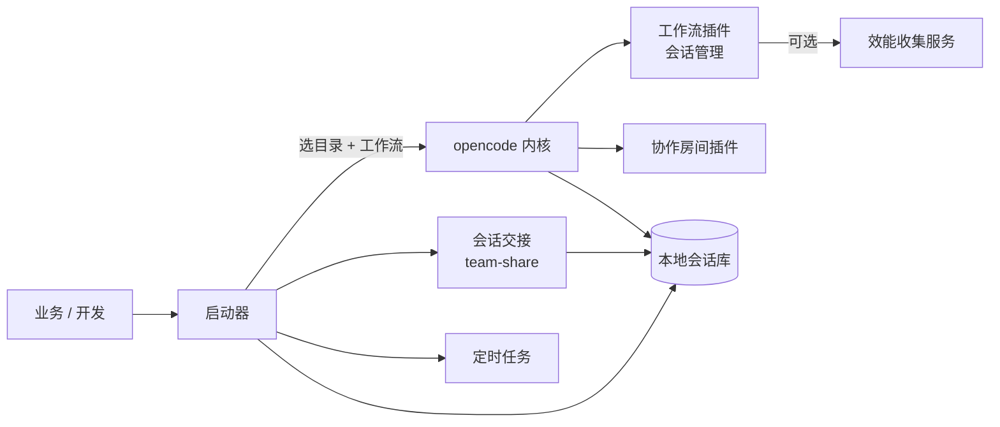
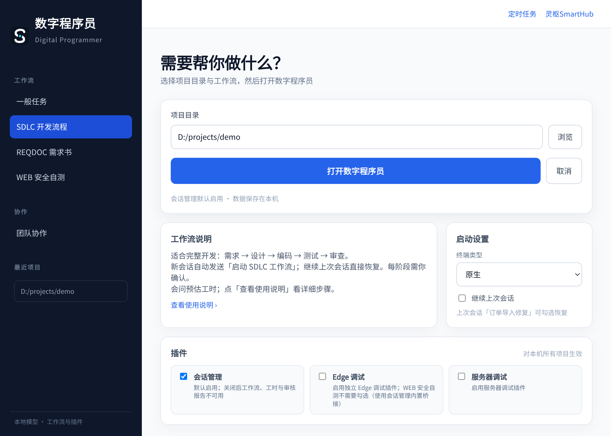
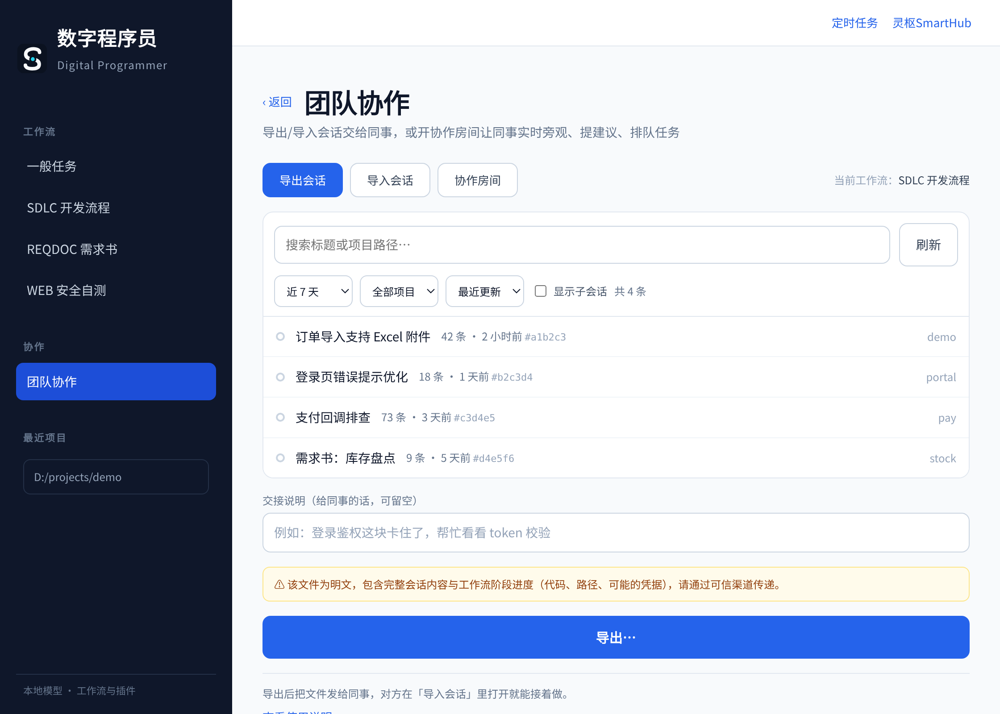
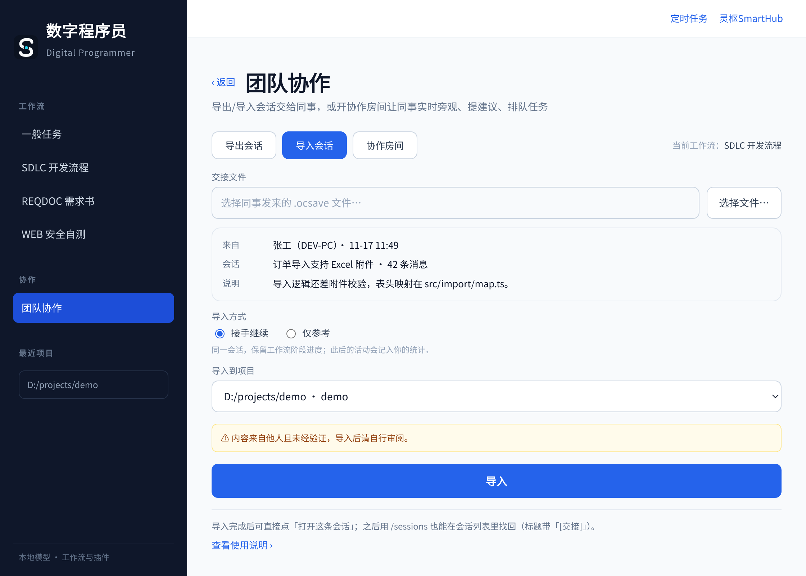
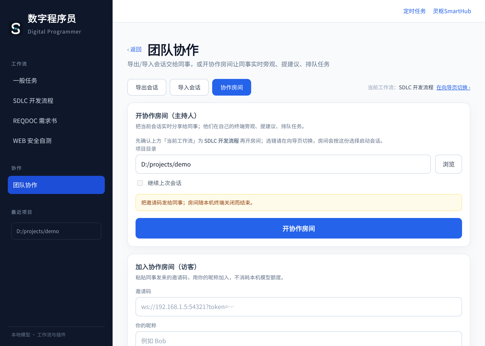

# 数字程序员 · 产品介绍

> 一个装在 Windows 上、给业务与开发团队共用的 AI 编程工作台：
> 双击安装、选目录、选工作流就能开工；过程可管、结果可交接、同事可旁观。

本文面向第一次接触本产品的使用者与推荐人，只介绍**本仓库自研部分**的能力与边界。
运行内核基于开源项目 opencode（MIT），上游能力不在此展开。

---

## 1. 它解决什么问题

AI 编程工具单机好用，但在团队里常卡在四件事：

| 痛点 | 常见表现 | 本产品的做法 |
|---|---|---|
| 装不起来 | 装 Node、配环境变量、手写 JSON、版本冲突 | 一个安装包装完全部依赖，免管理员、免命令行 |
| 过程失控 | AI 直接改代码、跳过评审、没人知道做到哪一步 | 四种工作流把步骤写死，关键节点必须人工确认，提交有门禁 |
| 经验带不走 | 交接只能靠聊天记录和截图 | 一条会话导出成一个文件，对方导入后接着做 |
| 协作靠转述 | 同事只能围观屏幕、口头提建议 | 协作房间实时旁观，可提建议、排队任务、看审批内容 |

核心取向是**可管控的 AI 编程**：AI 负责执行，人负责确认；每一步留痕，能统计、能追责、能交接。

---

## 2. 产品组成

| 组件 | 形态 | 作用 |
|---|---|---|
| `OpenCode-Setup.exe` | 安装包 | 一次装好运行环境、插件、Python、终端 |
| `OpenCode-launch.exe` | 启动器 | 选项目与工作流、开关插件、团队协作入口 |
| 会话管理 | opencode 插件 | 四种工作流、规则注入、提交门禁、工时与阶段统计 |
| 会话交接 | 独立 CLI + 启动器页面 | 导出 / 导入一条会话（`.ocsave`） |
| 协作房间 | TUI 插件 | 局域网实时旁观、建议、排队、审批可见 |
| 定时任务 | 托盘程序 | 按计划在后台跑一条 AI 任务 |
| Edge 调试 / 服务器调试 | opencode 插件 | 可选的专项调试能力 |

---

## 3. 一键安装与启动

安装包内置 Node 运行时、Python、Windows Terminal 与全部插件，安装到用户目录，
**不需要管理员权限，不需要命令行**。首次安装时由管理员填写模型网关、密钥与可选的
收集服务地址，之后普通用户只看到启动器。

启动器就是日常入口：

- **项目目录**：选哪个目录，AI 就以哪个目录为工作区（路径不会写死）。
- **工作流**：一般任务 / SDLC / REQDOC / WEB 安全自测，四选一。
- **启动设置**：原生控制台或专用 Windows Terminal；可继续上次会话。
- **插件**：会话管理默认开启；Edge 调试、服务器调试按需勾选。

快捷信息：约 440 MB 安装包、Windows 10/11、单文件绿色运行、卸载不影响会话数据。

---

## 4. 四种工作流

工作流不是提示词模板，而是**带状态机与门禁的流程**：阶段、清单、规则都由插件注册，
AI 每轮都会收到当前阶段与纪律；该确认时它不会自己往下走。

| 工作流 | 适合谁 | 阶段 | 关键产出 | 硬门禁 |
|---|---|---|---|---|
| **一般任务** | 业务、开发做轻量工作 | 单阶段 | 分类结果、预估/实际工时 | 完成需明确说「本次任务已完成」 |
| **SDLC 开发** | 完整需求开发 | 需求 → 设计 → 编码 → 测试 → 审查 → 提交 | 需求摘要、设计说明、测试结论、审查清单 | 每阶段人工确认；审查通过前禁止 `git commit` |
| **REQDOC 需求书** | 业务写 PRD | 背景 → 场景 → 流程规则 → 边界异常 → 规格书 → 业务确认 | 结构化 PRD、Word 导出 | 知识库与功能点清单确认后才可定稿 |
| **WEB 安全自测** | 开发上线前自测 | 范围 → 资产接口 → 检查 → 验证定级 → 报告 | 报告 + 覆盖台账 | 默认只读；写操作逐次授权；结论需独立复核 |

共同点：

- **人工确认**：AI 只提议，不代替你点「下一步」。
- **规则常驻**：当前阶段、待办清单与禁止事项每轮注入，长会话也不跑偏。
- **产出落盘**：文档、报告、台账都在项目目录内，可进版本库。
- **状态可恢复**：关掉终端再回来，进度还在；「继续上次会话」直接续上。

---

## 5. 团队协作

### 5.1 会话交接（导出 / 导入）

把一条会话连同工作流阶段、成本与 Token 统计，导出成单个 `.ocsave` 文件，
同事导入后**从同一条会话继续**，不用重述背景。

导出页支持搜索、按项目筛选、时间范围、排序与分页；无 git 的目录也能按目录分组找到。

导入前先只读预览：来自谁、哪台机器、什么会话、多少条消息、交接说明。
两种导入方式：

- **接手继续**：同一会话，保留阶段进度，后续活动记入接手人的统计。
- **仅参考**：复制成新会话（标题带「[参考]」），不继承成本与进度，避免工作量串账。

### 5.2 协作房间

主持人开房，把邀请码发给同一局域网的同事；对方在自己的终端里实时旁观。

访客能看到的内容与正常会话页一致：

- 用户消息、AI 正文（Markdown）、思考过程；
- 工具调用：命令与输出、文件改动 diff、读取与搜索结果、待办清单、子代理；
- 审批请求的完整内容（命令、文件、diff）与 AI 反问的问题；
- 底部实时显示主机模型、Token 与成本、队列人数、连接状态。

访客可以做三件事：

| 操作 | 说明 |
|---|---|
| 建议 | 文字进入主机上下文，不触发模型回答 |
| 排队 | 主机空闲时按顺序执行，队列上限 20 |
| 翻页 / 退出 | 可回看历史；退出房间不影响主机 |

关键约束：

- **访客零额度**：访客端不运行模型、不执行工具，所有消耗都在主机。
- **只读审批**：访客看得到审批内容，但不能替主机授权。
- **纯局域网**：邀请码是带随机令牌的 `ws://` 地址，不经过公网服务。
- **断线可恢复**：自动重连并补齐内容；主机关闭终端即房间结束。

---

## 6. 定时任务

托盘常驻的 `OpenCode-Scheduler.exe`，按「一次性 / 每天 / 每周」在后台执行一条任务，
适合日报整理、定时巡检、批量小改动这类重复工作。

- 每个任务可单独限制：读取、修改、执行命令、访问网络、使用项目 Skill。
- 读取只允许项目目录；Skill 只允许项目内 `.opencode/skills`。
- 完全后台运行，不弹终端；运行历史与日志可查，每任务保留最近 20 次。
- 同一任务不会并发执行；电脑关机或程序未运行时不补跑。

---

## 7. 质量与效能

会话管理插件在本机记录每条会话的工作流、阶段、预估与实际工时、Token 与成本，
并可按项目聚合。需要跨人统计时，可选接入团队自建的收集服务（管理员配置，默认不启用）：

- 谁在哪个阶段、花了多久、返工几次；
- 哪些任务类型最耗时；
- 审查与测试环节的门禁命中情况。

数据默认只在本机，是否上报由部署方决定。

---

## 8. 典型场景

**业务写需求书**：选「REQDOC 需求书」→ 口述或投放材料 → AI 追问补全 → 逐条确认 → 导出 PRD。
业务不需要懂代码，也不需要离开对话。

**功能开发**：选「SDLC 开发」→ 确认需求与设计 → AI 编码 → 测试 → 逐段审查 →
审查通过后才允许提交。管理者能看到卡在哪一阶段。

**上线前安全自测**：选「WEB 安全自测」→ 说明范围与账号 → 在 Edge 中正常走查 →
AI 只读探测与复核 → 输出报告与覆盖台账。定位是自查，不替代专业渗透测试。

**交接与协作**：把卡住的会话导出给同事；或开协作房间，让同事边看边提建议，
需要代跑的任务排队交给主机执行。

**重复巡检**：把每天的检查写成定时任务，结果进日志，人只看异常。

---

## 9. 上手路径

1. 运行管理员给的 `OpenCode-Setup.exe`，按向导填一次配置。
2. 从桌面快捷方式打开「数字程序员」。
3. 选项目目录与工作流，点「打开数字程序员」。
4. 跟着 AI 的提问回答；到确认节点时说「确认」即可推进。
5. 想换任务时用 `/new` 开新会话，避免多个任务混在一起。

首次使用建议先跑一条「一般任务」熟悉节奏，再进入 SDLC 或 REQDOC。

---

## 10. 数据与安全

- **本地优先**：会话库、配置、日志都在本机用户目录；不装服务端也能用。
- **明文交接文件**：`.ocsave` 含完整会话正文（代码、路径、可能含凭据片段），
  必须走可信渠道传递；文件不加密，便于排查。
- **协作房间明文传输**：仅限可信局域网；令牌等同于「旁观 + 建议 + 排队」权限。
- **权限模型**：工具权限由主机会话与任务配置决定；访客不能提权，也不能执行工具。
- **脱敏**：本文与截图中的地址、路径、人名均为示例，真实环境由部署方填写。

---

## 11. 能力边界

- **平台**：交付形态只针对 Windows 10/11；运行不依赖 WSL。
- **模型**：需要可用的模型网关（安装时配置）；离线不可用。
- **单机为主**：协作房间是「一人执行、多人旁观」，不是多人同时编辑。
- **局域网**：协作房间不做公网穿透与账号体系；跨网需自备通道。
- **AI 仍需人审**：门禁能防跳步，但不能替代代码审查与安全判断。
- **上游同步成本**：内核跟随 opencode 更新，自定义插件需持续适配。

---

## 12. 常见问题

**Q：需要会命令行吗？**
不需要。安装、启动、导出导入、开房间都在图形界面完成。

**Q：访客会消耗自己的模型额度吗？**
不会。访客端只接收内容，模型与工具都在主机侧运行。

**Q：没有 git 的项目能用吗？**
能。工作流不依赖 git；SDLC 的提交阶段才需要版本库。

**Q：会话数据存在哪？**
本机用户目录下的会话库；卸载/重装不会删除，需要清理时用 `OpenCode-Reset.exe`。

**Q：能多人同时改代码吗？**
不能。协作房间是实时旁观 + 建议 + 排队执行，写入始终由主机完成。

**Q：安全自测能替代渗透测试吗？**
不能。它面向开发自查，默认只读，结论需人工复核。

**Q：断网了会怎样？**
本机工作流不受影响；协作房间会自动重连，主机关闭后房间结束。

---

## 13. 术语

| 术语 | 含义 |
|---|---|
| 工作流 | 带阶段、清单与门禁的任务流程 |
| 门禁 | 不满足条件就阻断动作的硬规则，例如未审查不能提交 |
| 会话 | 一次连续的 AI 对话及其工作流状态 |
| 交接文件 | `.ocsave`，一条会话的完整快照 |
| 协作房间 | 主机实时广播会话、访客只读旁观的局域网房间 |
| 收集服务 | 可选的团队效能汇总端点 |

---

## 14. 版本与许可

- 内核基于开源项目 **opencode**（MIT License）。
- 本仓库自研组件（安装包、启动器、会话管理、会话交接、协作房间、定时任务、调试插件）
  与内核同仓库维护，版本随安装包整体交付。
- 截图取自实际界面，使用演示数据；不同版本的界面细节可能略有差异。

相关文档：

- 安装与打包：[`portable-installer/README.md`](portable-installer/README.md)
- 启动器：[`portable-installer/launcher/README.md`](portable-installer/launcher/README.md)
- 定时任务：[`portable-installer/scheduler/README.md`](portable-installer/scheduler/README.md)
- 会话交接：[`opencode-team-share/README.md`](opencode-team-share/README.md)
- 协作房间：[`opencode-collab-room/README.md`](opencode-collab-room/README.md)
- 会话管理：[`opencode-session-mgmt/README.md`](opencode-session-mgmt/README.md)
