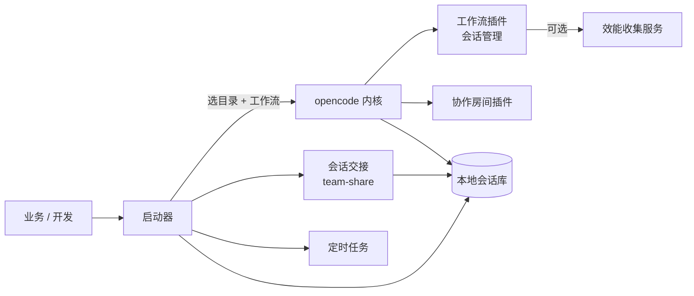
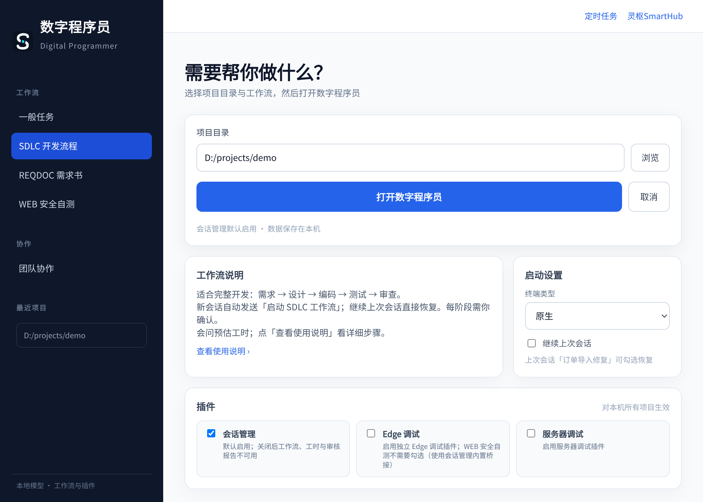
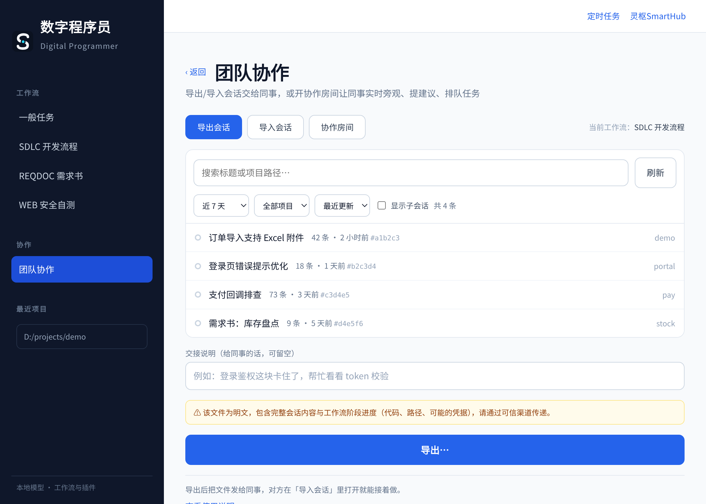
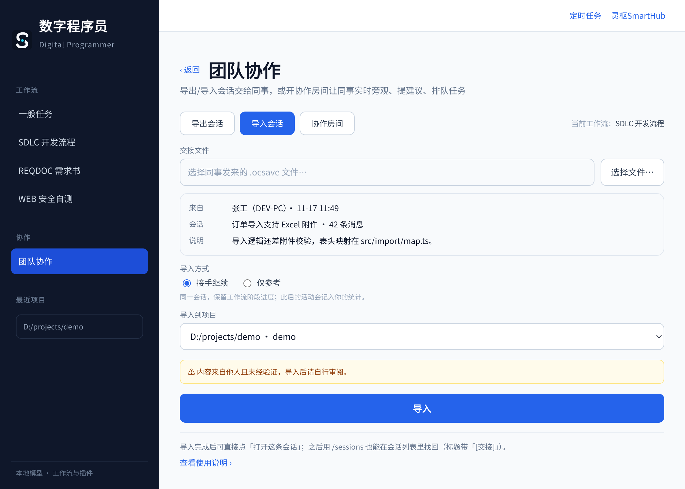
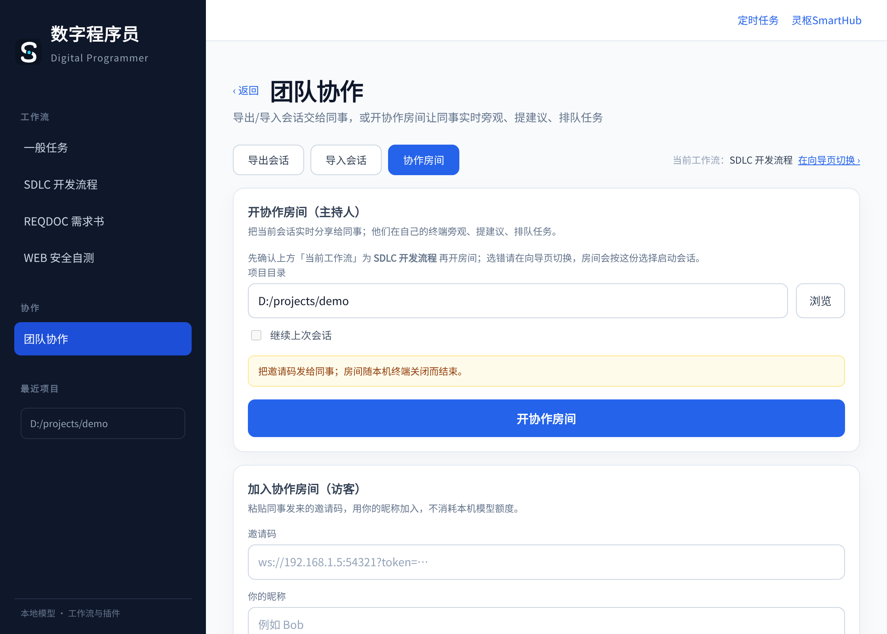

# 数字程序员（Digital Programmer）

> Windows 上的团队 AI 编程工作台：双击安装、选目录和工作流就能开工；过程可管、结果可交接、同事可旁观。

**非官方 fork 声明**：本仓库是 [anomalyco/opencode](https://github.com/anomalyco/opencode) 的定制分支，
用于内部 Windows 交付，不由 OpenCode 团队维护。运行内核基于上游 opencode（MIT），
上游的安装方式与文档不适用于本发行版。

完整产品介绍见 [PRODUCT.md](PRODUCT.md)。

---

## 它解决什么问题

AI 编程工具单机好用，但在团队里常卡在四件事：

| 痛点 | 常见表现 | 本产品的做法 |
|---|---|---|
| 装不起来 | 装 Node、配环境变量、手写 JSON、版本冲突 | 一个安装包装完全部依赖，免管理员、免命令行 |
| 过程失控 | AI 直接改代码、跳过评审、没人知道做到哪一步 | 四种工作流把步骤写死，关键节点必须人工确认，提交有门禁 |
| 经验带不走 | 交接只能靠聊天记录和截图 | 一条会话导出成一个文件，对方导入后接着做 |
| 协作靠转述 | 同事只能围观屏幕、口头提建议 | 协作房间实时旁观，可提建议、排队任务、看审批内容 |

核心取向是**可管控的 AI 编程**：AI 负责执行，人负责确认；每一步留痕，能统计、能追责、能交接。

## 产品组成

| 组件 | 形态 | 作用 |
|---|---|---|
| `OpenCode-Setup.exe` | 安装包 | 一次装好运行环境、插件、Python、终端 |
| `OpenCode-launch.exe` | 启动器 | 选项目与工作流、开关插件、团队协作入口 |
| 会话管理 | opencode 插件 | 工作流、规则注入、提交门禁、工时与阶段统计 |
| 会话交接 | 独立 CLI + 启动器页面 | 导出 / 导入一条会话（`.ocsave`） |
| 协作房间 | TUI 插件 | 局域网实时旁观、建议、排队、审批可见 |
| 定时任务 | 托盘程序 | 按计划在后台跑一条 AI 任务 |
| Edge 调试 / 服务器调试 | opencode 插件 | 可选的专项调试能力 |

## 一键安装与启动

安装包内置 Node 运行时、Python、Windows Terminal 与全部插件，安装到用户目录，
**不需要管理员权限，不需要命令行**。模型网关与密钥由部署方在安装向导中配置一次。

日常入口就是启动器：选项目目录（AI 的工作区）、选工作流、选择控制台形态与插件，点启动即可。
约 440 MB 安装包，支持 Windows 10/11，卸载不影响会话数据。

## 四种工作流

工作流不是提示词模板，而是**带状态机与门禁的流程**：阶段、清单、规则由插件注册，
AI 每轮都会收到当前阶段与纪律；该确认时它不会自己往下走。

| 工作流 | 适合谁 | 阶段 | 关键产出 | 硬门禁 |
|---|---|---|---|---|
| **一般任务** | 业务、开发做轻量工作 | 单阶段 | 分类结果、预估/实际工时 | 完成需明确说「本次任务已完成」 |
| **SDLC 开发** | 完整需求开发 | 需求 → 设计 → 编码 → 测试 → 审查 → 提交 | 需求摘要、设计说明、测试结论、审查清单 | 每阶段人工确认；审查通过前禁止 `git commit` |
| **REQDOC 需求书** | 业务写 PRD | 背景 → 场景 → 流程规则 → 边界异常 → 规格书 → 业务确认 | 结构化 PRD、Word 导出 | 知识库与功能点清单确认后才可定稿 |
| **WEB 安全自测** | 开发上线前自测 | 范围 → 资产接口 → 检查 → 验证定级 → 报告 | 报告 + 覆盖台账 | 默认只读；写操作逐次授权；结论需独立复核 |

共同点：人工确认、规则常驻、产出落盘、状态可恢复（关掉终端再回来，「继续上次会话」直接续上）。

## 团队协作

### 会话交接（导出 / 导入）

把一条会话连同工作流阶段、成本与 Token 统计导出成单个 `.ocsave` 文件，
同事导入后**从同一条会话继续**，不用重述背景。

导出页支持搜索、按项目筛选、时间范围、排序与分页；无 git 的目录也能按目录分组找到。

导入前先只读预览来源、会话与交接说明，再选择：

- **接手继续**：同一会话，保留阶段进度，后续活动记入接手人的统计。
- **仅参考**：复制成新会话（标题带「[参考]」），不继承成本与进度，避免工作量串账。

### 协作房间

主持人开房，把邀请码发给同一局域网的同事；对方在自己的终端里实时旁观。

访客可见内容与正常会话页一致：消息正文与思考过程、命令与输出、文件改动 diff、
待办清单、子代理、审批请求内容与 AI 反问，以及底部的模型、Token/成本、队列与连接状态。

| 访客操作 | 说明 |
|---|---|
| 建议 | 文字进入主机上下文，不触发模型回答 |
| 排队 | 主机空闲时按顺序执行，队列上限 20 |
| 翻页 / 退出 | 可回看历史；退出房间不影响主机 |

约束：**访客零额度**（不运行模型、不执行工具）、**只读审批**（看得到但不能替主机授权）、
**纯局域网**（邀请码是带随机令牌的 `ws://` 地址）、**断线可恢复**（自动重连并补齐内容）。

## 定时任务

托盘常驻的 `OpenCode-Scheduler.exe` 按「一次性 / 每天 / 每周」在后台执行任务，
适合日报整理、定时巡检、批量小改动。每个任务可单独限制读取、修改、执行命令、访问网络与
使用项目 Skill；读取只允许项目目录。完全后台运行，历史与日志可查，同一任务不并发。

## 质量与效能

会话管理插件在本机记录每条会话的工作流、阶段、预估与实际工时、Token 与成本，并可按项目聚合。
需要跨人统计时可选接入团队自建的收集服务（默认不启用；示例实现见
[performance_dashboard](https://github.com/karsonto/performance_dashboard)）。
数据默认只在本机，是否上报由部署方决定。

## 典型场景

- **业务写需求书**：选「REQDOC 需求书」→ 口述或投放材料 → AI 追问补全 → 逐条确认 → 导出 PRD。
- **功能开发**：选「SDLC 开发」→ 确认需求与设计 → AI 编码 → 测试 → 逐段审查 → 通过后才允许提交。
- **上线前安全自测**：选「WEB 安全自测」→ 说明范围与账号 → 正常走查 → 只读探测与复核 → 输出报告与台账。
- **交接与协作**：把卡住的会话导出给同事；或开协作房间，让同事边看边提建议、排队代跑任务。
- **重复巡检**：把每天的检查写成定时任务，结果进日志，人只看异常。

## 上手路径

1. 运行部署方提供的 `OpenCode-Setup.exe`，按向导填写模型网关与密钥。
2. 从桌面快捷方式打开「数字程序员」。
3. 选项目目录与工作流，点「打开数字程序员」。
4. 跟着 AI 的提问回答，到确认节点说「确认」即可推进；换任务用 `/new` 开新会话。

首次使用建议先跑一条「一般任务」熟悉节奏，再进入 SDLC 或 REQDOC。

## 数据与安全

- **本地优先**：会话库、配置、日志都在本机用户目录；不装服务端也能用。
- **明文交接文件**：`.ocsave` 含完整会话正文（代码、路径、可能含凭据片段），必须走可信渠道传递。
- **协作房间明文传输**：仅限可信局域网；邀请码等同于「旁观 + 建议 + 排队」权限。
- **权限模型**：工具权限由主机会话与任务配置决定；访客不能提权，也不能执行工具。

## 能力边界

- **平台**：交付形态只针对 Windows 10/11；运行不依赖 WSL。
- **模型**：需要可用的模型网关；离线不可用。
- **单机为主**：协作房间是「一人执行、多人旁观」，不是多人同时编辑。
- **局域网**：协作房间不做公网穿透与账号体系；跨网需自备通道。
- **AI 仍需人审**：门禁能防跳步，不能替代代码审查与安全判断。

## 仓库结构与构建

| 路径 | 用途 |
|---|---|
| `packages/*` | 上游 opencode 包（内核基础） |
| `portable-installer/` | Windows 安装包、启动器、定时任务与重置工具 |
| `opencode-session-mgmt/` | 工作流引擎、规则、本地统计 CLI 与插件测试 |
| `opencode-team-share/` | 会话交接（导出 / 导入） |
| `opencode-collab-room/` | 协作房间 TUI 插件 |
| `opencode-edge-debug/`、`opencode-server-debug/` | 可选调试插件 |
| `plugin-guide/` | 定制维护与上游升级说明 |

启动器 UI 内嵌在 `OpenCode-launch.exe`，改动 `launcher/index.html` 后必须重建启动器与整个安装包；
构建产物不入库。构建步骤见 [portable-installer/README.md](portable-installer/README.md)。

## 相关文档

- [产品介绍（完整版）](PRODUCT.md)
- [安装与打包](portable-installer/README.md) · [启动器](portable-installer/launcher/README.md) · [定时任务](portable-installer/scheduler/README.md)
- [会话交接](opencode-team-share/README.md) · [协作房间](opencode-collab-room/README.md) · [会话管理](opencode-session-mgmt/README.md)
- [团队房间实施方案（待实施）](TEAM-ROOM.md)
- [会话管理架构](opencode-session-mgmt/docs/session-management.md) · [SDLC 工作流](opencode-session-mgmt/docs/workflow-sdlc.md) · [REQDOC 工作流](opencode-session-mgmt/docs/workflow-reqdoc.md)

## 内核与许可

运行内核基于开源项目 [opencode](https://github.com/anomalyco/opencode)（MIT License）。
上游的安装脚本、包管理器、桌面端与 Agent 说明请参阅
[官方文档](https://opencode.ai/docs)；本仓库的自研组件与内核同仓库维护，随安装包整体交付。
