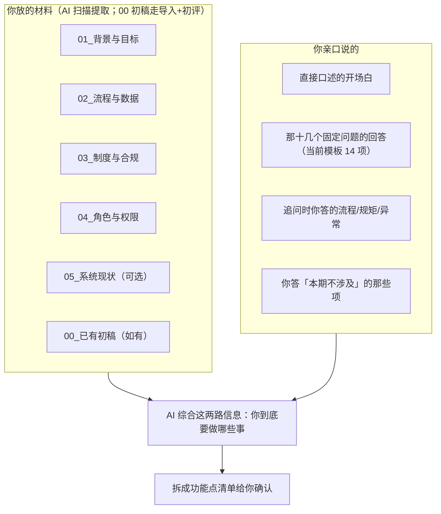

# 功能公告文案（五段）

> 对外说明用。② 的流程图按文档规范用 mermaid（对话输出才禁用 mermaid）。
> ③ 含内部注，发布前删除；④ 须在 Windows 重启 opencode 守护进程后再发。
> 实测数值出处：`scripts/eval-rules/results/new.r53,r50,r51,r52.json`（2026-10-16）。

## ① 术语白话

术语白话的两道防线已上线：r2 规则禁令 +《业务口语规约》对照表（枚举值 →「这个单子/字段允许填哪几种值，比如…」）。目前是软约束，评测中作为观察项跟踪命中率、尚未清零验收，偶发技术词仍可能出现。以后遇到听不懂的词，往对照表加一行即可（包内基线需同步并重启守护进程；要纳入评测跟踪需再加观测词表）。

## ② 需求从哪来

AI 给你「列菜单」之前，料全部来自你亲手给的两路——没有第三个来源：

补充一句：如果你们机构以前做过类似需求、留了历史记录，AI 可能会参考**以前你说过的定义**来帮忙——仅作参考，仍要你点头。

## ③ 提问顺序

提问顺序已优化。AI 展示功能点清单时会标出每件功能的优先级，并按「哪几个是必须先做好？」征询你的意见；之后的提问按你确认的重要性排，重要的先问。优先级标注在 AI 展示清单的消息里可以看到。

<!-- 内部注（发布时删除）：该问句最近评测 0/3 未出现（n=3，vLLM+关思考标准口径复跑仍 0/3），
     等 r53 修复达标后再发本段。 -->

## ④ 先出初稿

先出初稿功能已开放。对话里出现「信息没齐也能先出初稿」提示时，你说「先出个初稿」，AI 就会生成初稿——文件里没定的地方标着 [缺省：…]（如「未确认」），对话里 AI 会说明哪些内容暂未获得、待确认。初稿可直接导出 Word，拿去线下讨论，讨论完回来接着补。没看到提示时先照 AI 引导走，走到那一步提示自然会出现。定稿标准没变。

<!-- 内部注（发布时删除）：本段依赖 P2-A（a4f69f9c9d），Windows 侧须已 sync-bundle 并重启守护进程。 -->

## ⑤ 银行场景

银行业务场景继续跟进。已按标准口径复测 3 个银行场景、各 3 轮：**反洗钱报送 3/3 通过**（总分 95，合规 16/16）——有银行材料时 AI 能吸收合规要求；**跨境汇款**能产出初稿但 75 分，流程闭环与合规两维未达线；**贷款审批**三轮都没走到组装。合计 3/9，完成度不稳定，继续改进。
