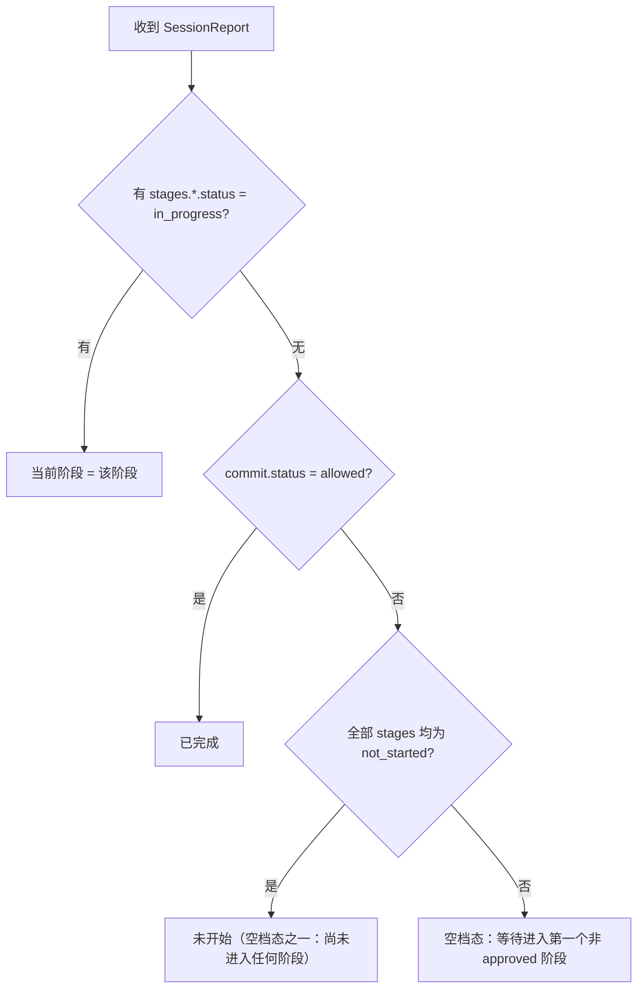

# 上报指标的判读：当前阶段、阶段耗时与返工

> 面向收集服务 / 看板实现者。输入是 `SessionReport`（字段见 [collector-spec.md](collector-spec.md) 5.1 节），
> 本文给出三个常用指标的派生口径。**上报里没有 `currentStage` 字段**——当前阶段由各阶段状态与
> 转换时间戳推导，本文即为唯一口径。

## 判读顺序



## 数据来源字段

| 字段 | 用途 |
|---|---|
| `workflow.stages.<阶段键>.status` | 判定当前阶段 / 完成度（`not_started` / `in_progress` / `approved`） |
| `workflow.stages.<阶段键>.revision` | 阶段被回退次数（含级联，见后文） |
| `workflow.stages.<阶段键>.transitions[]` | 阶段转换时间戳：`action ∈ {enter, revisit, approve}`、`at`（epoch ms）、可选 `note` |
| `workflow.stages.review.comprehension.confirmed` | 返工副作用观测：理解确认被级联重置后 confirmed 会下降 |
| `workflow.commit.status` | 完结口径：`allowed` 即全部阶段 approved（reqdoc 同样适用） |
| `reportedAt` | 本机时钟快照时间；`in_progress` 阶段耗时用它当右端点 |

阶段键随工作流类型不同：

- `sdlc`：`requirements` / `design` / `implementation` / `testing` / `review`
- `reqdoc`：`goal` / `rules` / `edge` / `prd` / `review`

## 当前阶段

1. 存在 `status = in_progress` 的阶段 → 该阶段即当前阶段（状态机保证同时最多一个）。
2. 无 `in_progress` 时按上节顺序图：`commit.status = allowed` → 已完成；全 `not_started` → 未开始；
   否则 → 空档态，当前处于「等待进入第一个非 approved 阶段」。

空档态在数据上与「尚未推进到该阶段」同形，仅凭快照无法区分用户是正在犹豫还是刚 approve 完。

## 阶段耗时

时间戳配对规则（`workflow-ops.ts` 的写入语义）：

- 进入动作 = `enter` 或 `revisit`；结束动作 = `approve`。
- 一段耗时 = 结束动作 `at` − 进入动作 `at`；一个阶段可能有多个「进入→结束」段（每次 revisit 重计一段）。
- 仍在进行中的阶段 = `reportedAt` − 最后一条 transition 的 `at`。
- 阶段之间的等待（空档）= 下一阶段 `enter.at` − 上一阶段 `approve.at`，不属于任何阶段耗时。

```text
duration(stage) = Σ（每段 approve.at − 该段 enter/revisit.at）
pending(stage)  = reportedAt − transitions[last].at        // 仅 in_progress
idle_gap        = nextStage.enter.at − prevStage.approve.at
```

注意：`enter` 幂等，重复 enter 不追加 transition；`revisit` 不追加 `enter`，不要按 `enter` 计数进入次数。

## 返工

- **主信号**：`stages.<键>.revision`——该阶段被回退次数（每次直接 revisit +1，被上游级联回退也 +1）。
- **明细**：`transitions` 中 `action = "revisit"` 的条目（`at` 定位时间，`note` 带原因）。
- **区分直接返工与级联波**：一次 revisit 会把下游所有已 approved 阶段一起打回
  （`status → in_progress`、`revision++`、各补一条同 `at`、同 `note` 的 `revisit`）。
  因此**同一 `at`（同 note）的一批 revisit = 一次级联波**，孤立出现的那条才是用户直接发起的返工。
- **其他返工观测面**：`quality.iterationCount`（单文件被 AI 编辑的最高次数）、
  `quality.reworkRate`（仅 CI 回写通道）、`quality.firstPassRate`；
  review 阶段 `comprehension.confirmed` 下降 = 级联回退触发了理解确认重置，是返工副作用而非数据错误。

## 边界与坑

- `reportedAt` 是发送方本机时钟；跨机聚合应以服务端 ingest 时间为准做去抖，不要直接拿它当权威时间。
- 快照里没有「人在等待 / AI 正在干活」的区分，`transitions` 只有阶段边界戳；更细粒度需要新增上报字段，
  现有「只报流程摘要」的约定做不到。
- `reqdoc` 的 `review` 也有 `checklist` 与 `comprehension`，但清单键不同（`completeness` / `clarity` /
  `edgeCoverage` / `resolution`），聚合时不要复用 sdlc 的四个键。
- 旧版插件可能缺 `workflow.type`（缺省按 sdlc）、`baseline`、`lines` 等字段，缺失时按空值处理，不得报错。

## 计算示例

取 [collector-spec.md](collector-spec.md) 5.1 节的 sdlc 示例（全部 approved）：

```text
requirements  enter 1750000000000 → approve 1750003600000  = 3600s（1.0h）
design        同段结构                                        = 3600s（1.0h）
implementation / testing / review                            各 3600s
空档            各阶段 approve.at 与下一阶段 enter.at 相同 → 0
当前阶段      无 in_progress 且 commit.status = allowed → 已完成
返工          各阶段 revision 见原字段；直接/级联按同 at 分波
```

若 `design` 的 `status` 改为 `in_progress`，则当前阶段 = `design`，耗时 = `reportedAt − 1750003600000`。
